# Lemely UX flow design

Status: proposal for owner review, 2026-11-16. It designs flows, screens, content and states (no visual styling) and steers the redesign/* and nf/* lanes, the .impeccable mocks and feat/paymob-integration; owner decisions D1-D5 (§2) are binding.
Tags: [repo: path] is a file at perf/staging-cold-start-and-parallel-deploy @ a5ee813e and [repo: branch:path] a branch-only file; [source: URL] is external; [assumption: how to test] is a proposal or an unknown. Goals: **PA** paid activation · **RM** users return to mark more papers · **TR** trust in marks · **PR** profit (revenue per user minus LLM cost per marked paper). ⚠ Minor-data marks anything that touches consent, parent linking or a minor's data.

## 1. Summary

1. **Teachers enter free and are never refused a student.** A free workspace of 10 seats and 15 papers a month, a 60-day pilot of 30 seats and 60 papers once 3 students join, and pending seats in place of a refusal; seats (EGP 40 a month) and packs are sold after the pilot (§5.1, §8.1.3). PA, RM. [assumption: D1; ten-teacher test T1 and T7, §13.3]
2. **Mark first, organise later.** A teacher's first screen is a class-set drop; cover names become a class and roster, and released results land in each student's history, which today never happens (§4.1, §6.3). RM, PA. [repo: lemely/db/review_repo.py:20-26] [assumption: A-TA, A-M]
3. **Hybrid release (D4).** Self-uploads release at once with confidence shown; class work waits for the teacher, who must open every Low answer first; reminders at 48 h and 5 days, no auto-release (§7.9). TR, RM. [assumption: D4; A-T]
4. **Confidence is shown as server-computed band words.** High, Close call, Not sure, Not marked; no percentages until 0580 and 0606 are calibrated; no promise of teacher review on self-uploads (§2.6). TR. [repo: lemely/core/schemas.py:54-59,76-80; PRODUCT.md:71]
5. **Everyone can challenge a mark, free.** 3 per paper; class work goes to the teacher, with an automatic re-mark offered after 7 days unanswered; self-uploads get an automatic re-mark, then one escalation if the student has a teacher; every changed mark notifies the student and linked parents (§7.10). TR. [repo: lemely/db/models/enums.py:245-267] [assumption: D4; A-RE]
6. **One guarded anonymous paper (D3).** Headline result before signup, full result after; Turnstile, 1 per device and network, a USD 5 daily cap, a kill switch, no anonymous upload under 15, deletion at 7 days unless claimed; then 2 visible free papers and no monthly refill (§8.2). PA, PR. [assumption: D3; A-AN, A-R]
7. **Papers are the only unit.** A completed marking costs exactly 1 paper; failures, unsupported papers, challenges and re-marks cost nothing; the branch's actual-cost metering and credits wording change (§8.1.5). PA, TR, PR. [repo: feat/paymob-integration:docs/superpowers/specs/2026-11-02-paymob-billing-design.md §2.4] [assumption: A-FL]
8. **The Season pack leads for minors and parents.** Season pack EGP 449 for 30 papers is highlighted, the Try pack is EGP 99 for 5, and Monthly (EGP 249 for 20) is offered only to 18+ self-payers and parents; cards only through Paymob's hosted page (D2), with wallets tested later as A-W (§8.1, §8.6). PA, PR. [assumption: A-P, A-W]
9. **Minors' data is minimised by default.** Guardian consent before any under-15 script, child-issued parent links with a minimal pre-link view, teacher visibility narrowed to class work, first-party analytics only; the consent basis for class sets is open (Q1) (§6.4, §6.11). TR, PA. [source: https://www.tamimi.com/our-knowledge/publications/general/Articles/from-policy-to-practice-egypt-issues-executive-regulations-of-the-personal-data-protection-law/] [assumption: A-L, A-CS]
10. **The build order follows the goals.** Measure cost and merge the Paymob backend with enforcement off (D5), then the teacher pilot loop on server-owned marking runs, then the student trust loop and paid activation, with the anonymous paper last (§12). PR, PA. [assumption: §12.1 ordering rule; effort scale A-EF]

## 2. Foundations

Owner decisions, binding on every section and not reopened here [assumption: owner checkpoint reply, 2026-11-16]:
- **D1 Teacher entry.** A free capped teacher workspace with free pilot seats. Students beyond the seats wait in a pending seat and are never refused. Seats and packs are sold after the trial.
- **D2 Payment rails.** Cards only, as built on feat/paymob-integration: a card subscription and card packs through Paymob's hosted redirect, which counts as in-app checkout. No mobile wallets, InstaPay or Fawry at launch.
- **D3 Free allowance.** A visitor can mark one paper before signup, behind guards, and the allowance after signup is counted in papers and always visible.
- **D4 Trust.** Hybrid. Student self-uploads release at once with confidence shown; class-set and teacher-assigned work is released by the teacher; everyone can challenge a mark, with an automatic re-mark when there is no teacher; the student is told when a mark changes.
- **D5 Sequencing.** Merge the Paymob backend first with enforcement flags off, then design billing screens inside the redesign IA.

### 2.1 Roles

| Code name | UI name | Who | Basis |
|---|---|---|---|
| `visitor` | (none, not signed in) | Anyone on the anonymous first-paper path (D3). This is not a stored role. | [assumption: new; D3] |
| `student` | Student | Candidate aged about 14-18 sitting CAIE papers. Self-signup. ⚠ Minor-data | [repo: lemely/db/models/enums.py:22-29; docs/LEMELY_UI_SPEC.md:33] |
| `parent` | Parent | Guardian linked to one or more students. Joins through a child's link, at most 4 parents per child. ⚠ Minor-data | [repo: lemely/db/parent_repo.py:66] |
| `teacher` | Teacher | Runs classes, marks class sets, releases class work. Self-signup. This is the GTM wedge. | [repo: lemely/db/models/enums.py:27] |
| `school_admin` | School admin | Kept in the data model. No v1 screens, because schools sit outside billing and serve no goal yet; §5.2 sketches the phase-2 flow. | [repo: feat/paymob-integration:docs/superpowers/specs/2026-11-02-paymob-billing-design.md; lemely/db/models/enums.py:28] |
| `platform_admin` | Lemely ops | The owner. Prices, pilots, spend cap, payments and quality. | [repo: lemely/db/models/enums.py:29] |

Two relationship roles apply to money and are not user roles. The **payer** owns the card, the receipts and cancellation; the **beneficiary** uses the papers. A parent paying for a child is payer≠beneficiary [repo: feat/paymob-integration:lemely/db/models/billing.py (payments.payer_user_id, beneficiary_user_id)].

### 2.2 Glossary

| Term | Definition (binding for all sections) | Basis |
|---|---|---|
| **Paper** | One CAIE question-paper identity: syllabus, component, variant and session, e.g. "0625 Paper 42, May/June 2025". v1 covers 0580, 0606 and 0625 only. | [repo: PRODUCT.md:60; lemely/web/routers/student.py:831-871] |
| **Paper (unit)** | The allowance and price unit: one submission marked to completion. Failed runs, unsupported papers, challenges and automatic re-marks never cost a paper, and a run where less than half the marks could be marked returns its paper (§7.11). The ledger keeps its internal units underneath; users only ever see papers. | [assumption: flat 1 paper per completed mark_paper job in place of actual-cost charging (§8.1.5); test that the margin per paper stays positive in OPS-02] |
| **Script** | One candidate's handwritten answer pages for one paper, as a photo set or PDF. Limits: 25 MiB, 40 pages. | [repo: lemely/io/_scan_common.py:63; PRODUCT.md:73] |
| **Submission** | One script sent for marking, which runs as one marking job. Its **origin** is `anonymous`, `self` (student-initiated), `assigned` (student uploads a paper a teacher assigned) or `class_set` (a teacher uploads it). Origin decides who pays (§8.1.5) and whether a release step applies (§7.9). | [repo: lemely/web/routers/teacher.py:879-949] [assumption: new field shared by student and teacher paths] |
| **Class set** | A batch of scripts for one paper, uploaded by a teacher in one drop. Each script is matched to a roster student by its cover name, and unmatched scripts wait for the teacher to assign them. | [repo: redesign/f1-ui-kit:docs/superpowers/plans/2026-11-15-redesign-l12-pipeline.md] [assumption: A-M, matching accuracy unmeasured] |
| **Roster placeholder** | A roster name with no account yet, created from cover names (T-03) or pasted names (T-07). Results wait on it until the right student is attached (§6.3). ⚠ Minor-data | [assumption: new; counsel on holding names before consent] |
| **Class pool** | The teacher's monthly papers. It pays for `class_set` and `assigned` submissions. It is the free workspace papers plus 4 papers per paid seat. Unused papers expire at period end, with no rollover (as built). | [repo: feat/paymob-integration:docs/superpowers/specs/2026-11-02-paymob-billing-design.md §2.1, §2.6] [assumption: pool sizes in §8.1.3] |
| **Seat** | One student slot on a teacher's account. An **active** seat lets the teacher assign papers to that student, release class work to them and see their class-context papers. Self-uploads stay on the student's own allowance. | [repo: feat/paymob-integration:lemely/db/teacher_team_repo.py] [assumption: seat scope narrowed from the branch's seat_allowance model] |
| **Pending seat** | A student joined a class while no seat was free. The student is enrolled, keeps their own allowance and sees "Waiting for a seat"; the teacher sees them in T-08. Nothing is refused and no 409 is returned (D1). | [repo: feat/paymob-integration:lemely/db/class_repo.py:841-860 (the 409 being replaced)] |
| **Free workspace / pilot** | Free seats and papers on every teacher account (D1): the free workspace (10 seats, 15 class-pool papers a month) from verification, and a 60-day pilot (30 seats, 60 papers) that starts when 3 students have joined or when ops grants it (§5.1 T4). | [assumption: sizes and unlock rule to test, §8.1.3] |
| **Pack** | A one-off card purchase of N papers. It expires 12 months after purchase, with no cash refunds (as built; §8.5.5 proposes a 7-day unused refund). | [repo: feat/paymob-integration:docs/superpowers/specs/2026-11-02-paymob-billing-design.md §2.1] |
| **Season pack** | The hero student pack, sized for one exam session. It is a pack and does not auto-renew. It is the card-only substitute for the wallet-paid "Season Pass" in the strategy draft. | [repo: docs/strategy/2026-11-16-new-user-flows.md:196-199] [assumption: D2 cards only] |
| **Subscription (Monthly)** | A card auto-renewing plan through Paymob subscriptions, with a 30-day period and N papers per period. Teacher seats are also billed as a subscription. | [repo: feat/paymob-integration:docs/superpowers/specs/2026-11-02-paymob-billing-design.md §2.1, §5.2] |
| **Free allowance** | Free papers. A visitor gets 1 anonymous paper, and a new student account gets 2 papers at verification. Always visible as "N papers left" (D3). | [assumption: sizes in §8.1.3] |
| **Claim** | Moving an anonymous submission into the account created on the same device within 7 days (§8.2). | [assumption: new rule; test with claim rate = `anon_result_claimed` / `anon_result_viewed` (A-AN) and the §12.5 Claim check] |
| **Release** | The teacher action that makes a `class_set` or `assigned` result visible to the student and linked parents. Self-uploads release at once (D4). A teacher may switch on "Show results straight away" for one assignment (§7.9). | [assumption: new; D4] |
| **Challenge** | A student disputes one question's mark with a written reason, within 30 days of release. Cap: 3 per paper, 1 per question. Class work goes to the teacher, with an automatic re-mark offered after 7 days unanswered. Self-uploads get an automatic re-mark first, then one escalation to a teacher if the student has one; for a solo student the re-mark is final (D4). Always free. | [repo: .impeccable/mocks/student-r1/student.js:22,36 (3-per-paper cap, reason lengths)] [assumption: routing per D4, §7.10] |
| **Re-mark** | A second automatic marking pass on the challenged question only. Marks can go up or down, and the student is told before sending. | [repo: lemely/db/self_review_repo.py (marks move both ways today)] [assumption: re-mark engine = adjudication pass on page crops] |
| **Override** | A teacher sets a question's mark. Precedence: teacher override > student self-mark > AI. | [repo: lemely/db/models/attempts.py:374-381] |
| **Confidence band** | The display band derived from the engine's per-question confidence score and flags (§2.6). | [repo: lemely/core/schemas.py:54-59,81] |
| **Guardian consent** | A recorded, revocable consent from a linked parent, required before an under-15 student's scripts are processed. ⚠ Minor-data | [source: https://www.tamimi.com/our-knowledge/publications/general/Articles/from-policy-to-practice-egypt-issues-executive-regulations-of-the-personal-data-protection-law/] [assumption: counsel confirms the under-15 threshold and the mechanism] |
| **Cardholder statement** | The checkbox at X-15: "This card is mine and I'm 18 or older, or the cardholder said yes to this payment." Under-15 students never reach X-15. ⚠ Minor-data | [assumption: A-L, counsel on minors' contracting capacity] |
| **Session** | A CAIE exam series: May/June, Oct/Nov, or Feb/March where it applies. | [repo: docs/strategy/2026-11-16-new-user-flows.md:86] |

### 2.3 What Lemely can do today

| Capability | State | Basis |
|---|---|---|
| Upload a script by photo, PDF, camera or PWA share target, with an offline queue. Limits are 25 MiB and 40 pages. | Shipped | [repo: web/src/portals/student/screens/CorrectPaper.tsx; lemely/io/_scan_common.py:63] |
| Identify the paper from the cover page, then do an exact corpus lookup | Shipped. There is no confirm step, and a paper missing from the corpus fails the run. | [repo: lemely/web/routers/student.py:831-871,1068-1075] |
| Marking scope: 0580, 0606 and 0625 only. 289 of the 479 source scheme PDFs are parsed. | Shipped | [repo: lemely/db/migrations/versions/0024_reference_catalogue.py:66-70; corpus/manifest.json] |
| Per-question marks, a 0-1 confidence score, feedback, topic, and a paper grade with boundary provenance | Shipped | [repo: lemely/core/schemas.py:54-59,317-493; lemely/core/analytics.py:118-173] |
| Accuracy of the shipped Claude configuration: 87.5% of leaves exact, 98.6% within 1 mark, 17.0% flagged for review. Measured on 5 scripts, 0625 Physics only. | Measured, narrow | [repo: BUILD/accuracy-runs/claude-c-2026-10-26-live3/FLIP.md:35-37] |
| Marking keeps running after the client disconnects, and the client reattaches by polling | Shipped | [repo: lemely/web/routers/student.py:750-825] |
| Teacher review queue with override, where a teacher override beats a student self-mark, which beats the AI mark | Shipped. An override sends no notification. | [repo: lemely/db/models/attempts.py:374-381; lemely/db/models/enums.py:245-267] |
| Classes with join codes, and parent links issued by the child (at most 4 parents per child) | Shipped. Codes cannot be rotated. | [repo: lemely/db/class_repo.py:505,930; lemely/db/parent_repo.py:66] |
| Card checkout through a Paymob hosted redirect, plus packs, subscriptions, seats, a usage ledger and a margin view | Built on an unmerged branch with no prices. On main, marking is free and unlimited for any verified student, and teacher marking has no gate at all. | [repo: feat/paymob-integration:docs/superpowers/specs/2026-11-02-paymob-billing-design.md; lemely/web/routers/student.py:954-962; lemely/web/routers/teacher.py:192-195] |
| Turnstile and a pre-launch allow-list access gate | On origin/develop and origin/main (merged in #332, d7a7da74); not on the checked-out branch | [repo: origin/main:lemely/web/turnstile.py; origin/main:lemely/core/access.py] |

### 2.4 Known limits that shape the flows

| Limit | Fact | What the flows must do | Basis |
|---|---|---|---|
| Request timeout vs run length | Cloud Run cuts requests at 300 s. One full theory script took 371-442 s across 4 runs (n=1 script). | No flow may wait on an open request for a result. Every marking flow is asynchronous. X-03 says "Safe to leave. We'll tell you when it's marked." The result arrives by N-01, N-03 or N-04. The client never re-POSTs a run automatically. | [repo: .github/workflows/deploy.yml:339 (--timeout=300); BUILD/accuracy-runs/claude-e2e2-0625-w24-41-enh1/COST.md:143-161; web/src/portals/student/screens/CorrectPaper.tsx:542-548] |
| Concurrency | At most 3 instances and scale-to-zero (min 0). Each process runs one extraction at a time (rasterise, scan hygiene, first and second read, re-reads). Correction, about 134-180 s of a 371-442 s run, runs outside that slot, so student runs overlap and student throughput is above 3 concurrent runs by an unmeasured amount. Teacher grading is serial: 1 worker per instance, and one teacher's set is submitted to one process. | X-03 needs a "queued" state with an honest wait. T-02 shows a set ETA before upload. A 30-script set runs serially on one instance, about 3-3.5 h at 6-7 min a script, until a task queue can spread it (B-09). | [repo: .github/workflows/deploy.yml:339 (--max-instances=3); lemely/io/run_cap.py:1-20 (the slot covers extraction only); lemely/web/routers/teacher.py:341-342; BUILD/accuracy-runs/claude-e2e2-0625-w24-41-enh1/COST.md:143-149 (latency table)] [assumption: 30 × 6-7 min arithmetic; load test with scripts/load_sanity.py on staging] |
| Free load vs paid capacity | Anonymous and allowance runs contend for the same per-process extraction slot as paid and class work, and a class set already waits on the serial teacher pool. | **Trade-off:** first-come order keeps free runs fast (PA, RM), while putting paid and class work first protects paying users (TR, PR). **Recommend paid and class work first** whenever runs are waiting for an extraction slot, and use the OPS-01 kill switch to stop free marking under load. | [assumption: new queue policy; measure queued time by payer_type from marking_started → marking_completed] |
| Email cap | Resend's free tier allows 100 mails a day and 3,000 a month. Account mail and tutoring mail share it, and tutoring is capped at 60 a day. Email verification is mandatory before a student's first mark. | Daily signups are capped by the email quota. N-catalogue email (N-03, N-12, N-22 and others) competes with verification mail. Before launch, either move to a paid email tier or keep email to money, consent and verification only. The `email_sent` daily count is a guardrail (§3.5). | [repo: lemely/runtime/config.py:1255-1278 (EmailSettings), 1244-1252 (tutoring cap); lemely/web/routers/student.py:962] [assumption: paid-tier price not checked] |
| No spend cap in the web process | Only a GCP budget alert exists. The configured $0.10 per paper target is logged and never blocks a run. | The D3 anonymous paper needs the OPS-01 daily cap and kill switch before it ships (§8.2). | [repo: docs/deployment.md:145; lemely/runtime/config.py:284-285] |
| No cost or failure record | Per-upload cost is computed and then thrown away unless it passes $0.10. Duration and failure reason are not stored. | `marking_completed.cost_usd`, `duration_s` and `marking_failed.reason` have to be persisted before any PR metric works. | [repo: lemely/web/routers/student.py:1053; lemely/db/models/attempts.py:66-98] |
| No age, consent or dispute handling ⚠ Minor-data | No date of birth, guardian consent, terms of service or privacy policy. No challenge flow. The /data page omits Anthropic. | X-05, X-08, X-09 and X-20 are new builds. The X-12 challenge is new. Copy names both AI providers. | [repo: lemely/db/models/users.py:68-71; web/src/portals/marketing/dataHandling.ts:108; web/src/portals/teacher/screens/Review.tsx:58-64] |
| Scope and language | 3 IGCSE syllabuses, CAIE only, English-only UI with Arabic deferred | X-22 handles out-of-scope papers without charging. Layouts must survive RTL later. | [repo: PRODUCT.md:143-147] (§10.8 X-22) |

### 2.5 Cost per marked paper

| Figure | Value | Basis |
|---|---|---|
| Measured mean, shipped Claude Haiku configuration | $0.0492 per script. Worst script $0.0655, shortest $0.0130 (5 scripts × 2 runs, 0625 Physics). | [repo: BUILD/accuracy-runs/claude-c-2026-10-26-live3/FLIP.md:38-51] |
| Planning range | $0.06-0.08. A thinking second read adds up to 13%, a re-run doubles the cost, and 4 runs of one script differ by up to 18%. | [repo: BUILD/accuracy-runs/claude-e2e2-0625-w24-41-enh1/COST.md "Remaining gaps" item 6 (the +13%)] [assumption: re-run end to end ≈ 2× script cost, unmodelled in repo] [repo: BUILD/accuracy-runs/claude-e2e2-0625-w24-41-enh1/COST.md:119 (4-run spread)] |
| Loaded cost used for pricing | $0.069-0.092 (EGP 3.85-5.13): the planning range plus 15% for re-marks, challenges and failed runs | [assumption: see §8.1.2] [assumption: arithmetic; test with challenge_resolved.cost_usd] |
| Expensive path | $0.09-0.17 extra when an attached scheme PDF fails the deterministic parse and the Gemini fallback runs (n=1) | [repo: BUILD/accuracy-runs/e2e-0625-w24-41-2026-10-19/COST.md:18-20]. Flows route users to the corpus and T-11 first. |
| Price cliff | Haiku bills a request at 5× once input passes 100k tokens. A script of about 22 pages at the measured page size would cross it, and the code downsamples to stay under. | [repo: BUILD/accuracy-runs/claude-e2e2-0625-w24-41-enh1/COST.md:163 ("Remaining gaps" item 7); lemely/runtime/config.py:276-277] |
| Not measured | 0580 and 0606 maths (146 of 289 schemes), MCQ papers, class-set bulk, regrade, infrastructure | [repo: corpus/manifest.json; lemely/db/migrations/versions/0024_reference_catalogue.py:66-70] [repo: docs/deployment.md:231 (infrastructure not measured under load)] [assumption A-C: read p50 and p95 by subject after the first 100 persisted papers] |

### 2.6 Confidence presentation contract

What the engine produces today:

| Signal | Value | Basis |
|---|---|---|
| Per-question `confidence_score` | Float 0-1 | [repo: lemely/core/schemas.py:54-59] |
| Engine band | HIGH ≥ 0.90, MEDIUM ≥ 0.70, LOW < 0.70 | [repo: lemely/core/schemas.py:54-59] |
| Marker flag `needs_teacher_review` | Set when the final Haiku mark is below 0.72 (per-model threshold) | [repo: lemely/runtime/config.py:212-222] |
| Review-queue rule | Opens a row when the score is below the fixed `REVIEW_CONFIDENCE_THRESHOLD = 0.90`, or for plagiarism, manual or self-review-judge reasons | [repo: lemely/core/schemas.py:81; lemely/db/review_queue_rules.py:151] |
| Adjudication re-read | Up to 6 leaves below 0.86 per script | [repo: lemely/runtime/config.py:318] |
| Unscored sources (`blank`, `missing`, `dropped`) | Placeholder confidence, excluded from tiers | [repo: lemely/core/schemas.py:105-142] |
| Paper grade prediction | Only ever LOW or MEDIUM, never HIGH | [repo: lemely/core/analytics.py:166-168] |
| Measured review rate | 17.0% of leaves at 0.72. One script reached 30-44% at the 0.90 rule. | [repo: BUILD/accuracy-runs/claude-c-2026-10-26-live3/FLIP.md:37; BUILD/accuracy-runs/claude-e2e2-0625-w24-41-enh1/COST.md] |
| Calibration scope | 0625 Physics only (n=5 real scripts); 0580 and 0606 not calibrated | [repo: lemely/core/schemas.py:76-80; BUILD/accuracy-runs/claude-c-2026-10-26-live3/FLIP.md:35-37] |

The UI today has four tiers: Confident, Uncertain, Needs review and Not marked [repo: web/src/lib/markingConfidence.ts:175-188; web/src/components/ui/confidence-indicator.tsx].

Display bands (binding). The server computes one `display_band` per question so that every surface agrees; the client never recomputes it from raw scores [assumption: new DTO field, B-03].

| Band | Engine condition | Student and parent see | Teacher sees | What it does | Goals |
|---|---|---|---|---|---|
| **High** | score ≥ 0.90, no flag, no review_reason | A quiet check icon and the marks. No percentage. | Same, with "Show rationale" (filtered, §7.7.3) | Counts at once. "Challenge" sits in the question's overflow menu. | TR |
| **Check** | 0.72 ≤ score < 0.90, marker did not flag | A "Close call" label with icon and text, plus "See why" (paraphrased criterion and the student's own quoted words) | "Check" chip | Counts at once on self-uploads. Challenge is offered inline. On class work it shows in T-04 under the "Close calls" filter, which is off by default. | TR, RM |
| **Low** | score < 0.72, or `needs_teacher_review`, or any review_reason | A "Not sure" label with a filled icon, "See why", and Challenge as the primary action on that row | "Low" chip. Shown first in T-04, and required before release. | Counts at once on self-uploads; challenge is free. On class work the teacher must open every Low item before releasing (§7.9). | TR |
| **Not marked** | marker_source in blank, missing or dropped | "Not marked" in a neutral tone, with the reason: "Left blank", "We couldn't read this" | Same, plus "Mark manually" | Never counted as a confident zero, and never shown as a warning. Unreadable items invite a challenge. | TR |

The band rows above are [assumption: thresholds follow the marker's 0.72 flag and the 0.90 engine line; test with the challenge change rate by band, §3.3].

Rules:
1. Show band words, never a raw percentage, until calibration covers 0580 and 0606. This departs from the student mock ("Lemely was 82% sure") [repo: .impeccable/mocks/student-r1/student.js:22] and from PRODUCT.md ("confidence, shown as a percentage"), so it needs owner approval [repo: PRODUCT.md:56]. Trade-off: a percentage feels precise (TR up), but it implies a calibrated probability that n=5 Physics scripts cannot support (TR down if wrong). **Recommend band words** [assumption: test reliability curves per subject once a labelled set exists; eval/labels is empty per repo: BUILD/ACCURACY-FINAL-REPORT.md].
2. Never promise that a teacher will check a mark "before it counts" on self-uploads [repo: PRODUCT.md:71; web/src/components/ui/confidence-indicator.tsx:19-38]. On class work held for release, the copy may say "Your teacher releases this set", because the release gate is real (D4).
3. Never label a mark as produced by AI or deterministically [repo: PRODUCT.md:56,135].
4. The paper-level summary is band counts, in the student voice: "We're sure about 19 of 21. 2 are close calls, tap to see why." [repo: web/src/components/ui/confidence-indicator.tsx (summary variant); PRODUCT.md:96-104]
5. Grade lines carry their boundary provenance: "Grade B on the Jun 2025 boundary", or "estimated" when the source is not exact [repo: lemely/core/analytics.py:118-173].
6. Each band carries an icon and text, never colour alone. The band row fits a 320px width [repo: web/src/components/ui/confidence-indicator.tsx:5-10].
7. Copyright: "See why" shows question numbers, marks, a paraphrased criterion and the student's own words. It never shows question-paper or mark-scheme text, and `expected_answer` is never rendered verbatim [repo: lemely/core/schemas.py:317-493; corpus/README.md:3-10]. Every criterion, feedback and rationale string passes the verbatim filter in §7.7.3 [assumption: A-K, audit before launch].
8. Teacher queue load. T-04 defaults to Low items, which tracks the marker's 0.72 rule measured at 17% of leaves; Close calls (0.72-0.90) are one filter away. Trade-off: including Check items by default raises TR for class work but can double teacher load (30-44% on one script). **Recommend Low by default** [repo: BUILD/accuracy-runs/claude-c-2026-10-26-live3/FLIP.md:37; BUILD/accuracy-runs/claude-e2e2-0625-w24-41-enh1/COST.md] [assumption: count queue rows per attempt on staging].

## 3. Success metrics

Each goal has one primary metric, the event that defines it, the events it needs, and guardrails that stop one goal being bought at another's expense. The events are defined in the catalogue in §3.7. No baseline exists for any metric, because there are no users yet [repo: PRODUCT.md:127]. Every threshold below is therefore a proposal with a test, not a target drawn from data.

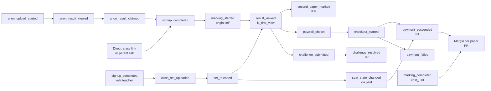

### 3.1 PA: paid activation

| Item | Definition | Basis |
|---|---|---|
| **Primary metric (students and parents)** | Share of student signups whose account, as beneficiary, gets a first `payment_succeeded` (is_first_payment = true) within 30 days of `signup_completed`. Split by signup source and payer_role. | [assumption: see §3.7] |
| **Primary metric (teachers)** | Share of teachers who reach pilot end (day 60) and get a first `payment_succeeded` (seat subscription or teacher pack) by day 90 | [assumption: the pilot gives 60 free days, so a 30-day window would read zero for teachers; test on the first pilot cohort] |
| Defining event | `payment_succeeded`, emitted server-side only after the HMAC-verified Paymob callback, never from the X-16 return page | [repo: feat/paymob-integration:lemely/db/models/billing.py (payments)] [assumption: server-side emission] |
| Funnel events | `anon_result_viewed` → `anon_result_claimed` → `signup_completed` → `paywall_shown` (position) → `checkout_started` → `payment_succeeded` / `payment_failed` | [assumption: see §3.7] |
| Parent path ⚠ Minor-data | `parent_ask_sent` (purpose payment) → `signup_completed` (source parent_ask) → `payment_succeeded` with payer_role parent | [assumption: see §3.7] |
| Diagnostic | Paywall conversion by position (PW-1 to PW-9) and by highlighted_sku. Checks T5 (Season pack hero). | [assumption: see §8.1.6 T5] |
| Proposed bar | Student first-payer share ≥ 7% if most first purchases are Season packs, ≥ 28% if most are Try packs. This is the break-even conversion that covers free papers at worst-case cost. | [assumption: see §8.1.4] [assumption: arithmetic, not data; revisit after 200 signups] |

### 3.2 RM: users return to mark more papers

| Item | Definition | Basis |
|---|---|---|
| **Primary metric (students)** | Share of activated students (first `result_viewed` with is_first_view on their own submission) who reach `second_paper_marked` within 14 days. Count any origin. | [assumption: see §3.7] |
| **Primary metric (teachers)** | Share of teachers with a first `class_set_uploaded` who upload a second set within 30 days | [assumption: new; 30 days approximates a class cycle, test on the pilot cohort] |
| Defining events | `second_paper_marked` (derived from `marking_completed`), `class_set_uploaded` | [assumption: see §3.7] |
| Supporting events | `marking_started` (origin), `notification_opened` (type), `result_viewed` (viewer_role student after `set_released`), `seat_state_changed` (pending→active) | [assumption: see §3.7] |
| Secondary | Weekly marking users. Share of released class results opened by the student within 7 days. Share of a teacher's students who also self-upload, which is the teacher-to-student funnel. | [assumption: test whether teacher-assigned work drives self-uploads, as T3 and T4 depend on it] |
| Proposed bar | No absolute bar is set before data exists. Set the bar from the first 4 weeks of cohort data, then use it as the primary metric for the T3 refill experiment. | [assumption: see §8.1.6 T3] [assumption: owner sets the bar from 4 weeks of `second_paper_marked` cohort data] |

### 3.3 TR: trust in marks

| Item | Definition | Basis |
|---|---|---|
| **Primary metric** | Challenge change rate: `challenge_resolved` with outcome raised or lowered, divided by `challenge_submitted`. Split by band (High, Check, Low) and by route (auto_remark, teacher). | [assumption: see §3.7] |
| Calibration check | Change rate must rise from High to Check to Low. If High-band challenges change as often as Low-band ones, the display bands are miscalibrated and the band words mislead. | [assumption: see §2.6] [assumption: needs about 30 challenges per band before reading] |
| Defining events | `challenge_submitted`, `challenge_resolved`, `mark_changed` | [assumption: see §3.7] |
| Supporting events | `question_why_opened` (band), `paper_confirmed` (changed), `set_released` (n_low_opened, n_overrides), `marking_failed` (reason) | [assumption: see §3.7] |
| Secondary | Challenge rate per 100 marked questions. Teacher override rate per released set. Paper identification accuracy = 1 − `paper_confirmed.changed` rate. Share of `marking_started` that ends in `marking_failed`. | [assumption: see §3.7] |
| Hard rule | Notification coverage: 100% of `mark_changed` events have notified = true, which means N-05 was sent to the student and to linked parents (D4). Anything below 100% is a defect, not a metric to optimise. ⚠ Minor-data | [repo: lemely/db/models/enums.py:245-267 (no change notification today)] |

### 3.4 PR: profit per user vs LLM cost per paper

| Item | Definition | Basis |
|---|---|---|
| **Primary metric** | Margin per paper = recognised revenue per paper − `cost_usd` per paper, by SKU and origin, net of the Paymob fee and refunds | [assumption: see §3.7, §8.1.4] |
| Defining events | `marking_completed.cost_usd` and `marking_failed.cost_usd` (persisted), `payment_succeeded.amount_minor`, `payment_refunded` (§3.7) | [repo: lemely/web/routers/student.py:1053] |
| Free cost per signup | Sum of `cost_usd` where payer_type is anon or free, divided by `signup_completed`. The planning figure is EGP 15.40 per student at worst-case cost. | [assumption: see §8.1.4] |
| Revenue per paying user | Sum of `amount_minor` per payer over 90 days, minus refunds | [assumption: computed from `payment_succeeded` and `payment_refunded`; first read 90 days after the first payment] |
| Breakage | Papers expired unused (period end, pack expiry) as a share of papers granted. It raises PR but can hurt TR and RM if large. | [repo: feat/paymob-integration:docs/superpowers/specs/2026-11-02-paymob-billing-design.md §2.6] [assumption: report it, never optimise for it] |

### 3.5 Guardrails

A guardrail breach pauses the experiment or flow that caused it. Thresholds are proposals [assumption: tune after the first 100 papers].

| Guardrail | Formula (events) | Proposed alert | Protects | Basis |
|---|---|---|---|---|
| Cost per paper | p50 and p95 of `marking_completed.cost_usd`, by subject and page count | p95 > $0.10, the configured paper target | PR | [repo: lemely/runtime/config.py:284-285] |
| Challenge overturn rate | `challenge_resolved` raised or lowered ÷ `challenge_resolved`, High band only | High-band rate ≥ Check-band rate (ordering breach, see §3.3) | TR | [assumption: test with `challenge_resolved` by band; review the alert after the first 100 challenges] |
| Downward-change share | `mark_changed` with delta_marks < 0 ÷ `mark_changed` | Read by route. A high share on auto_remark means the re-mark is harsher than the first pass, not that students are wrong. | TR | [repo: lemely/db/self_review_repo.py (marks move both ways)] [assumption: read `mark_changed.delta_marks` by route weekly in OPS-04] |
| Free-paper abuse rate | (`anon_upload_blocked` with reason device_cap or turnstile) ÷ `anon_upload_started`, plus `allowance_granted` per device_token > 1 | Any device with more than 2 allowance grants in 30 days. The daily cap hit on more than 3 days in a week. | PR | [assumption: see §8.2; tune the thresholds from `anon_upload_blocked` and `allowance_granted` counts in the first month] |
| Anonymous spend | Daily sum of `cost_usd` where payer_type = anon, against the OPS-01 cap of USD 5 per day | 80% of the cap reached before 18:00 Africa/Cairo | PR | [assumption: see §8.2; owner sets the cap in OPS-01; test with the daily anonymous `cost_usd` sum] |
| Failure rate | `marking_failed` ÷ `marking_started`, by reason | timeout share rising, since the 300 s limit (§2.4) makes timeout the likely leading reason | TR, PR | [repo: .github/workflows/deploy.yml:339] [assumption: test with `marking_failed.reason` counts on staging] |
| Time to result | p95 of `marking_completed.duration_s`, plus queued time | p95 > 15 min for a self-upload | RM, TR | [assumption: about 2× the measured 371-442 s run] |
| Release latency | Median `set_released.hours_from_marked` | > 72 h (A-T) | RM, TR | [assumption: see §13.1 A-T] |
| Card failure | `payment_failed` ÷ `checkout_started`, by gateway reason | Read with X-14 "no card" exits. This is the A-W test for card-only rails (D2). | PA | [assumption: see §8.1.6 T1, §13.1 A-W] |
| Refund rate | `payment_refunded` ÷ `payment_succeeded` | Any refund on a pack where papers were used is reviewed in OPS-03 | PR, TR | [assumption: read `payment_refunded` ÷ `payment_succeeded` by sku in OPS-03] |
| Consent completion ⚠ Minor-data | `consent_granted` ÷ `consent_requested`, plus hours_to_decision | Measured, never nudged by countdowns aimed at the child | PA, TR | [assumption: see §8.3 exclusions, §3.7] |
| Email quota | Daily `email_sent` count ÷ 100 | > 70% on any day | PA (verification is blocked when the quota runs out) | [repo: lemely/runtime/config.py:1255-1278] [assumption: test with the daily `email_sent` count against the provider dashboard] |

### 3.6 Instrumentation rules

| Rule | Detail | Basis |
|---|---|---|
| Sink | A first-party Postgres events table. No third-party analytics script runs on student or parent sessions. **Trade-off:** a third-party tool is faster to build (PR, one-off), while first-party keeps minors' behavioural data with Lemely alone (TR). **Recommend first-party.** ⚠ Minor-data | [assumption: no tracker exists today; counsel confirms] |
| Server-side truth | Money, marking, challenge, seat and consent events are emitted by the server at the state change. Only view and open events (`result_viewed`, `question_why_opened`, `paywall_shown`, `notification_opened`) come from the client. | [assumption: design rule; verify each server event fires at the state change with a staging event-count test (B-02)] |
| Payload limits ⚠ Minor-data | IDs, bands and enums only. No script content, names, date of birth, or free-text challenge reasons. age_band replaces the date of birth. | [assumption: see §3.7 common properties] |
| Prerequisites before launch | Persist the per-upload cost (already computed), the duration and the failure reason. Without them PR and the failure guardrails cannot be read. | [repo: lemely/web/routers/student.py:1053; lemely/db/models/attempts.py:66-98] |
| Retention of events ⚠ Minor-data | Events tied to a deleted account or an unclaimed anonymous submission keep only aggregate counts after deletion (7 days for anonymous) | [assumption: see §8.2 Retention] [assumption: counsel] |

### 3.7 Event catalogue

Common properties on every event: `user_id` or `device_token`, `role`, `age_band` (`u15` / `15_17` / `18p` / `unknown`, never the date of birth itself), `ts`, `app_version`. ⚠ Minor-data: events carry IDs, bands and enums only, never script content, names or free-text reasons (§3.6) [assumption: first-party events table, B-02]. Rows marked "new event" do not exist today. Each is verified by a staging test that performs the action and checks that one row lands in the events table; notification rows are also checked through `notification_sent` [assumption: B-02 exit check].

| Event | Key properties | Goal | Metric it defines | Basis |
|---|---|---|---|---|
| `anon_upload_started` | subject, turnstile_ok | PA, PR | Anonymous starts per day | [assumption: new event; staging event-count test, B-02] |
| `anon_upload_blocked` | reason (`device_cap` / `daily_cap` / `kill_switch` / `turnstile` / `under_15`) | PR | Abuse and cap pressure | [assumption: new event; staging event-count test, B-02] |
| `allowance_granted` | source (`anon` / `signup`), papers | PR | Multi-account farming of free papers | [assumption: new; guardrail in §3.5] |
| `paper_confirmed` | submission_id, detected_paper, chosen_paper, changed (bool) | TR | Identification accuracy = 1 − changed rate | [repo: lemely/web/routers/student.py:831-871] |
| `marking_started` | submission_id, origin, subject, paper, payer_type (`anon` / `free` / `sub` / `pack` / `class_pool`), papers_left_before, retry_n | RM, PR | Papers started per user; retries | [assumption: new event; staging event-count test, B-02] |
| `marking_completed` | submission_id, origin, duration_s, cost_usd, pages, n_questions, n_low, n_check, n_not_marked | RM, PR, TR | Cost per paper (p50, p95); time to result; Low share | [repo: lemely/web/routers/student.py:1053 (cost computed, must be persisted)] |
| `marking_failed` | submission_id, reason (`unsupported` / `no_scheme` / `unreadable` / `pages_unmatched` / `timeout` / `stale` / `error`), cost_usd, paper_refunded | TR, PR | Failure rate; cost of failures | [repo: lemely/db/models/attempts.py:66-98 (no failure reason stored today)] |
| `anon_result_viewed` | submission_id | PA | Anonymous completion | [assumption: new event; staging event-count test, B-02] |
| `anon_result_claimed` | submission_id, hours_since_result | PA | Claim rate = claimed / anonymous results | [assumption: new event; staging event-count test, B-02] |
| `signup_completed` | role, source (`anon_claim` / `class_link` / `parent_ask` / `consent_link` / `direct`), age_band | PA | Signup conversion by source | [assumption: new event; staging event-count test, B-02] |
| `consent_requested` / `consent_granted` / `consent_declined` / `consent_withdrawn` ⚠ | student_id, channel, hours_to_decision | PA, TR | Consent completion rate for under-15 students | [assumption: new event; staging event-count test, B-02] |
| `result_viewed` | submission_id, viewer_role, release_state, is_first_view | RM, TR | Results seen; parent engagement | [assumption: new event; staging event-count test, B-02] |
| `question_why_opened` | submission_id, question_id, band | TR | "See why" use by band | [assumption: new event; staging event-count test, B-02] |
| `next_step_shown` / `next_step_tapped` | submission_id, step_type (`assigned` / `redo` / `next_paper` / `plan_setup`) | RM | Next-step reach and take rate | [assumption: new, §9.2] |
| `practice_started` | mode (`redo` / `checks` / `flashcards`), topic, source_submission_id | RM | Practice reach after a result | [assumption: new, §9.3] |
| `practice_completed` | mode, marks_back, n_items, cost_usd | RM, PR | Redo cost per paper (p95); practice → second paper rate | [assumption: new, §9.3] |
| `next_paper_suggested` | paper, source (`assigned` / `plan` / `component`), in_corpus, skipped_no_copy | RM | Suggestion acceptance; no-copy rate | [assumption: new, §9.4] |
| `exam_plan_set` | session, n_subjects, has_target, papers_planned, papers_held | RM, PA | Plan adoption | [assumption: new, §9.4] |
| `paywall_shown` | position (PW-1..PW-9), papers_left, skus_offered, highlighted_sku | PA | Paywall reach | [assumption: new event; staging event-count test, B-02] |
| `checkout_started` | sku, price_minor, payer_role, beneficiary_role, position | PA | Checkout start rate | [assumption: new event; staging event-count test, B-02] |
| `checkout_returned` | payment_id, phase_at_return, seconds_waited | PA, TR | Drop-off at the hosted-page hop (A-HC) | [assumption: new event; staging event-count test, B-02] |
| `payment_succeeded` | payment_id, sku, amount_minor, payer_role, beneficiary_role, is_first_payment, days_since_signup | PA, PR | **PA metric** (§3.1) | [repo: feat/paymob-integration:lemely/db/models/billing.py (payments)] |
| `payment_failed` | payment_id, sku, reason (gateway code), stage | PA | Card failure rate; input for A-W | [assumption: new event; staging event-count test, B-02] |
| `refund_requested` / `payment_refunded` | payment_id, sku, amount_minor, papers_clawed_back, reason | PR, TR | Net revenue; refund rate | [repo: feat/paymob-integration:docs/superpowers/specs/2026-11-02-paymob-billing-design.md §6] [assumption: new events] |
| `subscription_state_changed` | subscription_id, from, to, audience (`student` / `teacher`) | PA, PR | Renewal rate; past_due recovery rate | [repo: feat/paymob-integration:lemely/db/models/billing.py:186-395] |
| `papers_depleted` | role, source_exhausted | PA, RM | Time to depletion | [assumption: new event; staging event-count test, B-02] |
| `second_paper_marked` | user_id, days_since_first, origin | RM | **RM metric** (§3.2) | [assumption: derived from `marking_completed`, emitted for convenience] |
| `challenge_submitted` | submission_id, question_id, band, route (`auto_remark` / `teacher` / `auto_remark_after_wait`), origin, reason_code, escalated (bool) | TR | Challenge rate per 100 questions, by band | [assumption: new event; staging event-count test, B-02] |
| `challenge_resolved` | challenge_id, outcome (`upheld` / `raised` / `lowered`), delta_marks, route, hours_to_resolve, cost_usd | TR, PR | **TR metric** (§3.3); time to resolve; re-mark cost | [assumption: new event; staging event-count test, B-02] |
| `mark_changed` | submission_id, question_id, source (`override` / `challenge` / `remark`), delta_marks, notified | TR | Override rate; notification coverage = 100% | [repo: lemely/db/models/enums.py:245-267 (no change notification today)] |
| `class_created` / `roster_added` / `join_link_rotated` | class_id, n_names (roster_added) | RM | Class setup; code hygiene | [assumption: new, §5.1] |
| `class_set_uploaded` | set_id, n_scripts, paper, est_papers, pool_before | RM, PA | Teacher activation (first set) | [assumption: new event; staging event-count test, B-02] |
| `scripts_matched` | set_id, auto_matched, manual_matched, unmatched | RM | Matching accuracy (A-M) | [assumption: new event; staging event-count test, B-02] |
| `roster_claim_confirmed` ⚠ | class_id, set_id, student_id, n_results_attached | RM, TR | Placeholder results that reach a student | [assumption: new, §6.3] |
| `set_released` | set_id, n_scripts, hours_from_marked, n_low_opened, n_overrides | TR, RM | Release latency; teacher review load | [assumption: new event; staging event-count test, B-02] |
| `seat_state_changed` ⚠ | class_id, student_id, from, to, via (`pilot` / `free` / `paid` / `removed` / `downgrade`) | PA, RM | Pending→active conversion; seats paid per teacher | [assumption: new event; staging event-count test, B-02] |
| `class_board_opt_in` ⚠ | class_id, opted_in | RM | Class board uptake (§9.7) | [assumption: new event; staging event-count test, B-02] |
| `parent_ask_sent` ⚠ | student_id, purpose (`consent` / `payment` / `progress`), channel | PA | Ask → parent signup → payment funnel | [assumption: new event; staging event-count test, B-02] |
| `parent_link_state_changed` ⚠ | link_id, from, to | PA, TR | Linked parents per student | [repo: lemely/db/parent_repo.py] |
| `notification_sent` / `notification_opened` | type (N-xx), channel, recipient_role | RM | Open rate; return visits from notifications | [assumption: new event; staging event-count test, B-02] |
| `email_sent` | type (N-xx or verify), recipient_role, provider_status | PA | Daily count against the email quota | [assumption: new; guardrail in §3.5] |

## 4. Growth model

Lemely grows through teachers first. Students follow the teacher. Students who pay for themselves, or who get a parent to pay, come next [assumption: owner GTM; D1]. The loop below is the order in which a teacher's free workspace turns into seats, and their students turn into paying students and parents. No usage, conversion or retention data exists, so every rate in this section is a hypothesis with the event that measures it [repo: PRODUCT.md:127].

Prices, pool sizes and free allowances come from the pricing proposal (A-P). They are proposals until the owner signs them off in OPS-05 [assumption: A-P].

### 4.1 The teacher-first loop

```mermaid
flowchart LR
    T1["Teacher signs up (X-05)"] --> T2["Drops first class set (T-02)"]
    T2 --> T3["Set marked (N-03)"]
    T3 --> T4["Reviews Low items, releases (T-04)"]
    T4 --> T5["Save these students as a class (T-03)"]
    T5 --> T6["Shares join link (T-07)"]
    T6 --> S1["Student joins (X-23)"]
    S1 --> S2{"Free seat?"}
    S2 -->|"yes"| S3["Active seat: sees released results (N-04)"]
    S2 -->|"no"| S4["Pending seat (N-09 to teacher)"]
    S4 --> P6["PW-6: Add seats"]
    P6 -->|"paid seat"| S3
    S3 --> T7["Teacher assigns papers (T-09)"]
    T7 --> S5["Students upload, teacher releases"]
    S5 --> T8["Pool runs low or pilot ends (PW-5, PW-7)"]
    T8 -->|"buys seats or pack"| T7
    T8 -->|"stays free"| T9["Free workspace: 10 seats, 15 papers"]
    T9 --> T7
    S3 --> U1["Student self-uploads on own 2 free papers"]
    U1 --> U2["Out of papers (PW-2, PW-3)"]
    U2 -->|"pays"| U3["Season pack or Monthly"]
    U2 -->|"Ask a parent (PW-8)"| R1["Parent lands on child progress (P-01)"]
    R1 --> R2["Parent funds child (P-05)"]
    U3 --> U1
    R2 --> U1
```

Steps, the screen each happens on, and the goals it serves:

| Step | What happens | Screen / trigger | Goals | Basis |
|---|---|---|---|---|
| 1. Sign up | Teacher signs up with email and a password. School name optional. The workspace shows its free papers and seats in papers, never credits: "15 papers and 10 seats a month, free. When 3 students join, a 60-day pilot gives you 30 seats and 60 papers." The unlock rule is in §5.1 T4. | X-05, X-07 | PA | [repo: docs/strategy/2026-11-16-new-user-flows.md:226-236] [assumption: A-P pilot and workspace sizes] |
| 2. Mark first, organise later | The first screen is a drop zone, not "create a class". One PDF or many photos, then paper confirmation and an estimate in papers. | T-02, X-21 logic, PW-5 when the set exceeds the pool | RM, PA, PR | [repo: docs/strategy/2026-11-16-new-user-flows.md:237-241] [assumption: shorter time to first value raises teacher activation; measure `class_set_uploaded` within 24 h of signup] |
| 3. Time-saved moment | "28 papers marked. 9 answers to check." The teacher lands on the release queue, Low items first. | N-03, T-04 | TR, RM | [repo: docs/strategy/2026-11-16-new-user-flows.md:242-243] [assumption: Low-by-default queue, §2.6 rule 8] |
| 4. Class from the batch | "Save these 28 students as a class?" creates the class, its join link and roster placeholders from cover names (§6.3). | T-03 | RM | [repo: docs/strategy/2026-11-16-new-user-flows.md:244-246] [assumption: roster placeholders, §6.3] |
| 5. Students join | The teacher shares the link (class WhatsApp group, board, printed slip). Each joining student takes an active seat or waits on a pending one. Nobody is refused (D1). | T-07, X-23 | RM, PA | [repo: feat/paymob-integration:lemely/db/class_repo.py:841-860 (the 409 this replaces)] [assumption: D1] |
| 6. Results reach students | Released class-set results land in each claimed student's history, with N-04. This is the handoff that today does not exist: teacher-console papers never reach the student or parent. | T-04 → N-04 → X-10 | RM, TR | [repo: lemely/db/review_repo.py:20-26] |
| 7. Assigned papers | The teacher assigns a past paper with a due date. Students upload it; the class pool pays; the teacher releases. | T-09, S-06, N-21 | RM | [assumption: new; §2.2 origin `assigned`] |
| 8. Seat and pack purchase | The teacher pays when one of three things happens: a named student is waiting for a seat (PW-6), a set is larger than the pool (PW-5), or the pilot ends with a value summary (PW-7). | T-08, T-02, T-12 | PA, PR | [assumption: A-P seat price EGP 40 per seat per month beyond 10] |
| 9. Free fallback | A teacher who does not pay keeps 10 active seats and 15 papers a month. Extra seats go pending, never removed. The class stays alive and its students keep marking on their own allowance. | T-08, X-17 | RM, PR | [assumption: §8.1.6 T4] |

Why this order: the teacher sees marked work before being asked to build anything, and is asked to pay only at a moment tied to a named student or a concrete set size [repo: docs/strategy/2026-11-16-new-user-flows.md:247-255]. Competitors in the same space put a teacher release step before students see marks, and Medly makes teacher-set homework free to students [source: https://www.medlyai.com/uk/teachers] [source: https://thelearningmate.com/ai-marking]. Whether teachers in Egypt adopt in this order is untested [assumption: track signup → `class_set_uploaded` → `set_released` → `seat_state_changed` (to active) → `payment_succeeded` (teacher) per cohort week].

**Trade-off: class work never draws on the student's own papers (RM) vs student paid conversion (PA).** A student whose work is all teacher-assigned may never run out of papers, so never meets PW-2. Charging assigned work to the student would push PA up but would make the teacher's assignment a bill sent to a minor, and would break the "teacher pays for class work" promise that makes free seats worth sharing. **Recommend: keep class work on the class pool.** Student purchases come from self-uploads beyond class work (extra papers before the session) [assumption: compare `payment_succeeded` by beneficiary for class-seated vs solo students; §8.1.5 rule 3].

**Trade-off: release gate (TR) vs time to the student's first result (RM).** A class-set result waits for the teacher, so the student's first contact with Lemely can be days after the set was marked. **Recommend: keep the gate (D4) and push the teacher with N-08 at 48 h and 5 days**, not auto-release [assumption: A-T; watch `set_released.hours_from_marked`].

**Not in v1: referral papers ("give a paper, get a paper").** The strategy draft proposes them [repo: docs/strategy/2026-11-16-new-user-flows.md:202-203]. Each referred signup is another free allowance with real LLM cost, and referral rewards are an abuse target next to the anonymous paper. No evidence shows they beat the teacher loop. Cut until PA and abuse rates are measured [assumption: revisit if `signup_completed` with source `direct` stalls].

### 4.2 Students who arrive without a teacher

Design premise: a solo student meets Lemely through a shared link, search or a friend [assumption: channels unmeasured; read the `signup_completed.source` split after launch]. Their first paper is anonymous (D3).

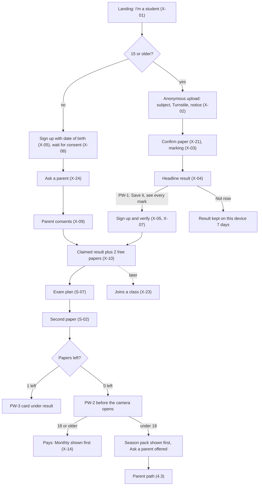

| Moment | Design | Conversion trigger | Goals | Basis |
|---|---|---|---|---|
| Anonymous upload | Age check, Turnstile, third-party processing notice, one paper per device and network. No name or email. | none (free) | PA, PR | [assumption: §8.2; D3] |
| Headline result | Score, grade with boundary provenance, band counts, top weak topic. Per-question marks, "See why", challenge and saving need an account. Copy: "You scored 41/60. Grade B on the Jun 2025 boundary. Waves cost you the most marks. Save it and see every mark: create a free account. You get 2 more papers." | PW-1 (account, not payment) | PA, TR | [assumption: §8.1.6 T6; test `anon_result_viewed` → `signup_completed` source `anon_claim`] |
| Claim | Signup on the same device within 7 days attaches the result. The page shows the expiry date because no contact exists to remind the visitor. | `anon_result_claimed` | PA | [assumption: §8.2] |
| Plan from one paper | During or after the first full result, the student sets session and target grade. The plan turns into "papers you need before May". S-01 then always shows one next paper. | Plan creates the reason for paper 2 | RM, PA | [repo: docs/strategy/2026-11-16-new-user-flows.md:121-131] [assumption: measure `second_paper_marked` within 14 days for students with vs without a plan] |
| Depletion | PW-4 nudge at 1 paper on S-01, PW-3 under the result at ≤1, PW-2 at 0 before the camera. A staged share-target script is never uploaded unpaid and never lost. | PW-2, PW-3, PW-4 | PA, PR | [assumption: §8.3] |
| Offer order | Season pack highlighted for under-18 beneficiaries and parent payers. Monthly is listed first for 18+ self-payers and hidden from under-18 self-payers. A 15-17 student choosing "I'll pay" sees "Use a card you're allowed to use, or ask a parent". | SKU choice on X-14 | PA, PR | [repo: docs/strategy/2026-11-16-new-user-flows.md:189] [assumption: §8.1.6 T5; counsel on minors' contracting] |
| Later class join | A solo student can join a teacher's class at any time. Self-uploads stay private to the student unless they share them with that class in X-19. | X-23 | RM | [assumption: §7.6 visibility rule] |

**Under-15 visitors cannot mark anonymously.** The age check routes them to sign up with a date of birth (X-05), then to X-08 and X-24 to ask a parent, so their first paper waits for guardian consent [source: https://www.tamimi.com/our-knowledge/publications/general/Articles/from-policy-to-practice-egypt-issues-executive-regulations-of-the-personal-data-protection-law/] [assumption: A-L, counsel]. ⚠ Minor-data. This costs PA at the very top of the funnel for the youngest students. It also puts a parent in the account on day one, and that parent is the likely payer (§4.3) [assumption: compare `payment_succeeded` within 30 days for `consent_link` vs `anon_claim` signups].

**Trade-off: anonymous paper (PA, RM) vs cost and abuse (PR).** It is settled by D3 and bounded by the daily anonymous spend cap and kill switch. This section only adds that the anonymous result must lead somewhere: X-04 links to sign up, and its "Not now" path keeps the result on the device for 7 days, so a later signup still claims it [assumption: §8.1.6 T2].

### 4.3 How a parent is pulled in and pays

Parents do not self-sign up. They arrive through their child: the parent link is child-issued today and stays child-issued in v1 (§6.4) [repo: lemely/web/routers/auth.py (parent 3-step signup from a child's code); lemely/db/invite_repo.py:120-125]. ⚠ Minor-data on every path below.

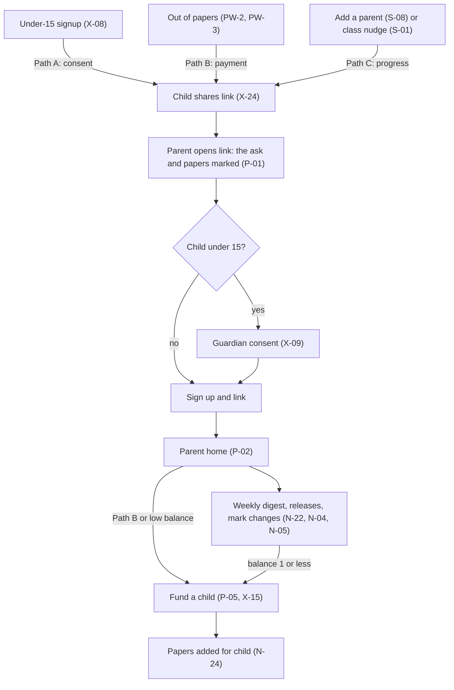

| Path | Who starts it | Parent's first screen | What the parent decides | Conversion trigger | Goals | Basis |
|---|---|---|---|---|---|---|
| A. Consent | Under-15 student at X-08 | X-09: what Lemely processes, who sees it, how long it is kept. Then grant or decline. | Consent, and in the same visit whether to fund | Consent unlocks the child's first paper. P-02 then shows "Omar has 2 free papers. A Season pack covers 30." | PA, TR | [assumption: A-L; §6.11] |
| B. Payment | Student at PW-2 or PW-3 taps "Ask a parent" | P-01: the child's first name, the ask and how many papers they have marked, then sign up and link. Grade and weak topics show once the parent is linked | Which pack to buy for the child | PW-8 (the ask itself) | PA | [repo: docs/strategy/2026-11-16-new-user-flows.md:209-215] [assumption: §8.3 PW-8] |
| C. Progress | Student on S-08, or prompted by the S-01 card "Add a parent so they see your progress" when a class teacher turns the nudge on (T-07) | P-01 as above, without a purchase prompt above the fold | Whether to follow the child's progress | N-22 digest and N-11 later turn following into funding | RM, PA | [assumption: new; `parent_ask_sent` purpose `progress`; teachers never see who linked a parent (§6.8)] |

Parent copy, in the parent voice: "Omar is on track for a B in Physics. Two topics need attention this month: waves and electricity." [repo: PRODUCT.md:96-100]. The child's prefilled ask carries no grade or topics, because the message travels outside Lemely: "Can you add 30 papers to my Lemely? It's EGP 449, one payment." [assumption: minimised prefill; test `parent_ask_sent` → parent `signup_completed`].

What keeps a parent paying when the Season pack does not renew:
- **N-22 weekly digest** (email): papers marked, trend, next session, balance. When the balance is 1 or less, it carries one link to P-05 [assumption: §6.12 N-22; the strategy draft calls the digest the renewal engine for non-renewing payers, repo: docs/strategy/2026-11-16-new-user-flows.md:219-220].
- **N-11 papers running low**, sent to the payer parent as well as the child [assumption: §6.12 N-11].
- **N-24 papers added for you** tells the child the parent paid, which is the cue to mark the next paper [assumption: new notification, §6.12].
- No countdown discounts or scarcity copy aimed at minors or their parents [repo: docs/strategy/2026-11-16-new-user-flows.md:280].

**Trade-off: parent account (PA) vs a password-free magic-link digest (less friction, smaller data footprint).** A magic link reaches more parents, but there is no account to attach a card, a consent record or a payer role to. **Recommend: an account, created in the same visit from the child's link with no separate code entry.** Consent and payment both need it [source: https://support.sparxmaths.com/en/articles/342337-why-and-how-we-engage-parents-with-sparx-maths (Sparx uses expiring portal links without accounts)] [assumption: test parent signup completion from P-01; revisit if `parent_ask_sent` → `signup_completed` (source `parent_ask`) is low].

**Trade-off: card-only rails (D2) vs wallet-first Egyptian parents (PA).** Settled by D2. A parent without a card can use a relative's or a prepaid card on the one-off Season or Try pack. Wallets stay assumption A-W, measured by X-14 "no card" exits and `payment_failed` reasons [repo: feat/paymob-integration:docs/billing/research/07-egypt-mena-pricing.md:18,203] [assumption: A-W].

### 4.4 Conversion triggers

| ID | Trigger | Payer | Screen / position | Offer | Goal | Event that measures it | Basis |
|---|---|---|---|---|---|---|---|
| CT-1 | Anonymous result ready | none (account gate) | X-04 / PW-1 | Free account, 2 more papers | PA | `anon_result_viewed` → `signup_completed` | [assumption: D3] |
| CT-2 | Student balance reaches 1 | student or parent | S-01 / PW-4, X-10 / PW-3 | Season pack · Try pack · Monthly | PA | `paywall_shown` (PW-3, PW-4) → `checkout_started` | [assumption: §8.3 PW-3, PW-4] |
| CT-3 | Student balance 0 at Scan | student or parent | S-02 / PW-2 | Same, plus Ask a parent | PA, PR | `paywall_shown` (PW-2) → `payment_succeeded` | [assumption: §8.3 PW-2] |
| CT-4 | Student asks a parent | parent | X-24 → P-01 → P-05 / PW-8 | Student SKUs, payer = parent | PA | `parent_ask_sent` (payment) → `payment_succeeded` (payer_role parent) | [assumption: §8.3 PW-8] |
| CT-5 | Guardian consent granted | parent | X-09 → P-02 | Fund the child after consent | PA, TR | `consent_granted` → `payment_succeeded` within 30 days | [assumption: new; measure before relying on it] |
| CT-6 | Payer parent's child is low | parent | N-11, N-22 → P-05 | Same SKUs | PA, RM | `notification_opened` (N-11, N-22) → `payment_succeeded` | [assumption: §6.12 N-11, N-22] |
| CT-7 | A named student waits for a seat | teacher | T-08 / PW-6 | Add 1 seat · Add all waiting · Leave pending | PA, RM | `seat_state_changed` (pending → active, via paid) | [assumption: D1] |
| CT-8 | Class set bigger than the pool | teacher | T-02 / PW-5 | Mark the first N now · Add seats · Teacher pack | PA, PR | `class_set_uploaded` with est_papers > pool_before → `payment_succeeded` | [assumption: §8.3 PW-5] |
| CT-9 | Pilot day 53 and day 60 | teacher | T-12 / PW-7 | Keep N seats · Stay on free workspace | PA | `notification_opened` (N-17) → `payment_succeeded` (teacher) | [assumption: §8.3 PW-7] |
| CT-10 | Renewal failed | payer | X-17 / PW-9 | Update card · Switch to a pack | PA, PR | `subscription_state_changed` past_due → active | [assumption: §8.3 PW-9] |

The PA metric is the share of signups with a first payment within 30 days, split by `signup_completed.source` and payer role. RM is the share of activated users with a second paper within 14 days [assumption: §3.7].

---

## 5. Flows

This section walks each role through the flows the product should have. Each role gets one flowchart and one step table. The flowchart shows the paths and decision points. The table gives, for each step, the screen, what the user is trying to do, what the system does, and the loading, empty, error and low-confidence states. Screen IDs (§10.8), paywall positions (§8.3), notifications (§6.12), events (§3.7), prices (§8.1) and state names (§6.10, §6.11, §7.6) are defined once in those sections. A flow that touches student scripts, consent, parent linking or seat membership carries ⚠ Minor-data. Every screen names the goals it serves (PA, RM, TR, PR), and a step that serves none was cut. All screens work as a single column from 320px. Teacher and admin screens become denser on desktop, but the step order stays the same [repo: PRODUCT.md:137-147]. UI copy in quotes follows the voice for that audience: hype and cheeky for students, clear and reassuring for parents, precise and efficient for teachers and school admins [repo: PRODUCT.md:96-104]. No screen shows question-paper or mark-scheme text. Screens show only question numbers, marks, paraphrased criteria and the student's own answer [repo: corpus/README.md:3-10] [assumption A-K: audit strings before launch].

### 5.1 Teacher

Teachers are the GTM wedge. The flow lets a teacher get value before doing any admin: mark a stack of scripts first and sort the students into a class afterwards. Students are never refused a seat (D1). Teachers are never asked to pay mid-run, so the paywall comes before a set starts, never during it. The teacher, not the AI, releases class work to students (D4).

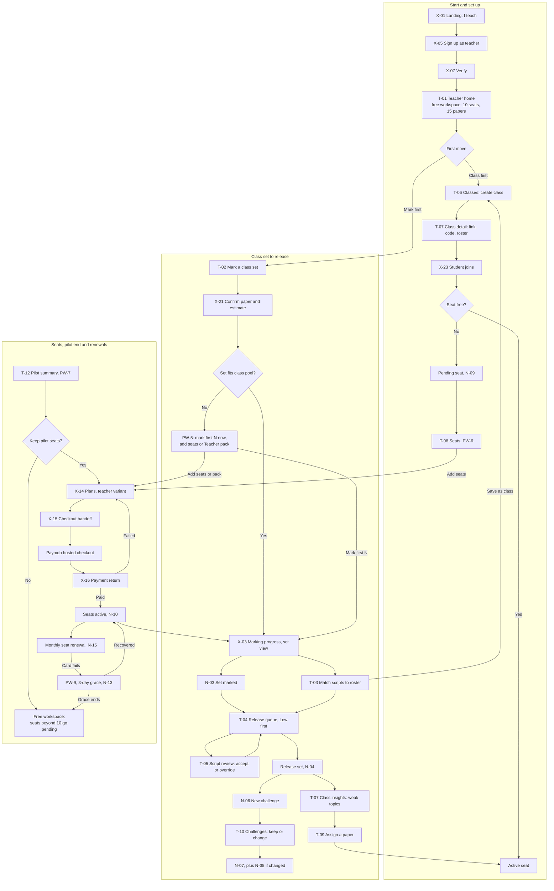

| Step | Screen | User intent | System response | States (loading, empty, error, low confidence) |
|---|---|---|---|---|
| T1 Sign up | X-01 → X-05 (PA) | "I teach. Let me try it on real scripts." | Signup has role preset to teacher and asks for name, email and a password. Phone sign-in and Google are later build items (B-13). No school is required, so the teacher starts independent. Emits `signup_completed` (role teacher, source direct). | Error: email already used shows "Sign in instead". Error: the pre-launch access gate refuses the domain and shows "Join the waitlist" with the Turnstile form (on main and develop, removed at launch). [repo: lemely/web/routers/auth.py:93] [repo: origin/main:lemely/core/access.py; origin/develop:lemely/core/access.py] |
| T2 Verify | X-07 (PA, PR) | Prove the account is real so marking unlocks. | A code goes by email. Verification issues the free workspace: 10 seats and 15 class-pool papers this month. Teacher marking stays locked until verification. Today teacher marking has no verification gate at all, so this closes an unguarded LLM spend path. | Loading: "Sending your code". Error: the code expired or the daily send limit was hit, which shows "Try again in N minutes". Resend's free quota is 100 mails a day, shared with student signups. [repo: lemely/web/routers/teacher.py:192-195,879-896; lemely/runtime/config.py:1244-1252] [assumption: free workspace sizes, §8.1.3] |
| T3 Free workspace home | T-01 (RM, TR) | See the one thing to do next. | Shows one next action. A brand-new teacher gets the setup path "Mark a class set", "Create a class" and "Check flagged answers", derived from account data only. Also shows the class-pool meter "15 class papers left this month · 10 free seats" and, once these exist, sets awaiting release, open challenges and pending seats, in that order. | Loading: skeleton of the meter and the next-action card. Empty: the setup path, with "Mark a class set" first: "Have a stack of scripts? Drop them in. You can sort students into a class afterwards." Error: "Couldn't load your classes. Retry." [repo: web/src/portals/teacher/home/setup.ts:1-35] [assumption: "mark first" order raises first-set activation; test `class_set_uploaded` within 7 days of signup, mark-first vs class-first default] |
| T4 Pilot unlock | T-01 banner → T-12 (PA, RM, PR) | Get room for a full class without paying yet. | When at least 3 students have joined (active or pending) across the teacher's classes, the 60-day pilot starts on its own: 30 seats and 60 class-pool papers. OPS-06 can start or extend it by hand. The banner reads "Pilot on: 30 seats and 60 papers until 15 Jan". The same rule gates later monthly refills of the 15 free papers. Trade-off: requiring joined students stops student accounts from posing as teachers for free papers (PR, PA), but delays a teacher who marks before any student joins (RM). The first 15 papers stay open on verify, so mark-first still works. Recommend the rule; the price list in §8.1.3 records it. | Empty: "Pilot starts when 3 students join. 1 of 3 so far." Error: none; the pilot starts on the next join. [repo: feat/paymob-integration:lemely/db/teacher_team_repo.py:1034-1075 (a manual subscription counts toward capacity); feat/paymob-integration:lemely/db/admin_customer_repo.py:846-849 (only a priced tier can be activated, so the pilot is a priced tier activated as complimentary)] [assumption: test the share of teacher accounts with 0 joined students after 30 days, and pilot-to-paid conversion] |
| T5 Create class | T-06 → T-07 (RM) | Group students so seats, assignments and insights work. | Asks for the class name and subject (0580, 0606 or 0625). Creates the class with a join link and a short code, and shows "What students see" next to them: "Ms Hanna sees the papers you upload for this class, and any papers you choose to share. Nothing else." Emits `class_created`. | Error: name already used by one of the teacher's classes. Empty roster: "No students yet. Share the link, or add names so we can match scripts." [repo: lemely/db/class_repo.py:500-506] [assumption: event name, §3.7] ⚠ Minor-data |
| T6 Invite students: code or link | T-07 (RM, PA) | Get students in with the least effort. | Offers "Copy link", "Share" (opens the device share sheet, so WhatsApp works with no API) and the code. Shows "Rotate code" because today's join codes never expire and cannot be rotated, so a leaked code fills seats. Rotating stops the old code from working and leaves students already joined untouched. Emits `join_link_rotated`. | Error: rotate failed, so the old code still works, and the screen says so. [repo: lemely/db/class_repo.py:505,930] [assumption: share-sheet use; §6.12 channel policy] ⚠ Minor-data |
| T7 Invite students: roster | T-07 "Add names" (RM, TR) | Have the names ready so class-set scripts match before students join. | The teacher pastes or types student names, one per line. Each name becomes a roster placeholder with its own join link. When a student joins through that link, the placeholder binds to their account. Placeholders store a display name only, with no email, phone or date of birth. They are used only for cover-name matching and are deleted when the class is deleted. Emits `roster_added`. | Empty: "Paste names, one per line." Error: duplicate name, which asks "Two Omar Ali? Add an initial so we can tell them apart." [assumption: placeholder roster is new; matching quality is assumption A-M; counsel confirms that a teacher may hold names before the student consents (A-L)] ⚠ Minor-data |
| T8 Student joins, seat check | X-23 (student) → T-08 (RM, PA) | (Student) join the class. (Teacher) see who is in. | If a seat is free (pilot, free workspace or paid), the join becomes an **active** seat. If none is free, it becomes a **pending** seat: the student is enrolled, keeps their own allowance and sees "Waiting for a seat". There is no 409. The teacher gets N-09 (in-app, plus a daily summary email). Emits `seat_state_changed`. | Error: invalid or rotated code shows "This code has changed. Ask your teacher for the new link." [repo: feat/paymob-integration:lemely/db/class_repo.py:706-712,841-860 (409 replaced)] [assumption: D1; §6.10] ⚠ Minor-data |
| T9 Pending seats | T-08 Seats, PW-6 (PA, RM) | Decide who gets a seat and whether to pay. | Lists active and pending students by name and join date: "Ahmed is waiting for a seat." Options: "Add 1 seat (EGP 40/mo)", "Add all 4 waiting (EGP 160/mo)", "Leave pending" and "Remove". Pending students' class-set scripts can be marked but are held at release, and the screen says so. Emits `paywall_shown` (PW-6). | Empty: "Everyone has a seat. 7 free seats left." Error: seat purchase failed, so students stay pending and nothing changes for them. [assumption: §8.3 PW-6, §8.1.3 seat price] ⚠ Minor-data |
| T10 Upload class set | T-02 (RM, PA, PR) | Drop a stack of scripts and have them marked. | Accepts one multi-script PDF or many photos. The system splits the stack into scripts, reads each cover for the paper and the candidate name, and goes to X-21. Per-script limits are 25 MiB and 40 pages. Emits `class_set_uploaded`. | Loading: "Reading 28 covers". Error: a file is over the limit, unreadable or not a PDF or image, and only that file is rejected with its name. Error: the paper is not supported, which goes to X-22 with "Add the mark scheme" (T-11, deterministic parse, $0 when it succeeds). [repo: lemely/io/_scan_common.py:63; lemely/web/routers/teacher.py:1413-1447] [repo: redesign/f1-ui-kit:docs/superpowers/plans/2026-11-15-redesign-l12-pipeline.md (class-set cover read)] |
| T11 Confirm paper and estimate | X-21 → PW-5 (TR, PR, PA) | Check the paper is right and see what it costs. | "0625 Paper 42, May/June 2025, right?" Change or confirm. Cost: "This set: 28 papers. You have 15." If the set fits, the button reads "Mark 28 scripts · uses 28 class papers". If not, PW-5 offers "Mark the first 15 now", "Add seats" and "Teacher pack (EGP 399, 50 papers)". The unmarked scripts stay staged and are never lost. If the pool is short, nothing is charged to students. Emits `paper_confirmed` and `paywall_shown` (PW-5). | Low confidence: the paper was detected with doubt, so "Change" is the default focus and "We're not sure which variant this is". Error: the corpus has no scheme for this variant, which goes to X-22. [repo: lemely/web/routers/student.py:831-871] [assumption: §8.1.5 rule 4, §8.3 PW-5] |
| T12 Marking progress | X-03 set view (RM, TR) | Know when it will be done, without waiting on the page. | Per-script rows show queued, marking, marked or needs attention, with an overall "12 of 28 marked". The estimate comes from the queue: "About 3 hours. Safe to leave, we'll email you." When all scripts are done, N-03 says "28 marked, 9 answers to check". A failed script returns its paper to the pool and gets N-02. The system never re-sends a job by itself. Emits `marking_completed` or `marking_failed` per script. | Loading: per-row stages. Error: unreadable pages show "Script 7: page 3 is too blurry. Retake that page", and other scripts keep going. Error: a timeout shows "Script 12 didn't finish. No paper used. Retry". [repo: lemely/web/routers/teacher.py:340-343 (one grading worker); lemely/web/routers/student.py:750-825 (background runs)] [assumption: time estimate from queue depth; load-test 30 scripts on staging] |
| T13 Match scripts | T-03 (RM, TR) | Make sure each result reaches the right student. | Matching runs while the set marks. Cover names are matched to the roster and placeholders, and auto-matches are shown in a list. Unmatched scripts sit at the top: "3 scripts need a name". If there is no class yet, the screen offers "Save these 28 students as a class", which creates the class, the roster placeholders and the join links in one step. Scripts for pending-seat students show "Waiting for a seat". Emits `scripts_matched`. | Empty: "All 28 matched." Error: two scripts match one student, which asks the teacher to pick. Low confidence: a weak name match carries a "Check" chip and is never auto-confirmed. [repo: redesign/f1-ui-kit:docs/superpowers/plans/2026-11-15-redesign-l12-pipeline.md (class_set_papers)] [assumption A-M] ⚠ Minor-data |
| T14 Review and release queue | T-04 (TR, RM) | Check what needs a human look, then send results out. | The queue opens per set with Low items first, sorted by marks at stake. "9 answers marked Low are waiting for your check." The Close calls filter (0.72-0.90) is off by default. Each item shows the question number, the marks, the band, the student's answer crop and a paraphrased criterion. "Release set" stays disabled until every Low item has been opened: "Open all 9 Low answers to release. 6 left." Release sends N-04 to students and to opted-in parents. Pending-seat scripts stay held: "2 students are waiting for a seat. Their results release when you seat them." Emits `set_released`. | Empty: "Nothing to check. Release 28 results?" Error: release failed, and nothing is half-sent: "No results were sent. Retry." Low confidence: Low items are pinned first and required, and Close calls are one filter away. [repo: lemely/core/schemas.py:54-81; lemely/runtime/config.py:212-222; BUILD/accuracy-runs/claude-c-2026-10-26-live3/FLIP.md:37] [assumption: §2.6 rule 8; A-T release within 48 h] ⚠ Minor-data |
| T15 Release reminders | N-08 → T-04 (TR, RM) | Not leave students waiting. | 48 hours after N-03, an unreleased set triggers "Your 0625 P42 set is still waiting for release", repeated at 5 days. There is no auto-release (D4). | n/a [assumption: §6.12 N-08; A-T] |
| T16 Override | T-05 (TR) | Fix a mark I disagree with. | Per question, the teacher sets marks within the question's maximum and adds an optional note that the student sees: "You found the right formula; the unit is missing." Precedence: teacher override > student self-mark > AI. Before release, the student sees only the final mark. After release, any change sends N-05 to the student and linked parents. Overrides are logged as accuracy labels for OPS-04. Emits `mark_changed` (source override). | Error: marks above the maximum are refused inline. Low confidence: the item keeps its band chip after an override, plus "Changed by you". The student-facing view never labels who or what produced a mark. [repo: lemely/db/models/attempts.py:374-381; PRODUCT.md:133] [source: https://repository.upenn.edu/marketing_papers/389] ⚠ Minor-data |
| T17 Answer page view | T-05 (TR) | See the student's working around an answer. | Shows the answer crop by default. "Whole page" shows the teacher's own uploaded image. Mark-scheme text is never shown, only paraphrased criteria. CAIE answer booklets carry printed question text, so whether the whole-page view may stay is a counsel question. | Loading: crop placeholder. Error: crop missing, so it falls back to the page image with the region outlined. [repo: corpus/README.md:3-10] [assumption A-K: counsel rules on displaying the user's own upload] |
| T18 Challenge handling | N-06 → T-10 (TR) | Answer a student's dispute fairly and quickly. | Each challenge shows the student's reason, the question number, the marks, the band, the answer crop and the paraphrased criterion. Actions: "Keep mark" and "Change mark", each with a note the student sees. The note is required on both. Every outcome sends N-07, and a change also sends N-05 to the student and linked parents. An escalated self-upload challenge lands here too; escalating shares that paper with this teacher (§7.10.3). Emits `challenge_resolved`. | Empty: "No open challenges." Error: the student withdrew or deleted the paper: "This challenge was withdrawn." Low confidence: challenges on Low items are listed first. [repo: .impeccable/mocks/student-r1/student.js:22,36] [assumption: D4 routing; §7.6] ⚠ Minor-data |
| T19 Class insights | T-07 analytics (RM, TR) | See what the class is losing marks on, and act on it. | Weak topics are ranked by marks lost across released class work: "Waves: 31 marks lost across 22 students." The screen also shows at-risk students and the paper count behind each figure. One next action: "Assign a paper on Waves" goes to T-09. Insights use class-context submissions only, not each student's whole history. | Empty: "Release a set to see where the class loses marks." Low confidence: topics built from fewer than 3 papers show "Early signal, 2 papers". [repo: lemely/web/routers/classes.py:926-945; lemely/db/class_history.py:43-55 (today's wider scope)] [assumption: §7.6 visibility; threshold of 3 to test] ⚠ Minor-data |
| T20 Assign a paper | T-09 (RM) | Get every student to sit the next paper. | The teacher picks the paper and a due date and assigns it to active-seat students, who get N-21. Students upload, the class pool pays, and the teacher releases. "Assigned to 26. 2 are waiting for a seat." When the pool runs out, a student uploads on their own papers only after confirming. | Empty: no active seats: "Seat your students first." Error: the pool is short for the whole class, which shows the PW-5 options before the assignment is saved. [assumption: §8.1.5 rules 3-4] ⚠ Minor-data |
| T21 Seat purchase when the cap or pilot ends | T-12 PW-7 → X-14 (teacher) → X-15 → X-16 (PA, PR) | Keep my class running after the free period. | On day 53 and day 60, T-12 shows the value summary: papers marked, sets released and students seated. Then the choice: "Keep 30 seats: EGP 800/mo (20 paid seats + 10 free)" or "Stay on the free workspace". The teacher picks which 10 students stay active, defaulting to the 10 who joined first. X-15 asks for the payer's phone and the cardholder statement (§8.4.0), then redirects to Paymob hosted checkout. X-16 polls the payment. Paid activates the seats, moves the chosen pending students to active (N-10), and returns to any staged set. Emits `checkout_started` and `payment_succeeded` or `payment_failed`. | Loading (X-16): "Confirming with your bank". Pending for more than 1 minute shows "Still confirming. We'll email you, and your students stay as they are." Error: card declined shows the reason plus "Try another card". Students are never removed because of a failed payment. [repo: feat/paymob-integration:web/src/routes.tsx:392; feat/paymob-integration:lemely/db/models/billing.py] [assumption: §8.1.3 prices; D2 cards only] ⚠ Minor-data |
| T22 Change seat count | X-17 teacher variant (PA, PR) | Add or drop seats as the class changes. | Adding seats takes effect at once, with a prorated charge through 3DS checkout. Removing seats takes effect at renewal. A removed student's seat frees at month end. | Error: reducing below the active count is refused with "Remove students first or keep N seats". [repo: feat/paymob-integration:docs/superpowers/specs/2026-11-02-paymob-billing-design.md §2.6, §5.3-5.4] |
| T23 Renewals | X-17, N-15, PW-9, N-13, N-14 (PA, PR) | Keep paying without surprises. | Seven days before renewal, N-15 says "Your 20 seats renew on 12 Dec for EGP 800." If the renewal fails, the subscription goes past_due: the payer gets N-13 and the app shows the PW-9 banner "Your card didn't go through. You have until 15 Dec." Papers already granted stay usable. After the 3-day grace, seats beyond 10 go leaving, then pending, and nobody is removed. N-14 confirms the downgrade. A price change gets 14 days' notice (N-16). | Error: the payment with another card failed, and the banner stays. Empty receipts: "No payments yet." [repo: feat/paymob-integration:lemely/core/billing_defaults.py; feat/paymob-integration:lemely/db/models/billing.py:186-395] [assumption: §6.10, §8.5] ⚠ Minor-data |

Trade-offs in this flow:
- **Mark first vs class first.** Mark first gets the teacher to a result sooner (RM, PA), but some scripts match no one until the class exists. Recommend mark first as the default, with "Save as class" in T-03 [assumption: test first-set rate].
- **Release gate scope.** Requiring every Low item to be opened raises trust (TR) but slows release (RM). Close calls are optional, which keeps the load near the 17% leaf flag rate rather than the 30-44% seen on one script under the 0.90 rule. Recommend the §2.6 default [repo: BUILD/accuracy-runs/claude-c-2026-10-26-live3/FLIP.md:37].
- **Pending scripts held at release.** Holding them gives the teacher a concrete reason to buy a seat (PA), but delays those students (RM). Recommend holding them, with the names shown on PW-6 so the cost of waiting is visible [assumption: watch `seat_state_changed` pending→active time].

### 5.2 School admin

School admin is not a launch screen set (§10.8 Cut). On the paymob branch, schools sit outside billing: school classes skip the teacher-seat claim and use legacy school seats that gate nothing [repo: feat/paymob-integration:lemely/db/class_repo.py:706-712] [repo: lemely/db/school_admin_repo.py:197-204]. Today only platform_admin can create a school or a school admin [repo: lemely/db/school_provisioning_repo.py:217-236].

The flow below is the phase-2 design. It is built on the teacher-seat model rather than the legacy school seats, so a school is a payer for its teachers' seats and class pools. The proposed IDs SA-01 to SA-05 are phase-2 only and are not in the v1 inventory (§10.8).

- **Trade-off:** building school admin now serves departments buying centrally (PA) but costs a sole developer net-new seat allocation, school payer and billing-profile work before teacher PA is measured (PR, focus).
- **Recommendation:** defer to phase 2, triggered when two or more paying teachers name the same school, or a school asks to pay centrally. Bottom-up teacher adoption followed by a school purchase has precedent [source: https://www.edweek.org/policy-politics/startups-target-teachers-as-consumerization-of-education-emerges/2012/12] [assumption: count paying teachers per school name in OPS-02].
- **Until then:** each teacher in a department runs their own free workspace and pilot, and Lemely ops can start pilots for several teachers at once, tagged with a school name (OPS-06, §5.5 O12). The branch also builds free teacher assistants (presets co_teacher, marker and viewer), but they stay dormant in v1, because assistant access to minors\' scripts has no consent design yet (B-52) [repo: feat/paymob-integration:lemely/core/team_permissions.py:45-53].

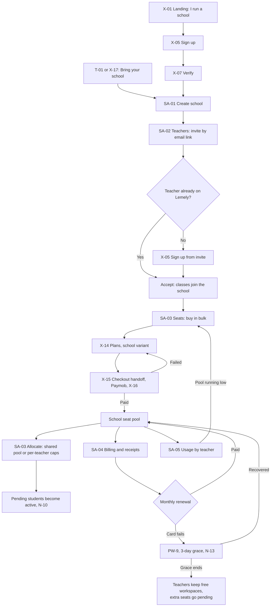

| Step | Screen | User intent | System response | States (loading, empty, error, low confidence) |
|---|---|---|---|---|
| SA1 Create school | SA-01 (PA) | Put my department or school on one bill. | Reached from a teacher's T-01 or X-17 ("Bring your school") or from X-01 "I run a school". Asks for the school name, city, a billing contact, and an optional tax registration number for receipts. The creator becomes the school's admin through a school membership and keeps their teacher role and classes. Schools get no free seats of their own, since each teacher already has a free workspace, so creating a school is not an abuse path. Emits `school_created` (phase 2). | Error: a school with the same name and city exists, which offers "Ask its admin to invite you" without revealing who that is. [repo: lemely/db/models/orgs.py (school_memberships.membership_role teacher or school_admin); lemely/db/school_provisioning_repo.py:217-236 (platform_admin only today)] [assumption: self-serve creation is new] |
| SA2 Invite teachers | SA-02 (PA, RM) | Bring colleagues in without making accounts for them. | The admin enters teacher emails, and each gets an invite link. An existing teacher accepts, and their classes, students and free workspace join the school. If they pay for seats themselves, their subscription is set to end at period end, and their seated students move to the school pool on acceptance, so nobody pays twice. A new teacher signs up through X-05 from the link. Admin-set passwords are not used: today's route creates the account with a password the admin chooses and cannot attach an existing teacher. Emits `school_teacher_invited` and `school_teacher_joined` (phase 2). | Empty: "No teachers yet. Invite the colleagues who mark the same papers." Error: the invite link expired after 7 days, with "Resend". Error: the teacher belongs to another school: "Ask them to leave that school first." [repo: lemely/db/school_admin_repo.py:192-229] [assumption: attach-existing flow is new] |
| SA3 Remove a teacher | SA-02 (TR) | Tidy up when a teacher leaves. | Removal is refused while the teacher still owns classes. The screen offers "Move 3 classes to another teacher" first, then removes. Students and their released results stay with the classes. The teacher keeps their own account and free workspace. | Error: no other teacher to move the classes to: "Invite a teacher first or keep this one." [repo: lemely/db/school_admin_repo.py:66-71 (ClassesWouldBeOrphanedError)] ⚠ Minor-data |
| SA4 Buy seats in bulk | SA-03 → X-14 school variant → X-15 → X-16 (PA, PR) | Seat every student in the school's classes at once. | Shows demand first: "142 students across 6 teachers. 60 free seats (6 × 10). 82 need a paid seat." Price: "82 seats: EGP 3,280/mo. Adds 328 papers a month to the school pool." The seat price is the teacher seat price, EGP 40 per seat per month, with no volume discount until data exists. X-15 asks for the cardholder statement, then redirects to Paymob card checkout. Cards only (D2): a school that needs a bank transfer or a purchase order cannot buy at launch. Emits `checkout_started` and `payment_succeeded`. | Loading (X-16): "Confirming with your bank". Error: the card was declined or a large single charge was refused by the bank: "Try another card, or buy fewer seats now and add more later." [repo: feat/paymob-integration:lemely/db/models/billing.py (extra_seats, extra_seat_price_minor)] [assumption: §8.1.3 seat price; A-S below; D2] |
| SA5 Allocate seats | SA-03 (RM, PA) | Make sure seats go where the students are. | By default the pool is shared: any school teacher's pending student takes a free school seat at once and gets N-10. The admin can set a per-teacher cap ("Ms Hanna: up to 40") and sees the pending count per teacher. Pool papers are shared the same way, and a per-teacher monthly paper cap is optional. Trade-off: a shared pool needs no admin work and seats students fastest (RM), while caps give control but leave students pending when one teacher hits a cap. Recommend shared by default, caps optional. Emits `school_seats_allocated` (phase 2) and `seat_state_changed` (via paid). | Empty: "All seats in use. 9 students are waiting across 2 teachers." Error: a cap is set below that teacher's active seats and is refused: "Ms Hanna has 46 active students." [assumption: allocation model is new; test pending→active time under shared vs capped] ⚠ Minor-data |
| SA6 Billing and receipts | SA-04 = X-17 school variant (PA, PR, TR) | Pay, prove payment to the bursar, and stop if needed. | Shows the subscription state, seat count, next charge date and amount, the saved card, and receipts. Each paid payment is a receipt, carrying the school name and optional tax number. Cancel keeps seats to period end. Seven days before renewal, N-15 goes to the billing contact. Whether schools need a formal tax invoice rather than a receipt is open. | Empty receipts: "No payments yet." Error: the receipt download failed: "Retry, or we'll email it." [repo: feat/paymob-integration:lemely/db/models/billing.py:588-696 (paid payment is the receipt); feat/paymob-integration:docs/superpowers/specs/2026-11-02-paymob-billing-design.md §2.5 (receipts only, no tax invoice)] [assumption A-V: accountant rules on tax invoices for school buyers] |
| SA7 Failed renewal | PW-9, N-13, N-14 (PA, PR) | Not lose the school's classes over a card problem. | The subscription goes past_due with a 3-day grace period, and the banner reads "Your card didn't go through. You have until 15 Dec." After grace, school seats lapse. Each teacher keeps their own 10 free seats, chosen oldest-first, and every other student goes leaving, then pending. Nobody is removed (D1). | Error: the payment with another card failed, and the banner stays. [repo: feat/paymob-integration:lemely/core/billing_defaults.py] [assumption: §6.10, §8.5] ⚠ Minor-data |
| SA8 Usage | SA-05 (PR, RM, PA) | See whether the school gets its money's worth and when to top up. | Per teacher: seats used of allocated, pool papers used this month, sets marked and released, median hours to release, and the open challenge count. Pool forecast: "At this pace the pool runs out on 24 Nov." with "Add seats" or "Teacher pack (EGP 399, 50 papers)". Aggregates only: the admin sees counts, never student names, scripts or marks. Students' data stays with their teachers. | Loading: skeleton table. Empty: "Usage shows after the first marked set." Low confidence: the forecast after fewer than 7 days of data reads "Early estimate". [assumption: least-privilege scope for minors; counsel A-L] ⚠ Minor-data |
| SA9 Students in school classes | X-23 only (TR) | (Admin) get students in. (Student) join safely. | Students join school classes only through the teacher's link or code (X-23), so date of birth, guardian consent for under-15s (X-08/X-09) and the student's own terms acceptance all apply. Today's admin-created student accounts with a temporary password are retired. Trade-off: bulk-created accounts are faster for a school (RM), but skip consent and put a password the admin knows on a minor's account (TR, legal). Recommend retiring them. | Error: under-15 student without consent sees X-08 "Ask a parent to say yes", and the seat stays pending-consent. [repo: lemely/db/seat_repo.py:187-199] [source: https://www.tamimi.com/our-knowledge/publications/general/Articles/from-policy-to-practice-egypt-issues-executive-regulations-of-the-personal-data-protection-law/] [source: https://www.insideprivacy.com/childrens-privacy/ftc-announces-coppa-settlement-against-ed-tech-provider-including-strict-data-minimization-and-data-retention-requirements/] ⚠ Minor-data |

Assumption A-S (school payment rail): card-only checkout (D2) may not fit schools that pay by bank transfer against an invoice or a purchase order. D2 is not reopened here. Test it by counting SA-03 exits after the price screen and any "we pay by transfer" requests to support. If schools stall, the first fallback is an OPS-06 manual activation after an offline payment, since manually activated subscriptions already exist in the data model [repo: lemely/db/models/billing.py:50-90 (is_manually_activated)] [assumption: owner decides after phase-2 data].

### 5.3 Student

The path runs anonymous first paper → claim → verify → home, then a loop of scan → result → next paper, with class join, challenge and payment branching off it. Every step keeps a staged script safe and never charges for a failed run [assumption: D3, D4; see §8.3 rules].

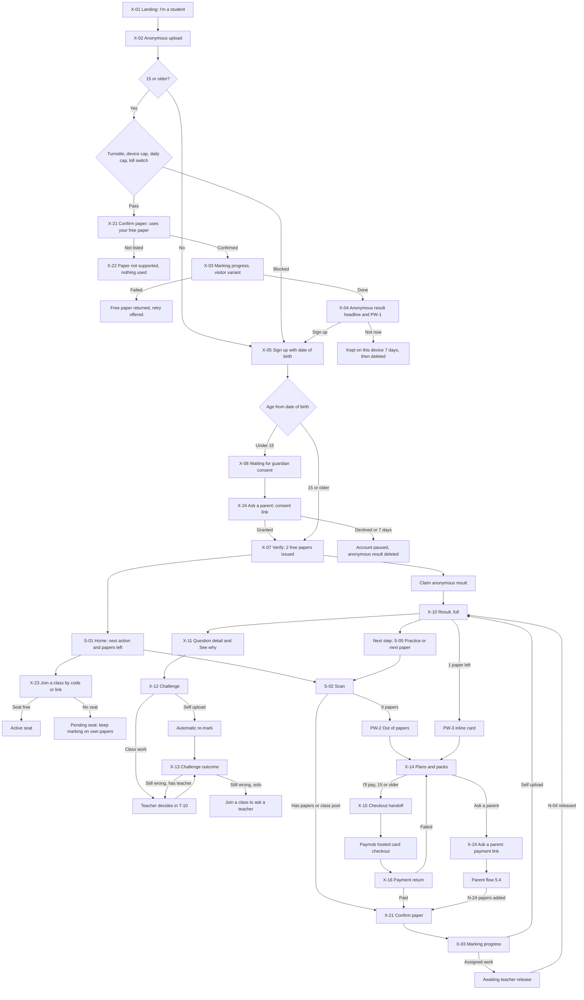

| Step | Screen | User intent | System response | States (loading, empty, error, low confidence) |
|---|---|---|---|---|
| S1 | X-01 Landing (PA) | "Will this work on my paper?" | Role-first entry. The student CTA reads "Mark a paper free. No account needed." and leads to X-02. Any claim carries its denominator, e.g. "within 1 mark on 98.6% of marked answers, 5 Physics scripts" [repo: BUILD/accuracy-runs/claude-c-2026-10-26-live3/FLIP.md:35-37]. The current unsourced figures are not reused [repo: docs/superpowers/specs/2026-10-28-brand-landing-page-design.md:7,18]. | Loading: static page. Error: none expected. Empty and low confidence: n/a. |
| S2 | X-02 Anonymous upload (PA, PR) ⚠ Minor-data | Upload my script without handing over details | The order is: subject (0580 / 0606 / 0625), then "Are you 15 or older?", then a data notice naming the providers ("Your pages are read by our AI providers (Anthropic, Google) and deleted after marking"), then "Leave your name off the cover", then Turnstile, then camera or file. The only data stored is the script, the subject and a device token [repo: origin/main:lemely/web/turnstile.py; web/src/portals/marketing/dataHandling.ts:108] (§8.2). | Loading: Turnstile spinner with a text label. Error: camera denied falls back to the file picker. Over 25 MiB or 40 pages gets "That's a lot of pages. Upload one paper at a time." [repo: lemely/io/_scan_common.py:63]. Blocked by device cap: "Your free paper on this device is used. Create an account for 2 more." Blocked by daily cap: the §8.2 copy. Kill switch: "Free marking is paused for a bit. Check back later today." [assumption: kill switch also pauses allowance papers, §8.2]. Each block fires `anon_upload_blocked` with its reason. |
| S3 | X-02 → X-05 (PA) ⚠ Minor-data | "I'm 14 but I want to try" | Answering "No" accepts no script. The screen says "Under 15? A parent says yes first. Make your account, then send them a link." and opens X-05 in student mode. The threshold is under 15 because Egypt's PDPL executive regulations, as reported, require written guardian consent below that age [source: https://www.tamimi.com/our-knowledge/publications/general/Articles/from-policy-to-practice-egypt-issues-executive-regulations-of-the-personal-data-protection-law/]. Students run 14-18, so this reaches real users [repo: docs/LEMELY_UI_SPEC.md:33]. | Age is self-declared [assumption A-L: counsel confirms that self-declaration plus online consent suffices]. No other states. |
| S4 | X-21 Confirm paper (TR, PR) | Make sure it marks against the right paper | Shows the detected identity: "0625 Paper 42, May/June 2025, right?" plus "Uses your free paper". Options are Yes, Change and "Not listed". Nothing is charged before confirmation [repo: lemely/web/routers/student.py:831-871] (§7.6). | Loading: "Reading your cover page…", announced through a live region. Error: an unreadable cover opens the manual picker (syllabus, session, paper, variant) with nothing preselected [assumption: no guessed default; measure `paper_confirmed.changed`]. "Not listed" goes to X-22. A visitor's notify-me option reads "Create an account and we'll tell you when it's added". |
| S5 | X-03 Marking progress, visitor variant (RM, TR) | Know it's working and how long it takes | Shows stages as text steps. Copy: "Long papers take several minutes. Keep this tab, or come back on this device within 7 days." A visitor gets no notifications [assumption: see §6.12 last line]. The job survives a disconnect [repo: lemely/web/routers/student.py:750-825]. | Loading: stage list with the current stage announced. Queued: "You're in the queue." The 300 s timeout is shorter than a 371-442 s run [repo: .github/workflows/deploy.yml:339; BUILD/accuracy-runs/claude-e2e2-0625-w24-41-enh1/COST.md:143-161], so the client polls and never re-POSTs [repo: web/src/portals/student/screens/CorrectPaper.tsx:542-548]. Failed: "That one didn't finish. Your free paper is back." with Retry. Unreadable pages: "Pages 3 and 7 are blurry. Retake just those." |
| S6 | X-04 Anonymous result + PW-1 (PA, TR) | See whether it's any good before signing up | Shows the full headline only (T6): score, grade with provenance, band counts and the top weak topic. Example: "52/80. Grade B on the Jun 2025 boundary. We're sure about 19 of 21 answers; 2 are close calls. Waves cost you the most." Then PW-1: "Save it and see every mark: create a free account. You get 2 more papers." The claim-expiry date is shown in the page [repo: lemely/core/analytics.py:118-173] (§8.1.6 T6, §8.3 PW-1). | Low confidence: the band counts include "Not sure" items, with "See which ones and challenge for free after you sign up". Not marked is shown neutrally ("3 left blank"). Empty: if no question could be marked, the run counts as failed and the paper is returned [assumption: test the rate with `marking_failed.reason=unreadable`]. Error: on reload from the same device the result is re-fetched by device token; with the cookie gone it shows "This result was saved on the device you used." |
| S7 | X-05 Sign up, student (PA) ⚠ Minor-data | Save my result and get more papers | Asks for first name, date of birth, email and a password. Phone and Google sign-in are later (B-13). The date of birth sets the consent path. It is stored on the account, and events carry `age_band` only [assumption: see §3.7]. An existing account signs in on X-06 and the claim still applies. | Error: "We couldn't send your code. Try again in a minute." Verification mail shares Resend's 100-a-day quota [repo: lemely/runtime/config.py:1244-1252]. The allow-list gate on main and develop must be lifted for public signup [repo: origin/main:lemely/core/access.py; origin/develop:lemely/core/access.py]. Conflict: an X-02 "15 or older" answer with a date of birth under 15 goes to S8 with the anonymous result held (§8.2). |
| S8 | X-08 Waiting for guardian consent (PA, TR) ⚠ Minor-data | Get going while under 15 | Copy: "Ask a parent to say yes. We won't read any of your pages until they do." It opens X-24 with purpose consent. While waiting, the student can set up S-07 and join a class (S12) [assumption: see §6.11]. | Waiting: shows when the link was sent, plus Resend link. Expired (7 days): "That link timed out. Send a fresh one." Declined: "Your parent said not yet. Your account is paused and nothing of yours is processed." with Delete account. A held anonymous result is deleted at its 7-day deadline if consent has not arrived [assumption A-R]. |
| S9 | X-07 Verify → claim (PA) | Finish signup and get my full result | The code check issues the 2 free papers and moves the anonymous submission into the account. Copy: "Saved. 2 papers left." Then the full X-10 opens. Fires `anon_result_claimed` [assumption: see §8.1.3, §8.2 Claim]. | Error, claim not found (cookie cleared, another device, or past 7 days): "We couldn't find your free paper on this device. Your 2 papers are ready." Code wrong or expired: inline message and Resend. |
| S10 | S-07 Exam plan (RM, PA) | Tell it what I'm aiming for | Optional and skippable: session, target grade, subjects. It feeds the S-01 next action and the papers-needed line ("8 papers to go before May/June") [repo: docs/strategy/2026-11-16-new-user-flows.md:86]. | Empty: skipping leaves S-01 suggesting "Mark another past paper". Error: save retries quietly and keeps the input. |
| S11 | S-01 Home (RM, PA) | What should I do now? | Shows one next action (an assigned paper first, then the exam-plan paper), a papers-left meter ("2 papers left", visible at all times, D3), released results, a pending-seat banner and a consent banner [assumption: see §10.8]. | Empty first run: a three-step walkthrough ending at "Mark your first paper". Balance 1: PW-4 nudge "1 paper left. Season pack covers 30." Balance 0: the meter reads "0 papers left" with a "Get papers" link. Loading: placeholder rows. Offline: queued scans listed as "Waiting for signal". |
| S12 | X-23 Join a class (RM, PA) ⚠ Minor-data | Join my teacher's class | The student enters a code or opens a link and sees the teacher's name, the class, and what the teacher will see: "Papers you mark for this class, plus any you choose to share. Not your other papers." Confirm. The result is an active or pending seat [assumption: see §7.6 Visibility, §6.10]. | Pending: "You're in Ms Hanna's class and waiting for a seat. Keep marking on your own papers meanwhile." Seat granted: N-10. Wrong or rotated code: "That code has changed. Ask your teacher for the new one." [repo: lemely/db/class_repo.py:505,930]. Under 15 without consent: joined, and the class shows "Waiting for parent consent" (§6.2) [assumption A-L]. |
| S13 | S-02 Scan (RM, PA) | Mark another paper | The balance is checked before the camera opens (PW-2). If assignments are open: "Is this for Ms Hanna's assignment?" Inputs are camera, file or share target [repo: web/src/portals/student/screens/CorrectPaper.tsx] (§8.3 PW-2). | Balance 0 on a self upload: PW-2 opens before capture. A script that arrived through the share target stays staged on the device and is never uploaded unpaid. Offline: queued. Camera denied: file picker. Pending seat: assigned papers show "Waiting for a seat" with "Mark it now with 1 of your papers" (§6.2); self upload works as normal. |
| S14 | X-21 Confirm paper, signed in (TR, PR) | Check it's the right paper and what it costs | Self upload: "Uses 1 paper. 1 left after." Assigned: "Uses your class's papers." [assumption: see §8.1.5 rule 3]. | Class pool empty: "Your class is out of papers. Use 1 of yours instead?" It is never charged silently [assumption: see §8.1.5 rule 4]. Not listed: X-22 with notify-me, then N-26 later. |
| S15 | X-03 Marking progress (RM, TR) | Leave and come back | Copy: "Safe to leave, we'll tell you." Completion sends N-01, or N-04 when released. A failure sends N-02 and returns the paper [assumption: see §6.12, §7.6]. | Same states as S5, with Retry and no automatic re-POST. A failure fires `marking_failed` with its reason. |
| S16 | X-10 Result (TR, RM) | See how I did and what to fix | Self upload: released at once. Shows score, grade with provenance, band summary, weak topics, one next step and the per-question list. Copy: "52/80, Grade B on the Jun 2025 boundary. Waves cost you 9 marks; that's your next win." Assigned: "Marked. Ms Hanna releases this set." with no marks until N-04 [repo: PRODUCT.md:96-104] (§2.6, §7.6). | Low confidence: summary "We're sure about 19 of 21. 2 are close calls, tap to see why." filters the list to Check and Low rows. Low rows carry "Not sure" plus icon and text, with Challenge as the row's primary action [assumption: see §2.6]. Not marked: neutral "Left blank" or "We couldn't read this". Error: "Couldn't load your result. Try again." The result is never lost. |
| S17 | X-11 Question detail (TR) | Understand why I lost marks | Shows marks, band, "See why" (a paraphrased criterion plus the student's own quoted words), feedback and change history. Question-paper and mark-scheme text is never shown, and `expected_answer` is never rendered verbatim [repo: lemely/core/schemas.py:317-493; corpus/README.md:3-10]. | Not marked: "We couldn't read this. Challenge it and we'll look again." Empty history: "No changes." Error: retry. |
| S18 | X-12 Challenge (TR) | "That mark is wrong" | Reason field (20 characters minimum, 40 for High or Check), the notice "Marks can go up or down", the route ("Automatic re-mark" for self uploads, "Goes to Ms Hanna" for class work) and a "1 of 3 on this paper" counter. Always free [repo: .impeccable/mocks/student-r1/student.js:22,36] (§2.2). | Error: a reason that is too short gets an inline count. The cap reached: "You've used 3 challenges on this paper." Submitting: the button is disabled and labelled. Offline: the draft is kept on the device. |
| S19 | X-13 Challenge outcome (TR) | Find out what happened | Every outcome sends N-07, and any change also sends N-05 (to linked parents too). Shows upheld, raised or lowered with a paraphrased reason and the new total and grade [assumption: see §7.6]. "Still wrong?" leads to the teacher for a student who has one. For a solo student the automatic re-mark is final (D4), and the screen offers "Join a class to ask a teacher". | Loading: "Re-marking question 4…". Error: a re-mark that fails stays open and goes to OPS-08; the student sees "Taking longer than usual. We'll tell you." Class challenge unanswered after 7 days: "Waiting for Ms Hanna since 3 Nov" with "Get a re-mark now" (§7.10.3) [assumption: measure `challenge_resolved.hours_to_resolve`]. |
| S20 | S-05 Practice / S-04 Progress (RM) | Fix the weak topic, then prove it | The next step on X-10 is a weak-topic practice set (free) ending in "Mark a paper to see the change", or the next exam-plan paper. Progress shows marks lost by topic and an "estimated" grade forecast [repo: lemely/core/analytics.py:166-168] (§10.8). | Empty: "Mark 2 papers to see a trend." Missing coverage: the question bank is measured for 0625 only, so 0580 and 0606 fall back to a paper suggestion [repo: lemely/db/question_bank_repo.py:60-85]. Balance ≤ 1: PW-3 inline card under the next step. |
| S21 | X-14 Plans and packs, student (PA, PR) ⚠ Minor-data | Get more papers | The Season pack (449 / 30 papers) is highlighted for under-18s, with the Try pack (99 / 5) beside it. Monthly (249 / 20) shows only to 18+ self-payers, where it is listed first (T5). Payer choice is "I'll pay" or "Ask a parent". Under 15 sees only "Ask a parent". The staged script is kept [assumption: see §8.1.3, §8.1.6 T5, §6.11 Minors paying]. | 15-17 choosing "I'll pay": "Use a card you're allowed to use, or ask a parent." No card: "No card? Ask a parent, or use a prepaid card." Logged for A-W [assumption: see §8.1.6 T1]. Error loading prices: retry, and the staged script stays safe. |
| S22 | X-15 Checkout handoff (PA) | Pay safely | Order summary in papers and EGP: "Season pack: 30 papers, EGP 449, use within 12 months, doesn't renew". Then the phone number, the cardholder statement (§8.4.0), and a redirect to Paymob hosted card checkout. Cards only (D2) [repo: feat/paymob-integration:docs/superpowers/specs/2026-11-02-paymob-billing-design.md §2.1; feat/paymob-integration:web/src/routes.tsx:392]. | Error: invalid phone gets inline help. Checkout fails to open (Paymob outage returns 503): "Checkout didn't open. Nothing was charged." [repo: feat/paymob-integration:docs/superpowers/specs/2026-11-02-paymob-billing-design.md §6 (Paymob outage)]. Loading: "Opening secure checkout…". |
| S23 | X-16 Payment return (PA, TR) | Know it worked and get back to my paper | Polls the payment. Paid: "30 papers added. Mark your staged paper now?" leading to X-21. Receipt N-12 [assumption: see §10.8 X-16]. | Pending: "Your bank is still confirming. Safe to leave; your papers land the moment it clears." Failed: plain reason plus "Try another card" or "Ask a parent", firing `payment_failed` with its reason [assumption A-W]. Loading: polling with a live-region update. |
| S24 | X-24 Ask a parent, payment (PA) ⚠ Minor-data | Get my parent to pay | Opens a prefilled WhatsApp, SMS or copy-link message: "Can you add 30 papers to my Lemely? It's EGP 449, one payment." Before sending, the student previews exactly what the parent's page shows before linking: first name, the ask and papers marked so far. The link expires in 7 days and can be revoked in S-08 [repo: docs/strategy/2026-11-16-new-user-flows.md:209-214] (§6.11). | Sent: S-01 shows "Asked on 12 Nov. Remind them?" Paid by the parent: N-24 and the staged script resumes. Expired: "Send a fresh link." No results yet (consent path): the preview shows only the consent explanation. Fires `parent_ask_sent`. |

Notes:
- **Free allowance after signup.** 2 papers, one-time, shown on S-01, S-02, X-21 and X-10 as "N papers left". There is no monthly refill at launch (T3). Free cost per acquired student is EGP 15.40 worst case [assumption: §8.1.3-§8.1.4, A-P].
- **Cost and abuse trade-off (D3).** The anonymous paper raises PA through an early value moment and costs up to EGP 5.13 per visitor. The USD 5 daily cap bounds the worst day, and the device and network cap bounds repeats. Recommend keeping the guards as in §8.2 and watching `anon_upload_blocked` against `anon_result_claimed` [assumption: tune the cap after 14 days of data].
- **Accessibility from 320px.** Each step is one column with one primary action. Camera capture always has a file fallback. Progress and payment polling use a polite live region. Bands use icon plus word [repo: PRODUCT.md:137-147] (§2.6 rule 6).

### 5.4 Parent

A parent arrives from a child's link, whether it was sent for payment, consent or linking. They sign up and are linked automatically, consent if the child is under 15, then fund the child and come back through the weekly digest. Every parent screen touches minor data ⚠ Minor-data [assumption: see §10.8, §6.11].

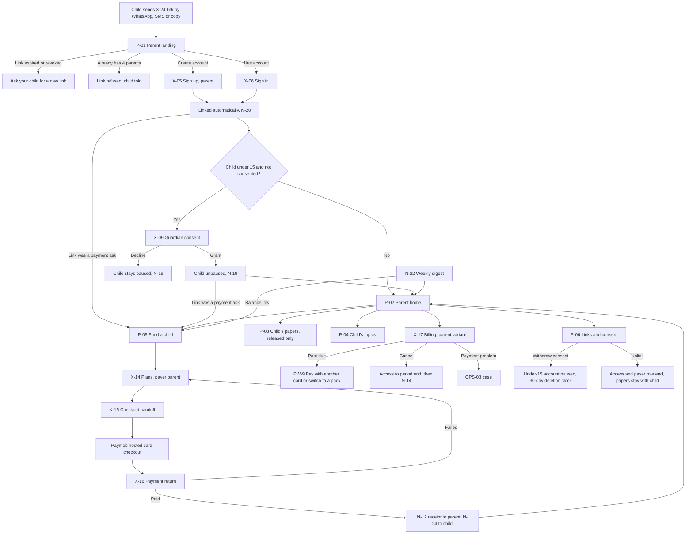

| Step | Screen | User intent | System response | States (loading, empty, error, low confidence) |
|---|---|---|---|---|
| P1 | X-24 message, outside the app (PA) ⚠ Minor-data | "My child is asking me for something" | The child's prefilled message and link (S24). The link holds a single-purpose child link code: payment, consent or link [repo: lemely/db/invite_repo.py:395-511] (§6.11). | n/a (WhatsApp or SMS). |
| P2 | P-01 Parent landing (PA) ⚠ Minor-data | See what my child is doing before I commit | Before linking it shows only what the child previewed in S24: "Omar asked you to add papers to Lemely. He's marked 4 papers so far." Then "Create a parent account" or "Sign in". Once the account is linked, the parent voice takes over: "Omar marked his 0625 Physics paper: Grade B on the Jun 2025 boundary. Two topics need attention: waves and electricity." [repo: PRODUCT.md:96-104; docs/strategy/2026-11-16-new-user-flows.md:212-214]. Trade-off: a forwarded link shows a minor's summary to whoever holds it (TR, privacy) against a real-progress landing (PA). Recommend the minimal pre-link view, a 7-day expiry and revocation from S-08 [assumption: counsel; test `parent_ask_sent` → `signup_completed`]. | Consent-purpose link for an under-15 child: no results exist, so the page explains what consent covers instead. Expired or revoked: "This link has expired. Ask Omar to send a new one." Four parents already linked: "Omar already has 4 parents linked." [repo: lemely/db/parent_repo.py:66]. Loading: placeholder for the summary. |
| P3 | X-05 Sign up, parent / X-06 Sign in (PA) ⚠ Minor-data | Make an account quickly | Asks for name, email, password, and an 18+ confirmation. On submit the parent is linked to the child automatically, with no code entry, and N-20 goes to both [repo: lemely/web/routers/auth.py:500-507 (parent signup stamps terms and auto-verifies email today)] (§6.11 invited→linked). | Error: the email is already a student or teacher account: "This email belongs to another account type. Use a different one." [assumption: test against role rules in lemely/web/routers/auth.py:93]. Code not sent: retry (Resend quota) [repo: lemely/runtime/config.py:1244-1252]. |
| P4 | X-09 Guardian consent (PA, TR) ⚠ Minor-data | Decide what Lemely may do with my child's work | Shown only for an under-15 child. It covers, in plain words: what is processed (photos of answer pages, marks, feedback), who sees it (the child, linked parents, and teachers of classes the child joins, for class work only), how long it is kept, which providers read pages (Anthropic, Google), and that consent can be withdrawn any time in P-06. Grant or Decline. The record holds timestamp, scope and policy version [repo: lemely/runtime/config.py:174-184] (§6.11). | Declined: "Omar's account stays paused. Nothing of his is processed." with the option "Delete Omar's account". Child aged 15-17: the screen is skipped and P-06 shows "Omar is 16 and manages his own consent." Error: the grant fails to save, retry, and the child stays paused until it saves [assumption A-L: counsel on whether online consent counts as "written"]. |
| P5 | P-02 Parent home (RM, PA) ⚠ Minor-data | Is my child on track? | Child switcher, an on-track sentence ("Omar is on track for a B in Physics. Two topics need attention this month."), the next session, papers left and recent released results [repo: PRODUCT.md:96-104] (§10.8). | Empty: "Omar hasn't marked a paper since you joined. When he does, you'll see it here." Low balance: N-11 banner "Omar has 1 paper left" with a link to "Top up". Paused child: "Waiting for your consent" or "Paused". Loading: placeholder lines. |
| P6 | P-05 Fund a child → X-14 parent variant (PA, PR) ⚠ Minor-data | Buy papers for my child | Season pack highlighted (T5), Try pack, and Monthly (allowed, because the parent is the payer). Payer is the parent and beneficiary is the child [repo: feat/paymob-integration:lemely/db/models/billing.py (payer_user_id, beneficiary_user_id)] (§8.1.3 Parent purchase). | Child already on Monthly: Monthly is disabled with "Omar already has Monthly. Add a pack for extra papers." (one live subscription per child) [repo: feat/paymob-integration:docs/superpowers/specs/2026-11-02-paymob-billing-design.md §2.7-2.8]. No card: "No card? A prepaid or debit card may work." [assumption A-W]. Error loading prices: retry. |
| P7 | X-15 → Paymob → X-16 (PA, TR) | Pay and know it landed | Order summary in papers ("30 papers for Omar, EGP 449, use within 12 months, doesn't renew" or "20 papers every 30 days, EGP 249, cancel any time"), phone, redirect to hosted card checkout, return and poll [repo: feat/paymob-integration:web/src/routes.tsx:392] (§8.1.3). | Paid: "Done. 30 papers added for Omar." N-12 goes to the parent and N-24 to the child. Pending: "Your bank is still confirming. We'll email the receipt." Failed: plain reason, Try again or Use another card. Payment mismatch: the parent is told "We're checking this payment" and it goes to OPS-03 with no grant [repo: feat/paymob-integration:docs/superpowers/specs/2026-11-02-paymob-billing-design.md (failed_mismatch)]. |
| P8 | P-03 Child's papers, X-10 parent variant (TR) ⚠ Minor-data | See the actual result | Released results only, read-only: score, grade with provenance, weak topics, and the band summary in parent words ("We're sure about 19 of 21 answers. 2 were close calls."). Mark changes show with their reason. Parents do not challenge; the student does [assumption: see §2.6, §7.6 Visibility]. | Awaiting release: "Marked. Ms Hanna releases this set." with no marks. Low confidence: "Not sure" rows carry the word and icon, plus "Omar can challenge this for free". Empty: "No released papers yet." Error: retry. |
| P9 | P-04 Child's topics (RM) ⚠ Minor-data | Know what to help with | Weak topics ranked by marks lost, with the trend across papers [assumption: see §10.8]. | Empty: "Needs 2 marked papers to show a trend." Loading: placeholder. |
| P10 | N-22 Weekly digest email (RM, PA) ⚠ Minor-data | Keep up without logging in | Sent weekly when there is activity or a balance ≤ 1: papers marked, trend, next session, papers left. When the balance is low it adds a one-tap "Top up Omar's papers" link to P-05 [repo: docs/strategy/2026-11-16-new-user-flows.md:218-220] (§6.12 N-22). | No activity and balance > 1: not sent. Email quota: the digest is lowest priority under the shared Resend cap [repo: lemely/runtime/config.py:1244-1252] [assumption: move the digest to a paid sender before volume]. Opt-out in X-19. |
| P11 | X-17 Billing, parent variant (PA, PR) | Manage what I pay for | Per child: papers left by source, subscription state and renewal date, receipts, saved card, Cancel (keeps access to period end), and "Problem with this payment", which opens an OPS-03 case [repo: feat/paymob-integration:web/src/portals/billing/ParentBilling.tsx] (§8.5). | Past due: PW-9 "Your card didn't go through. You have until 19 Nov." with "Pay with another card" or "Switch to a pack" [assumption: see §8.3 PW-9]. Renewal reminder N-15. Price change N-16. Cancelled: "Monthly ends 30 Nov. Omar keeps his papers until then." Empty receipts: "No payments yet." |
| P12 | P-06 Links and consent (TR) ⚠ Minor-data | Change or stop what I agreed to | Lists linked children with consent status, Withdraw consent and Unlink, each with a confirm that states the effect [assumption: see §6.11]. | Withdraw (under 15): "Omar's account pauses. His work is kept read-only for 30 days, then deleted unless you say yes again." [assumption A-R]. Unlink: "You'll lose access and stop paying for Omar. Papers you bought stay his." An under-15 child's only consenting guardian sees a warning that unlinking also pauses the child. Error: retry, with no state change until the server confirms. |

Notes:
- **Card-only (D2).** Parents in Egypt often pay by wallet, and wallets are not on offer at launch. The Season and Try packs are one-off card buys that a debit, prepaid or relative's card can cover. Measure no-card exits on X-14 and `payment_failed` reasons; wallets for packs are the first addition if those exits are material [assumption: A-W; see §8.1.6 T1].
- **Parent nav.** P-02 home plus Billing and Settings; each notification deep-links to its screen [repo: docs/strategy/2026-11-16-new-user-flows.md:222-224].
- **Accessibility from 320px.** Single column. Child names and grades are text, not charts alone. The trend has a text summary [repo: PRODUCT.md:137-147].

### 5.5 Platform admin

Lemely ops is the sole owner, working on desktop. The loop is reactive: an alert or a daily check opens one OPS screen, and every action needs a reason and is written to `admin_audit_log` [repo: feat/paymob-integration:docs/superpowers/specs/2026-11-02-paymob-billing-design.md §4.7]. Ops never browses a student's papers. The one exception is OPS-08, which shows the answer crop of a failed re-mark, with no name [repo: lemely/db/class_repo.py:840-858 (no super-role bypass today)].

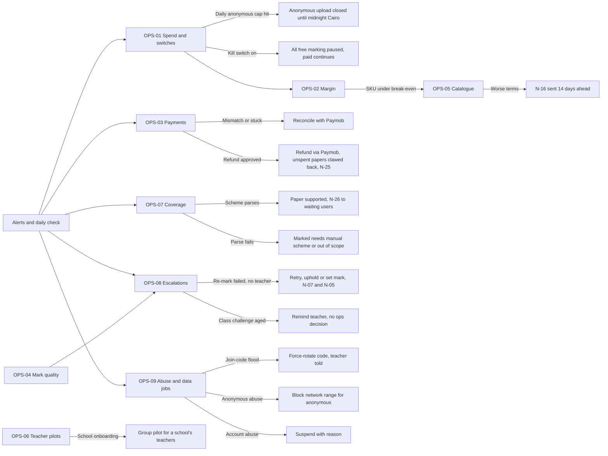

| Step | Screen | User intent | System response | States (loading, empty, error, low confidence) |
|---|---|---|---|---|
| O1 | OPS-01 Spend and switches (PR) | Know free marking is not burning money | Shows today's anonymous LLM spend against the USD 5 cap, today's free-allowance spend, the kill switch and both enforcement flags (OFF at merge, D5) [repo: feat/paymob-integration:lemely/runtime/config.py:1263,1296] (§8.1.5 rule 6, §8.2). | Precondition: per-upload cost is computed but not persisted, so the cap is not enforceable until `cost_usd` is stored [repo: lemely/web/routers/student.py:1053]. Cap hit: X-02 closes to visitors until midnight Cairo and ops gets an email [assumption: alert channel]. Empty: "No anonymous papers today." |
| O2 | OPS-01 kill switch (PR, TR) | Stop free spend now | The toggle requires a reason. It pauses new anonymous and allowance marking; paid, pack and class-pool marking continue, and running jobs finish [assumption: see §8.2 Platform kill switch]. | Users see the X-02 paused copy (S2), and signed-in free users see "Free papers are paused for a bit. Paid papers still work." on S-02 [assumption: test with the §12.5 Kill switch check]. Error: if the toggle fails to save, the state shown stays unchanged. |
| O3 | OPS-02 Margin (PR) | Is each paper profitable? | Revenue per paper against `cost_usd` per paper, by SKU and origin, with p50 and p95 cost and free cost per signup [repo: feat/paymob-integration:lemely/db/admin_margin_repo.py] (§3.7 PR metric). | Empty until the first 100 papers [assumption A-C]. Warning row when a SKU's measured papers per purchase pass break-even (§8.1.4), or p95 cost passes the long-script cliff [repo: lemely/runtime/config.py:276]. |
| O4 | OPS-05 Catalogue (PA, PR) | Change a price or allowance | Edits SKUs, prices, pool sizes, free allowance and pilot length. A worse term schedules N-16 14 days ahead [repo: feat/paymob-integration:lemely/db/admin_billing_repo.py] (§6.12 N-16). | Error: a price edit on a tier with live subscribers is refused until the branch's P07-T16 lands [repo: .claude/worktrees/paymob-integration/.superpowers/sdd/progress.md (git-excluded, worktree only)]. |
| O5 | OPS-03 Payments (PA, TR) | Fix stuck or wrong payments | Problem queue: amount mismatch (`failed_mismatch`, no grant), pending over 1 h, missing callbacks, HMAC failures. Actions: reconcile, void [repo: feat/paymob-integration:docs/superpowers/specs/2026-11-02-paymob-billing-design.md §6; feat/paymob-integration:web/src/portals/admin/screens/billing/Payments.tsx]. | Empty: "No payment problems." Error: a Paymob inquiry failing shows "Paymob didn't answer. Retry or check the dashboard." Our own refund row is written before the call, because Paymob has no idempotency keys [repo: feat/paymob-integration:docs/superpowers/specs/2026-11-02-paymob-billing-design.md ("No idempotency keys at Paymob")]. |
| O6 | OPS-03 Refund (PA, TR) | Resolve a payer's refund request | Requests come from X-17 "Problem with this payment". A refund goes through the Paymob refund API with a reason. A pack claws back unspent papers only, and a subscription refund stops renewal. The payer gets N-25 [repo: feat/paymob-integration:docs/superpowers/specs/2026-11-02-paymob-billing-design.md §6; feat/paymob-integration:web/src/portals/admin/screens/billing/PaymentActions.tsx]. Default policy is no cash refunds except for duplicate charges, mismatches and service failure [assumption: counsel on Egyptian consumer refund rights, spec §10]. | Partial refund: shows the papers kept and clawed back. A child's spent papers are never removed. Error: a failed Paymob refund stays in the queue marked failed and nothing changes in the ledger. |
| O7 | OPS-07 Coverage (TR, PR) | Make more papers markable | A queue grouped by paper identity, with request counts from X-22 notify-me, `marking_failed` reason `no_scheme` and `paper_confirmed` "not listed". Actions: add the scheme through the deterministic parse ($0), or mark it out of scope. Users waiting on the paper get N-26 [repo: lemely/web/routers/teacher.py:1413-1447; corpus/manifest.json (289 of 479 parsed)] (§3.7). Scheme files stay internal and are never shown to users [repo: corpus/README.md:3-10]. | Parse fails: stays "Needs manual scheme". The Gemini fallback ($0.09-0.17 per parse, n=1) runs only on an explicit ops choice [repo: BUILD/accuracy-runs/e2e-0625-w24-41-2026-10-19/COST.md:18-20]. Empty: "No unsupported requests." Out-of-scope syllabus: "Not planned" with no notification. |
| O8 | OPS-04 Mark quality (TR) | Spot where marking is going wrong | Challenge rate per 100 questions, change rate, override rate and re-mark cost, by subject and band. Also class challenges aged over 7 days [assumption: see §3.7 TR metrics]. | Empty until data exists, labelled "Calibrated for 0625 only" [repo: lemely/core/schemas.py:76-80]. Low confidence: a High-band change rate above Check is a calibration alarm [assumption: threshold set after first 500 questions]. |
| O9 | OPS-08 Escalations (TR) ⚠ Minor-data | Unstick challenges no teacher can answer | Items: re-marks that failed twice on a solo self-upload, and class challenges aged over 7 days (view and remind only, because the class mark stays the teacher's). For a failed re-mark ops sees the answer's page crop, the paraphrased criterion and both marks, with no name. Ops retries the re-mark, or upholds or sets a mark with a note, which sends N-07 and, on change, N-05. Every view is logged [assumption: new; §7.6]. Trade-off: an opt-in human review for every solo student who still disagrees would raise TR for solo students, but it costs the sole owner's time and opens a wider minor-data access path, and D4 already names the automatic re-mark as the solo route. Recommend failures only in v1; the opt-in review is open question Q13 [assumption: count re-mark failures and X-13 "Still wrong?" taps per week]. | Empty: "Nothing waiting." Backlog: the student still sees "Taking longer than usual", never a promised date. Error: the crop fails to load, so the item is skipped and kept. |
| O10 | OPS-09 Abuse (PR, TR) ⚠ Minor-data | Stop misuse without reading students' work | Signals: `anon_upload_blocked` spikes by network range, repeated device tokens, join-code floods (pending seats spiking in one class), repeated payment failures on one account. Actions: block a network range for anonymous uploads, force-rotate a join code (teacher notified), suspend an account with a reason [repo: lemely/db/class_repo.py:505,930 (codes never rotate today)] (§3.7). Ops sees counts and IDs, not script content. | Empty: "No signals today." False positive: a suspension is reversible, and the user sees "Your account is on hold. Contact us." Error: an action that fails leaves the prior state. |
| O11 | OPS-09 Data jobs (TR) ⚠ Minor-data | Know deletions actually happen | Status of the 7-day anonymous deletion, the 30-day deletion after consent withdrawal, and account deletions after the restore window [repo: lemely/core/deletion.py:16] (§8.2 Retention, §6.11). The uploads bucket deletes at 90 days today, so anonymous scans need a shorter rule [repo: docs/deployment.md:139]. | Error: a failed job alerts ops by email and lists the overdue item IDs. Empty: "All jobs on time." |
| O12 | OPS-06 Teacher pilots and school onboarding (PA) | Start a teacher or a school's teachers | Activate or extend a 60-day pilot: a priced teacher tier with 30 included seats, activated as a complimentary subscription so nothing is charged. A zero-price tier cannot be activated [repo: feat/paymob-integration:lemely/db/admin_customer_repo.py:846-849]. School onboarding creates pilots for several teachers at once, tagged with a school name. No school_admin account is created [repo: feat/paymob-integration:lemely/db/teacher_team_repo.py:1059] (§10.8 Cut). Trade-off: skipping school_admin keeps billing in one model (PR, simplicity) but leaves heads of department without a cross-class view. Recommend group pilots until a school asks to be billed as one [repo: feat/paymob-integration:lemely/db/class_repo.py:706-709 (school classes bypass billing)] [assumption: count schools requesting it]. | Pilot ending: N-17 at 7 days and on day 60, with T-12 for the teacher. Error: a teacher email that doesn't exist yet gets "No account. Send them the teacher signup link." Empty: "No active pilots." |

Notes:
- **Escalation scope.** Low-confidence items on solo self uploads do not go to ops. The student sees "Not sure" and can challenge for free, and only a failed re-mark reaches OPS-08. This keeps ops load bounded and avoids a reviewer promise ops cannot keep [repo: lemely/db/review_repo.py:373-381 (solo students have no reviewer today)] (§2.6 rule 2).
- **Accessibility.** OPS screens are desktop-dense but keyboard-operable. Tables have text status, not colour alone [repo: PRODUCT.md:137-147].

## 6. Cross-role handoffs

A handoff is any moment where one role's action changes what another role sees or can do. Each one names who starts it, what consent applies, which screens and notifications carry it, and what the receiving role sees.

### 6.1 Handoff map

| # | From → to | What moves | Who starts it | Consent / gate | Screens | Notification | Goals | Basis |
|---|---|---|---|---|---|---|---|---|
| H1 | Teacher → student | Class membership and seat | Teacher shares link; student joins | Student confirms what the teacher will see. ⚠ Minor-data | T-07, X-23, T-08 | N-09, N-10 | RM, PA | [repo: lemely/db/class_repo.py:636-677 (join today)] [assumption: seat states per D1] |
| H2 | Teacher → student | Class-set result | Teacher uploads, matches, releases | Student account claimed by the teacher (§6.3); under-15 needs consent first. ⚠ Minor-data | T-02, T-03, T-04, X-10 | N-03, N-04 | RM, TR | [assumption: roster placeholders, §6.3] |
| H3 | Teacher → student | Assigned paper | Teacher assigns | Active seat. Pending seat: see §6.2. | T-09, S-06, S-02 | N-21 | RM | [assumption: pending-seat rule, §6.2] |
| H4 | Student → teacher | Assigned submission, for release | Student uploads | Origin `assigned` holds for release | S-02, T-04 | N-03 (per batch) | RM, TR | [assumption: §7.6] |
| H5 | Student → teacher | Shared self-upload | Student shares in X-19 | Student's choice, per class. ⚠ Minor-data | X-19, T-07 | none | RM, TR | [assumption: narrows today's implicit visibility, repo: lemely/web/routers/classes.py:926-945] |
| H6 | Student ↔ teacher | Challenge and answer | Student | Class work, or an escalated self-upload | X-12, T-10, X-13 | N-06, N-07, N-05 | TR | [assumption: D4] |
| H7 | Student → parent | Link (and consent under 15) | Student | Under 15: guardian consent. 15-17: student's own consent. ⚠ Minor-data | X-24, P-01, X-09, P-06 | N-18, N-19, N-20 | PA, TR | [repo: lemely/db/invite_repo.py:120-125; lemely/db/parent_repo.py:66] [assumption: A-L] |
| H8 | Parent → student | Papers (payer ≠ beneficiary) | Parent | Active link | P-05, X-15, X-16 | N-12 (parent), N-24 (child) | PA, PR | [repo: feat/paymob-integration:docs/superpowers/specs/2026-11-02-paymob-billing-design.md §2.1, §5.1] |
| H9 | Teacher / system → parent | Released results, mark changes, at-risk alerts | System, on release or change | Active link; release notices opt-in. ⚠ Minor-data | P-02, P-03 | N-04, N-05, N-23 | RM, TR | [repo: lemely/web/routers/student.py:885-951 (at-risk to parents today)] |

### 6.2 Invites and joining a class (H1, H3) ⚠ Minor-data

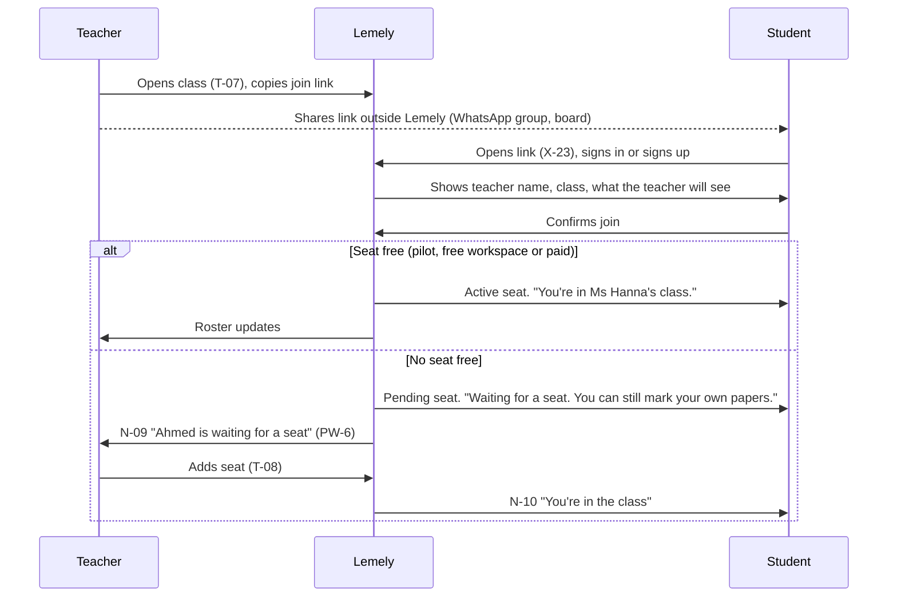

| Rule | Design | Goals | Basis |
|---|---|---|---|
| Join preview | X-23 shows the teacher's name, class name and subject before the student confirms. It shows no roster, count or other student, as the public preview does today. | TR | [repo: lemely/db/invite_repo.py:49-59] |
| What the teacher will see | Stated on X-23 before confirming: "Ms Hanna will see papers you mark for this class and any you choose to share. She won't see your other papers." | TR | [assumption: §7.6 visibility rule; narrows repo: lemely/web/routers/classes.py:926-945, where a teacher sees every rostered student's full history] |
| Join code safety | The teacher can rotate the link and code from T-07; old links stop working. A rotated code never removes students already in. | PA, TR | [repo: lemely/db/class_repo.py:505,930 (no rotation today)] [assumption: test with `join_link_rotated` and a staging check that an old link is refused] |
| Pending seat, student side | S-01 banner: "Waiting for a seat in Ms Hanna's class. Your own papers work as normal." Nothing is refused. | RM | [assumption: D1] |
| Pending seat, assigned work | The assignment appears in S-06 marked "Waiting for a seat". Two choices: "Wait for a seat" or "Mark it now with 1 of your papers". The second asks for confirmation, runs as origin `self` (instant result, the student's own paper), and shares that one paper with that class. | RM, PR | [assumption: §8.1.5 rule 4; test the share of pending students who mark assigned work on their own paper] |
| Under-15 awaiting consent | The student can join; the teacher sees the name with "Waiting for a parent's OK". No assigned upload, class-set result or release reaches the student until consent. | TR | [assumption: A-L, counsel] |
| Teacher removes a student, or student leaves | Released class results stay in the student's history. The teacher loses access to that student's future papers. Pending assigned uploads are cancelled with no paper charged. | TR | [assumption: §6.10; counsel on teacher retention of past class results] |
| Tutor-teacher side door | Joining a school-less class whose teacher holds a tutor profile still emails the student's linked parents, as today. | TR | [repo: lemely/db/class_repo.py:636-660] |

### 6.3 Class set to student history: roster claim (H2) ⚠ Minor-data

On a teacher's first set the students may have no accounts. The set still gets marked; the results wait on a roster placeholder until the right student is attached.

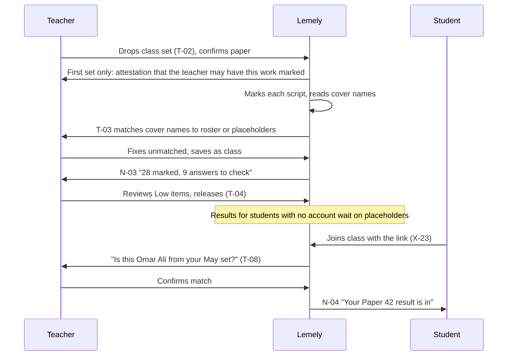

| Rule | Design | Goals | Basis |
|---|---|---|---|
| Match by teacher, not by name alone | A student who joins through the class link is attached to a placeholder only after the teacher confirms it. A student who joins through a placeholder's own link, which the teacher handed to that student (§5.1 T7), binds directly. Two students called "Omar" must never see each other's script. | TR | [assumption: A-M; measure `roster_claim_confirmed` and `scripts_matched` unmatched share] |
| Attestation | At the first class-set upload the teacher confirms: "I'm allowed to have these students' work marked. Students see their results once they join." This is recorded, not a consent substitute. | TR | [assumption: counsel, open question Q1. Teachers are not a consent channel (§6.11), yet class sets process minors' scripts before consent] |
| What a placeholder holds | Cover name, script, marks. Nobody but the teacher sees it. It never sends a notification. | TR | [assumption: data minimisation, counsel confirms (Q1); test that no `notification_sent` row references a placeholder] |
| Retention | An unclaimed placeholder's script and result are deleted 90 days after marking. T-07 shows "3 results waiting for students to join, deleted on 14 Feb". | TR, PR | [assumption: counsel; shorter than the 90-day bucket rule only if counsel asks, repo: docs/deployment.md:139] |
| Release order | Release goes to claimed, active-seat students. Pending-seat or unclaimed scripts stay held and release when their state resolves; the teacher does not release twice. | RM, TR | [assumption: test with `set_released` per set] |
| Cost | The set draws on the class pool when marked, whether or not students ever join. | PR | [assumption: §8.1.5 rule 3] |

### 6.4 Linking parents and students (H7) ⚠ Minor-data

**Who initiates: the student, always, in v1.** The child issues a link from X-24, X-08 or S-08 (single-use, 7 days, at most 5 live) or shares their rotatable code. At most 4 parents per child [repo: lemely/db/invite_repo.py:120-125; lemely/db/parent_repo.py:66].

**Trade-off: child-initiated only (as built) vs also letting a parent invite a child (the Khan Academy pattern).** Parent-initiated linking gives the cleanest consent record and lets a parent who finds Lemely first bring the child [source: https://support.khanacademy.org/hc/en-us/articles/202487460-If-my-child-is-under-age-13-what-login-options-are-there-]. In a teacher-first GTM the child almost always arrives first, and a child-issued link records that the child agreed to the parent seeing their results. **Recommend: child-initiated only in v1.** A parent who reaches X-01 first is asked to have the child send the link ("Ask Omar to tap Add a parent in Lemely") [assumption: count X-01 parent-role visits that never reach a link; build parent-initiated linking if that number is material].

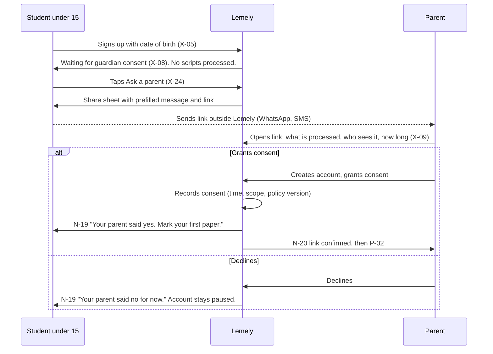

| Rule | Design | Goals | Basis |
|---|---|---|---|
| Consent age split | Under 15: guardian consent before any script is processed. 15-17: the student's own consent; linking a parent is offered, not required. | TR, PA | [source: https://www.tamimi.com/our-knowledge/publications/general/Articles/from-policy-to-practice-egypt-issues-executive-regulations-of-the-personal-data-protection-law/] [assumption: A-L] |
| One visit for the parent | Opening the child's link signs the parent up and links them. No separate code entry, no second email code. | PA | [repo: lemely/web/routers/auth.py (today: request-code, verify-code, signup)] [assumption: §6.11] |
| Link expiry | An unused link expires after 7 days. The child sees "Link expired. Send a new one." | TR | [repo: lemely/db/invite_repo.py:120] |
| Student unlinks | From X-19 / S-08. The parent loses access and any payer role at once; purchased papers stay with the child. An under-15 student cannot remove their only consenting guardian: "Ask your parent to change this." | TR | [repo: lemely/web/routers/student.py:1421 (student unlink exists)] [assumption: §6.11] |
| Parent unlinks | New: P-06 "Stop following Omar". Today a parent cannot unlink through the API. If the parent was the only consenting guardian of an under-15 child, unlinking withdraws consent, so P-06 says so before confirming. | TR | [repo: lemely/web/routers/parent.py:331-517 (read-only routes only)] [assumption A-L: counsel confirms that unlinking the only consenting guardian withdraws consent] |
| Consent withdrawal | P-06 "Withdraw consent". The child's account pauses: no new marking, data read-only. Scripts are deleted if consent is not re-granted within 30 days. The child gets N-19. | TR | [assumption: A-R, counsel] |
| Other parents | Linking or unlinking a parent tells the other linked parents, as today. | TR | [repo: lemely/db/parent_repo.py:62-67 (parent_linked / parent_unlinked emails)] |
| Active subscription on unlink | A Monthly paid by the unlinked parent is cancelled at period end; papers already granted stay usable by the child. | TR, PR | [assumption: counsel; §8.5] |

### 6.5 Teacher visibility of a student's papers (H4, H5) ⚠ Minor-data

| Paper type | Teacher of an active seat sees it? | Teacher of a pending seat sees it? | Basis |
|---|---|---|---|
| Class set from this teacher | Yes, from upload | Marked, held, not released to the student | [assumption: §6.10] |
| Assigned by this teacher | Yes, once uploaded | Only if the student marks it on their own paper, which shares that one paper with the class (§6.2) | [assumption: pending-seat rule, §6.2] |
| Self-upload shared with this class in X-19 | Yes, from the moment of sharing | No | [assumption: §7.6 visibility rule] |
| Self-upload escalated to this teacher in a challenge | That one paper, from escalation | No | [assumption: escalation rule, §7.10.3] |
| Any other self-upload, including papers from before joining and other subjects | No | No | [assumption: narrows repo: lemely/web/routers/classes.py:926-945; lemely/db/class_history.py:43-55] |

**Trade-off: teacher sees everything (richer class analytics, RM for teachers) vs least privilege for minors (TR).** **Recommend least privilege** (§7.6 visibility rule). The teacher's existing per-class unshare stays for papers a teacher chooses to drop from class analytics [repo: lemely/web/routers/classes.py:870-990] [assumption: counsel]. The student's share control in X-19 is per class, revocable, and stops future visibility only.

### 6.6 Review and release queue (H2, H4)

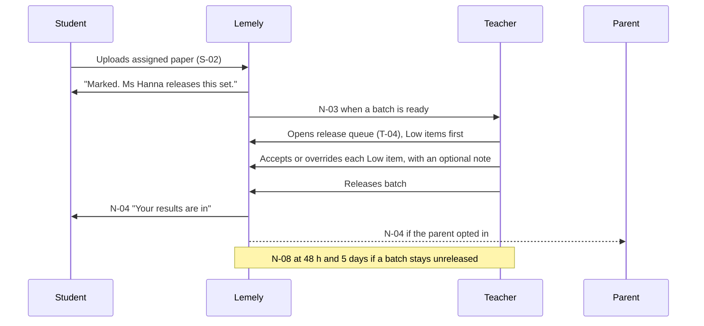

| Rule | Design | Goals | Basis |
|---|---|---|---|
| Queue order | Low items first and required. Close calls one filter away. High items never block release. | TR, RM | [repo: lemely/runtime/config.py:212-222; BUILD/accuracy-runs/claude-c-2026-10-26-live3/FLIP.md:37 (17% of leaves at 0.72)] [assumption: §2.6 rule 8] |
| Teacher copy | "9 answers in 0625 Paper 42 are marked Not sure. Open each to release the set." | TR | [repo: PRODUCT.md:96-100 (teacher voice)] |
| Override note | Shown to the student on X-11 as "Ms Hanna changed this: 2 → 3. Method mark for the correct substitution." The note is never shown to parents. | TR | [repo: lemely/db/models/attempts.py:374-381 (override wins)] [assumption: least privilege for parents, counsel confirms; test that the parent X-10 response omits the note] |
| Release granularity | Class sets release per set. Assigned work releases in batches of ready scripts: "Release 12 ready". Late uploads queue under "New since release". | RM, TR | [assumption: test with `set_released`] |
| Student waiting state | S-03 and S-06 show "Marked. Ms Hanna releases this set." No marks, no score, no band counts until release. | TR | [assumption: §2.6 rule 2] |
| No auto-release | Reminders only (N-08). The one exception is a teacher choice: "Show results straight away" on a single assignment (§7.9). | TR | [assumption: D4; A-T] |
| Override after release | Allowed from T-05 at any time. Any changed mark sends N-05 to the student, and to linked parents. | TR | [repo: lemely/db/models/enums.py:245-267 (no change notice today)] [assumption: D4] |

### 6.7 Challenges between student and teacher (H6)

A challenge is free, capped at 3 per paper, and needs a written reason (20 characters, 40 on High or Check items). Before sending, the student is told marks can go down [repo: .impeccable/mocks/student-r1/student.js:22,36] [assumption: D4; §7.10]. An anonymous result cannot be challenged until it is claimed [assumption: §8.1.6 T6].

| Origin | Student has a teacher? | First route | If the student still disagrees | If nobody answers | Goals | Basis |
|---|---|---|---|---|---|---|
| `class_set` or `assigned` | Yes (the releasing teacher) | Teacher, T-10 | Teacher's answer is final in Lemely | After 7 days the student may choose "Get an automatic re-mark instead". A later teacher override still wins. | TR | [assumption: D4; route value `auto_remark_after_wait`] |
| `self` | Yes, an active seat in a class of that subject | Automatic re-mark of that question | "Ask Ms Hanna" escalates; X-12 warns "Ms Hanna will see this paper" | The 7-day fallback does not apply: the re-mark already answered | TR | [assumption: D4; escalation needs an active seat in a class of that subject] ⚠ Minor-data |
| `self` | No | Automatic re-mark | X-13 offers "Join a class to ask a teacher" | n/a | TR | [repo: lemely/web/routers/review.py:3-8 (solo students have no reviewer today)] [assumption: D4] |

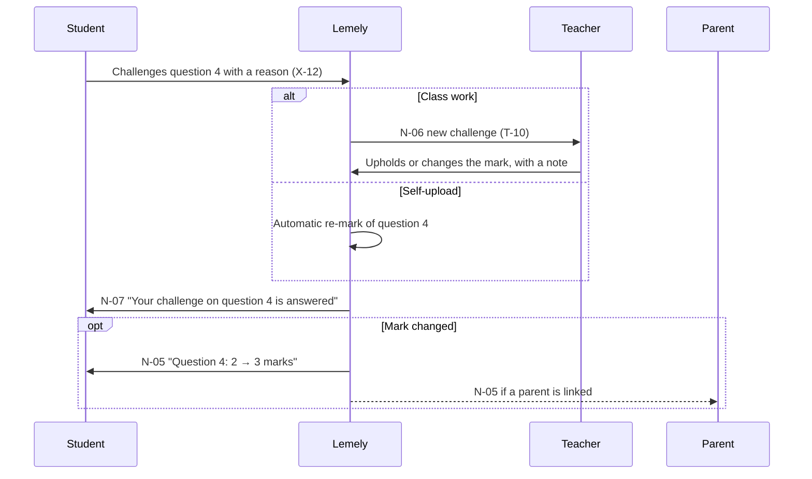

Copy on X-12, student voice, honest about what a challenge is: "Think we got question 4 wrong? Tell us why. We'll take another look. Heads up: marks can go up or down. This checks our marking, not Cambridge's." [repo: PRODUCT.md:96-100] [source: https://help.cambridgeinternational.org/hc/en-gb/articles/29567926906642-Enquiries-about-Results-General-Queries (official review is a separate Cambridge process)]. X-13 shows the outcome with the paraphrased criterion and the student's own words, never mark-scheme text [repo: corpus/README.md:3-10] [assumption: A-K].

**Trade-off: teacher authority over class marks (TR for teachers) vs a student stuck waiting on an unanswered challenge (TR, RM for students).** **Recommend the 7-day fallback to an automatic re-mark**, with the teacher's later decision still final. Teachers get N-06 in-app, in the daily digest and again in the day-3 digest, so 7 days covers a full school week [assumption: measure `challenge_resolved.hours_to_resolve` by route; adjust the 7 days from data].

**Trade-off: re-mark cost (PR) vs free challenges (TR).** Every automatic re-mark is an LLM call that no paper pays for. The 3-per-paper cap bounds it; the pricing proposal already loads a challenge allowance into cost per paper [assumption: §8.1.2; watch `challenge_resolved.cost_usd`].

### 6.8 What parents see and do not see ⚠ Minor-data

| Parents see | Parents do not see | Basis |
|---|---|---|
| Released results of linked children: score, grade with provenance, band summary, per-question marks (read-only X-10 parent variant) | Results awaiting teacher release | [assumption: §7.6 visibility rule] |
| Weak topics and trend (P-04), predicted grade marked "estimated" | The scanned pages or handwriting images | [assumption: data minimisation; counsel] |
| Papers left and who paid them (P-02, X-17 parent variant) | Teacher override notes, challenge reasons and challenge text | [assumption: least privilege, counsel confirms; test that the parent X-10 response omits these fields] |
| That a mark changed, with old and new marks (N-05) | Practice answers, flashcards, XP | [assumption: data minimisation, counsel confirms; test that parent responses omit them] |
| At-risk alerts, reason only, no grade text (N-23) | Class rosters, other students, the teacher's class analytics | [repo: lemely/web/routers/student.py:885-951] |
| Weekly digest (N-22) and, if opted in, release notices (N-04) | Withdrawn (deleted) papers | [repo: lemely/core/deletion.py:16] |
| Their own receipts and the child's papers added (N-12) | Other linked parents' payment details | [repo: feat/paymob-integration:docs/superpowers/specs/2026-11-02-paymob-billing-design.md §2.1] [assumption: test that a second linked parent's P-05 shows no other payer's receipts] |

Teachers see nothing about a student's parents: not who is linked, not whether anyone is. The class nudge in §4.3 path C is shown by Lemely to students without a linked parent; the teacher only switches it on [assumption: least privilege; counsel]. There is no teacher-to-parent messaging in v1; parents hear about class work through N-04, N-05 and N-23 [repo: lemely/db/models/ops.py:455-462 (no teacher-parent messaging today)] [assumption: least privilege; revisit if the §13.3 interviews ask for it].

**Trade-off: a 15-17 student hiding a paper from parents (student privacy, TR) vs parents who pay seeing what they fund (PA).** **Recommend no per-paper hiding from parents in v1.** Deleting a paper (the existing soft delete) remains the student's lever, and X-24 states before linking: "Your parent will see results you get back, your weak topics and papers left. They won't see your pages." [repo: lemely/web/routers/student_deletion.py] [assumption: counsel; add a per-paper control if parent-link revocations by 15-17 students cluster after results (`parent_link_state_changed`)].

### 6.9 Accessibility of handoff screens

- Every handoff screen (X-23, X-24, X-09, X-12, X-13, P-01, P-06, T-04, T-10) works as one column from 320px wide; the teacher queue keeps desktop density above that [repo: PRODUCT.md:137-147].
- Share actions use the device share sheet, with "Copy link" always present as a fallback when no share target exists [assumption: test on low-end Android browsers].
- States (pending seat, awaiting release, waiting for consent, challenge open) are shown as an icon with words, never colour alone, and status changes are announced to screen readers [repo: web/src/components/ui/confidence-indicator.tsx:5-10 (icon plus text pattern)] [assumption: verify in a screen-reader pass at 320px before launch].
- Notifications are text-first and deep-link to the exact screen named in the catalogue [assumption: §6.12].

### 6.10 Seat lifecycle ⚠ Minor-data

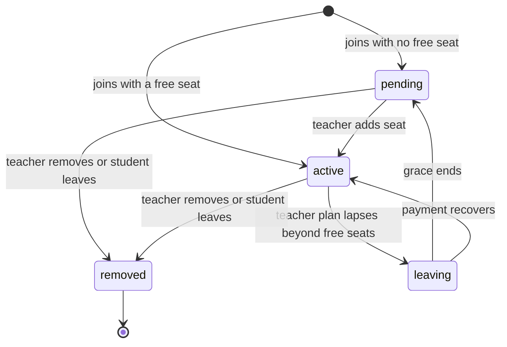

- A student joins through X-23, whose confirmation states what the teacher will see (§6.2) [assumption: §7.6 visibility rule].
- **Seat free** (pilot, free workspace or paid): the seat becomes **active**.
- **No seat free**: the seat becomes **pending**. The student is enrolled, keeps their own allowance, can self-upload and sees a banner on S-01. The teacher gets N-09. A pending student's script can be marked in a class set but is not released to them until the seat is active (T-03 and T-04 show "Waiting for a seat") [repo: feat/paymob-integration:lemely/db/class_repo.py:841-860 (the 409 replaced)] [assumption: D1].
- **pending → active**: the teacher adds a seat (PW-6), or a seat frees up. N-10 is sent.
- **active → leaving**: when the teacher's paid seats lapse (subscription expired or a failed seat charge), seats beyond the free 10 move to **leaving**, which keeps access through the grace period [repo: feat/paymob-integration:docs/superpowers/specs/2026-11-02-paymob-billing-design.md §5.4].
- **leaving → pending**: when grace ends, leaving seats go pending. The oldest 10 seats stay active by default, the teacher may choose others (§5.1 T21), and nobody is removed (D1) [assumption: D1].
- **Pilot end**: a pilot teacher's seats beyond 10 follow the same rule at day 60 unless they buy seats [assumption: D1].
- **removed**: the teacher removes the student, or the student leaves. Released class-context results stay the student's [assumption: counsel on teacher retention of past class results].
- **Join codes**: rotatable from T-07. Today they never expire and cannot be rotated, so a leaked code fills seats [repo: lemely/db/class_repo.py:505,930].

### 6.11 Parent link and guardian consent lifecycle ⚠ Minor-data

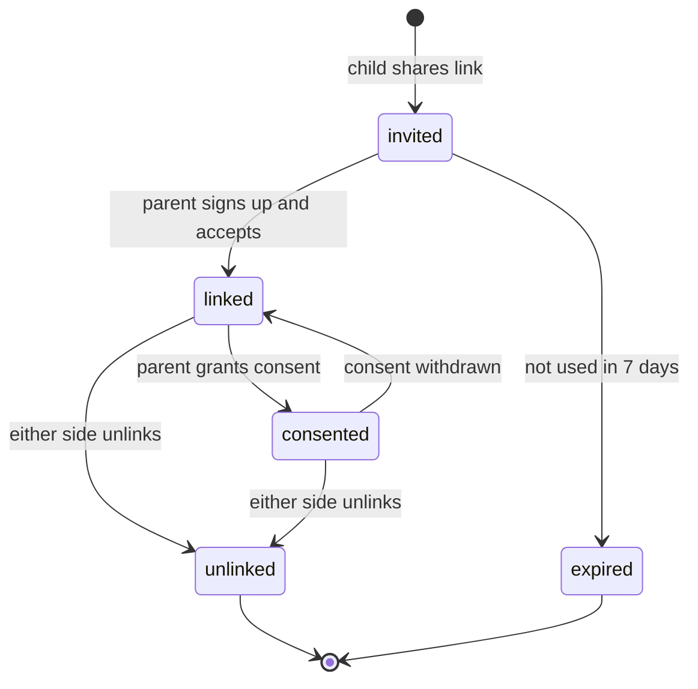

- **invited**: the child issues a link from X-24, X-08 or S-08, carrying the child link code and a purpose (consent, payment or progress). Today's child-issued code flow and its cap of 4 parents per child stay [repo: lemely/db/parent_repo.py:66; lemely/db/invite_repo.py:395-511].
- **invited → linked**: the parent signs up through P-01 or X-09 and is linked automatically, with no separate code entry [assumption: B-12].
- **invited → expired**: the link expires after 7 days [repo: lemely/db/invite_repo.py:120].
- **linked**: the parent sees released results, topics and billing for the child, and can pay (payer≠beneficiary) [assumption: §6.8].
- **consented**: required for an under-15 student before any script is processed. It is recorded with a timestamp, scope (what is processed, who sees it, retention) and the policy version. Students aged 15-17 may proceed on their own consent, and a parent link is recommended [source: https://www.tamimi.com/our-knowledge/publications/general/Articles/from-policy-to-practice-egypt-issues-executive-regulations-of-the-personal-data-protection-law/] [assumption: A-L, counsel confirms the thresholds and whether online consent counts as "written"].
- **consented → linked** (withdrawal): the under-15 account pauses, with no new marking and existing data kept read-only. If consent is not re-granted within 30 days, the scripts are deleted [assumption: A-R, counsel].
- **unlinked**: either side can unlink. An under-15 student cannot remove their only consenting guardian ("Ask your parent to change this"). An unlinked parent loses access and any payer role; purchased papers stay with the child, and a parent-paid Monthly stops at period end [assumption: counsel].
- **Teachers and consent**: teachers are not a consent channel, and a school-led consent path is out of v1. Class sets still process minors' scripts on the teacher's attestation before consent exists, so the basis is open question Q1 (§6.3) [source: https://www.insideprivacy.com/childrens-privacy/ftc-announces-coppa-settlement-against-ed-tech-provider-including-strict-data-minimization-and-data-retention-requirements/ (school-as-intermediary risk, US precedent)] [assumption: A-CS].
- **Minors paying**: the payer ticks the cardholder statement at X-15 (§2.2). A 15-17 student choosing "I'll pay" sees "Use a card you're allowed to use, or ask a parent", and an under-15 student sees only "Ask a parent" [assumption: A-L, counsel on minors' contracting capacity and Paymob's cardholder rules].

### 6.12 Notification catalogue

Channel policy:
- In-app and web push are the default.
- Email is used only for money, consent, the weekly parent digest and items a teacher must act on. Resend's free quota is 100 mails a day, shared with verification [repo: lemely/runtime/config.py:1244-1252].
- WhatsApp is reached only through user-initiated share links, with no API [assumption: no WhatsApp integration exists].
- Existing types are reused where they fit [repo: lemely/db/models/enums.py:245-267]. Each new type needs a same-named preferences column (B-28).

| ID | Notification | Trigger | Recipient | Channels | Existing type | Minor-data |
|---|---|---|---|---|---|---|
| N-01 | Paper marked | A `self` submission completes, or an `assigned` one whose teacher switched on "Show results straight away" (§7.9) | student | push, in-app | `grade_ready` | ⚠ |
| N-02 | Marking didn't finish (no paper used) | `marking_failed` | student or teacher | push, in-app | new | ⚠ |
| N-03 | Class set marked: "28 marked, 9 answers to check" | All scripts in a set, or a batch of assigned uploads, complete | teacher | push, in-app, email | new | |
| N-04 | Results released | Teacher releases a set or assigned work | student; parent (opt-in) | push, in-app | `grade_ready` | ⚠ |
| N-05 | Your mark changed | An override, challenge outcome or re-mark changes any question | student; linked parents | push, in-app, email (parent) | new | ⚠ |
| N-06 | New challenge | Student challenges class work | teacher | in-app; daily email digest; repeated in the day-3 digest | new | ⚠ |
| N-07 | Challenge answered | `challenge_resolved` (any outcome, including upheld) | student | push, in-app | new | ⚠ |
| N-08 | Set waiting for release | 48 h after N-03 with the set unreleased; repeats at 5 days | teacher | in-app, email | new | |
| N-09 | Student waiting for a seat | Pending seat created | teacher | in-app; daily summary email | new | ⚠ |
| N-10 | You're in the class | Pending→active | student | push, in-app | new | ⚠ |
| N-11 | Papers running low | Balance hits 1 (student) or class pool hits 20% (teacher) | student and payer parent; teacher | in-app; email to the payer parent | new | ⚠ |
| N-12 | Receipt | `payment_succeeded` | payer | email, in-app | new | |
| N-13 | Payment problem | Renewal failed (past_due), with the grace end date | payer; beneficiary sees an in-app banner | email, in-app | `billing` (branch, arrives with the D5 merge; copy changes only) [repo: feat/paymob-integration:lemely/db/models/enums.py:279; feat/paymob-integration:lemely/io/notify_email.py:377-415,545-620] | |
| N-14 | Plan ended | expired→downgraded | payer and beneficiary | email (payer), in-app | `billing` (branch, arrives with the D5 merge; copy changes only) [repo: feat/paymob-integration:lemely/db/models/enums.py:279; feat/paymob-integration:lemely/io/notify_email.py:377-415,545-620] | |
| N-15 | Renewal reminder | 7 days before a Monthly or teacher-seat renewal | payer | email | new | |
| N-16 | Price change notice | 14 days before worse terms apply | payer | email | `billing` (branch, arrives with the D5 merge; copy changes only) [repo: feat/paymob-integration:lemely/db/models/enums.py:279; feat/paymob-integration:lemely/io/notify_email.py:377-415,545-620] [repo: feat/paymob-integration:lemely/core/billing_defaults.py] | |
| N-17 | Pilot ending | 7 days before, and on day 60 | teacher | email, in-app | new | |
| N-18 | Guardian consent request | Under-15 signup; the student shares a link | parent (via the child's share) | link (X-09); email reminders only if the parent typed an email | new | ⚠ |
| N-19 | Consent decision | Granted, declined, or withdrawn | student; parent (confirmation) | in-app, email (parent) | new | ⚠ |
| N-20 | Parent link confirmed | Link becomes active | student and parent | in-app, email (parent) | `parent_link` | ⚠ |
| N-21 | Paper assigned / due tomorrow | T-09 assignment; 24 h before due | student | push, in-app | new | ⚠ |
| N-22 | Weekly parent digest | Weekly, if any activity or a balance ≤ 1 | parent | email | new | ⚠ |
| N-23 | At-risk alert | Existing at-risk rule | teacher; parent | in-app, email (parent) | `at_risk_alert` | ⚠ |
| N-24 | Papers added for you | `payment_succeeded` where payer≠beneficiary | student | push, in-app | new | ⚠ |
| N-25 | Refund issued | `payment_refunded` | payer; beneficiary in-app | email, in-app | new | |
| N-26 | Your paper is now supported | A paper someone asked about on X-22 becomes markable (OPS-07) | users who tapped notify-me | push, in-app | new | ⚠ |
| N-27 | Papers expiring soon | 30 days before pack papers expire | payer by email; beneficiary in-app | email, in-app | new | |
| N-28 | Weekly plan nudge | The S-07 plan has an open paper this week; at most once a week; stops after 3 unopened weeks | student | push, in-app | `study_plan_reminder` [repo: lemely/db/models/enums.py:255] | ⚠ |

N-28 replaces the daily 19:00 `streak_warning` push, which §9.7 retires [repo: docs/deployment.md:420-423]. The anonymous visitor gets no notifications, because no contact is collected; X-04 shows the claim-expiry date in the page instead. Scheduled notifications (N-21 "due tomorrow", N-28) depend on the in-process sweeper and can arrive late while the service scales to zero (§9.6) [repo: docs/deployment.md:416-435]. The catalogue rows are [assumption: new types unless an existing type is named; test coverage with `notification_sent` per trigger].

## 7. The marking moment

This section covers everything from the moment a student or teacher points a camera at a script to the moment a mark is final: capture, paper identification, background marking, progress, the result, low-confidence handling, release, challenges and failures. Bands are defined in §2.6, events in §3.7, notifications in §6.12, prices in §8.1 and screens in §10.8.

### 7.1 Rules for the whole moment

| # | Rule | Goals | Basis |
|---|---|---|---|
| R1 | Nobody waits on an open request. Upload is the only step that needs the app open. After that the user is told "Safe to leave". | RM, TR | [repo: .github/workflows/deploy.yml:339 (300 s timeout); BUILD/accuracy-runs/claude-e2e2-0625-w24-41-enh1/COST.md (371-442 s per 19-page script, n=1 script, 4 runs)] |
| R2 | No paper is charged until the user confirms the paper identity. A run that fails, is unsupported or stops halfway gives the paper back. | TR, PR | [assumption: see §8.1.5, §7.6] |
| R3 | Nothing re-sends marking without a deliberate tap, because every re-send pays for the model again. | PR | [repo: web/src/portals/student/screens/CorrectPaper.tsx:542-548; redesign/f1-ui-kit:docs/superpowers/plans/2026-11-15-redesign-l06-upload.md:20] |
| R4 | A captured script is never lost. Pages stay on the device until the server accepts them, including offline and at a paywall. | RM, PA | [repo: web/src/lib/offline/uploadQueue.ts] (§8.3) |
| R5 | Question-paper and mark-scheme text is never shown. The user sees question numbers, marks, a paraphrased criterion and their own words. | TR | [repo: corpus/README.md:3-10] (§2.6 rule 7) |
| R6 | Confidence is shown as band words with icon and text, never as a percentage. | TR | [assumption: see §2.6 rule 1] |
| R7 | Every mark change notifies the student and is logged in an audit trail the student can read. | TR | [repo: lemely/db/models/enums.py:245-267 (no change notification today)] |
| R8 | Every screen works as a single column at 320px. Every camera step has a file-upload alternative. | RM, TR | [repo: PRODUCT.md:137-147] |

### 7.2 Capture and upload ⚠ Minor-data

The pages are a minor's handwriting, and on the anonymous path they belong to someone Lemely has no contact for. Every capture entry runs these checks first, in this order, before the camera opens:

| Check | Who | Outcome if it fails | Goals | Basis |
|---|---|---|---|---|
| Consent | student under 15 | X-08 "Ask a parent to say yes". The camera does not open and no page is accepted. ⚠ Minor-data | TR | [assumption: see §6.11] [assumption A-L: counsel] |
| Age, Turnstile, device cap, daily cap, kill switch | visitor (X-02) | X-02 blocked states (§8.2). No page is accepted. | PR | [assumption: see §8.2] |
| Papers left | student, `self` origin | PW-2 is shown before the camera. A file that came in through the share target stays staged on the device. | PA, PR | [repo: web/src/lib/sharedScan.ts] (§8.3 PW-2) |
| Class pool | teacher, `class_set` origin | Nothing at capture. The estimate in papers (PW-5) appears after identification on T-02, when the set size is known. | PA, PR | [assumption: see §8.3 PW-5] |
| Assigned paper | student | S-02 opens the assigned-paper picker first: "Is this for Ms Hanna's Paper 42?" Yes sets origin `assigned`, so the class pool pays. | RM | [assumption: see §10.8 T-09] [assumption: picker shown only when an open assignment exists] |

#### 7.2.1 Phone camera flow (320px and up)

Phones open on the camera and desktops open on file upload. A desktop never opens a camera [repo: .impeccable/mocks/upload-r1/final.html; redesign/f1-ui-kit:docs/superpowers/plans/2026-11-15-redesign-l06-upload.md:67 (K1, pointer: coarse)].

| Step | What the user sees and does | Copy (student voice) | Goals | Basis |
|---|---|---|---|---|
| 1. First-time tips | Shown once per device, then from a "Tips" link: three short tips and one button | "Flat page. Good light. Whole page in the frame. Start with the cover: it tells us which paper you sat." · [Open camera] · "Upload a file instead" | TR | [repo: lemely/io/scan_metadata.py:28-29 (identity read from the first 2 pages)] [assumption: test retake rate with and without tips] |
| 2. Permission | Browser camera prompt. If it is blocked, a recovery card with the browser's settings path and the file option | "Your camera is blocked for Lemely. Allow it in your browser settings, or upload photos or a PDF instead." | RM | [repo: .impeccable/mocks/upload-r1/final.html (camera blocked state)] |
| 3. Capture | Full-screen viewfinder, page-edge outline, auto-capture plus a manual shutter, page counter, Done. A landscape hint appears when the phone is sideways. | "Page 3" · "Hold still…" · "Turn your phone upright" | RM, TR | [repo: .impeccable/mocks/upload-r1/capture.html; web/src/components/CameraCapture.tsx] |
| 4. Per-page check | Runs on the device after each shot: blur, cut-off edge, glare, too dark. A failed page blocks until it is retaken or kept on purpose. | "Page 4 is blurry. Retake it?" [Retake] [Keep anyway] | TR, PR | [repo: .impeccable/mocks/upload-r1/final.html ("bad page blocks until retaken")] [assumption: on-device heuristics cost no model call. The server's scan_quality_warning fires only after model spend has started and is never shown today, per repo: lemely/io/answer_extraction.py:1134-1144] |
| 5. Your pages | A grid of thumbnails with count, and per page: retake, rotate, fix crop, delete, move up, move down | "16 pages. Check they're in order." · "Page 9 is cut off at the bottom." · [Check my paper] | TR | [repo: .impeccable/mocks/upload-r1/final.html] |
| 6. Send | Byte progress. The only step that needs the app open. | "Sending your pages. Keep Lemely open until this finishes." | RM | [repo: .impeccable/mocks/upload-r1/final.html] |
| 7. Sent | The paper check starts (§7.3). Push permission is asked here once, in context, not at signup. | "Sent. Want a ping when it's marked?" [Yes, notify me] [Not now] | RM | [assumption: test push opt-in rate by ask position] |

Limits are shown before they are hit:
- At 35 pages: "5 pages left in this paper (40 max)." [repo: lemely/io/_scan_common.py:63 (MAX_SCAN_PAGES = 40)] [assumption: warn threshold]
- The browser assembles the photos into one PDF, which must stay at 25 MiB or less [repo: lemely/web/upload_utils.py; web/src/components/CameraCapture.tsx].

#### 7.2.2 Files, PDF, desktop, share target, offline

| Path | Behaviour | Copy | Goals | Basis |
|---|---|---|---|---|
| File picker or drag-drop | Accepts PDF, JPEG, PNG, TIFF, WebP and BMP. Several photos join into one script, in the order the user arranges on "Your pages". | "PDF or photos · up to 25 MB · 40 pages" | RM | [repo: web/src/lib/scanAccept.ts] |
| Refused file | Each refused file is listed by name and the rest are kept | "seating-plan.docx skipped · not a PDF or image" | TR | [repo: .impeccable/mocks/upload-r1/final.html] |
| HEIC from an iPhone file picker | Refused by the server today | "That photo format isn't supported. Take it with the Lemely camera, or export it as JPG." | RM | [repo: web/src/lib/scanAccept.ts (HEIC refused)] [assumption: measure refused-HEIC count before deciding on conversion] |
| Share target | A file shared from another app opens "Mark this paper?" with the same checks as S-02 | "Mark this paper?" | RM | [repo: web/src/lib/sharedScan.ts; .impeccable/mocks/upload-r1/final.html] |
| Offline | Pages are saved on the device and sent automatically when the connection returns. The Idempotency-Key prevents a duplicate upload. | "Saved. Waiting for a connection… sends by itself." | RM | [repo: web/src/lib/offline/uploadQueue.ts; lemely/web/routers/student.py:648-744] |
| Own mark scheme | Offered only from X-22 when the paper is missing from the corpus, not on the main capture path (§7.3) | — | PR, TR | [repo: lemely/web/routers/student.py:831-871] |
| Teacher class set (T-02) | One PDF or many photos for a whole set. Desktop drop zone; phone camera with the same steps 1-7 | "One student's paper, or a whole class set in one PDF. We read each name off the cover page." | RM, PA | [repo: .impeccable/mocks/upload-r1/desktop.html] |

#### 7.2.3 Accessibility for capture and upload

| Need | Design | Goals | Basis |
|---|---|---|---|
| No camera, or a camera the user can't aim | "Upload a file instead" sits on every camera screen and lands on the same "Your pages" review | RM | [repo: PRODUCT.md:139 (WCAG AA baseline)] |
| Screen reader | Polite live-region announcements for page count, "Page 4 is blurry", send progress (every 25%) and "Safe to leave". The shutter is a labelled button, and auto-capture can be turned off. | TR | [assumption: test with VoiceOver and TalkBack at 320px] |
| Reordering without drag | "Move up" and "Move down" buttons on every page, as well as drag | TR | [assumption: keyboard-only and switch-access test of page reordering before launch] |
| Motor | Large touch targets (44px or more) and no gesture that is the only way to do something | RM | [assumption: audit touch targets and gesture alternatives at 320px before launch] |
| Exam stress | Problems use neutral or amber wording, never red-heavy | TR | [repo: PRODUCT.md:140-141] |
| RTL later | Page order arrows and reorder controls use logical direction | — | [repo: PRODUCT.md:143-147] |

### 7.3 Paper identification and confirm (X-21, X-22)

Today the server reads the identity from the first two pages and then looks it up in the corpus by exact identity. There is no confirm step, and a lookup miss fails the run [repo: lemely/io/scan_metadata.py:28-29; lemely/web/routers/student.py:831-875]. The redesign runs detection as its own step, right after upload, and stores the result so the marking run does not pay for detection again [repo: redesign/f1-ui-kit:docs/superpowers/plans/2026-11-15-redesign-l06-upload.md:23].

| Case | X-21 shows | Actions | Charge | Goals | Basis |
|---|---|---|---|---|---|
| Detected and in the corpus | "Mathematics 0580 · Paper 42 · May/June 2025. Is this the paper you sat? We mark it against this mark scheme." · "Uses 1 paper" (or "Uses 1 of your class's papers") | [Yes, mark it] · [No, change it] | 1 paper reserved on Yes | TR, PR | [repo: .impeccable/mocks/upload-r1/final.html] (§10.8 X-21) |
| Cover unreadable or detection failed | "We couldn't read the cover. Which paper is it?" with the picker open | Pick, then confirm | none until confirm | TR | [repo: lemely/web/routers/student.py:1055-1063 (detection failure continues today)] |
| User taps "No, change it" | Picker: subject (only the 3 supported), session, paper number, variant. It lists only papers Lemely can mark, plus "My paper isn't listed". | Pick → confirm, or Not listed → X-22 | none | TR | [repo: lemely/io/det/profiles.py:167-169] [assumption: picker draws from the loaded corpus] |
| Detected, but not in the corpus | X-22: "We don't have the mark scheme for this paper yet." | Student: [Notify me when it's added] · [Add the mark scheme PDF] · [Mark a different paper]. Teacher: [Add mark scheme] (T-11) | none | TR, PR, RM | [repo: .impeccable/mocks/upload-r1/final.html; corpus/README.md (289 of 479 parsed)] |
| Subject out of scope | X-22: "Lemely marks IGCSE Maths 0580, Add Maths 0606 and Physics 0625 for now." | [Notify me] | none | TR | [repo: lemely/db/seed.py:6-8] |
| A scheme the user attached disagrees with the cover | "Your pages look like Paper 42, but the mark scheme is for Paper 41. Which is right?" | Pick one | none | TR | [repo: lemely/io/scan_metadata.py:95-115 (scheme wins silently today)] |

A mark scheme a student or teacher attaches is parsed only by the deterministic parser. If that parse fails, the user sees "We couldn't read this mark scheme. Try the official PDF." and no paper is used.
- Trade-off: the costly LLM-fallback parse costs $0.09-0.17 (n=1) and would widen coverage (RM). Refusing it protects PR.
- Recommend deterministic only, because the corpus and the teacher library grow at $0 per scheme.

[repo: BUILD/accuracy-runs/e2e-0625-w24-41-2026-10-19/COST.md:18-20; lemely/web/routers/teacher.py:1413-1447] [assumption: track X-22 "Add the mark scheme PDF" parse-failure rate]

Detection is free to the user even when they abandon at X-21; it is about 2% of a run's cost.
- An anonymous visitor who abandons still spends the device's one anonymous try, which stops repeat probing.

[repo: BUILD/accuracy-runs/claude-e2e2-0625-w24-41-enh1/COST.md (cost split, scan metadata 2%)] [assumption: confirm detection cost stays near 2% with `marking_failed.cost_usd` on X-21 abandons]

`paper_confirmed.changed` measures identification accuracy (§3.7) [assumption: see §3.7].

### 7.4 Background marking: never wait on a spinning request

**Problem.**
- A full theory script took 371-442 s. The Cloud Run request timeout is 300 s, so the progress stream is cut mid-run [repo: BUILD/accuracy-runs/claude-e2e2-0625-w24-41-enh1/COST.md; .github/workflows/deploy.yml:339].
- L6 keeps the client's `POST /student/correct` open, because under request-based CPU the run's thread only gets CPU while a request is open [repo: redesign/f1-ui-kit:docs/superpowers/plans/2026-11-15-redesign-l06-upload.md:190].
- So a locked phone, a closed tab or the 300 s cut can starve the run. Recovery then depends on a stale check at 20 minutes [repo: lemely/web/routers/student.py:766].

| Option | How | User effect | Cost and effort | Goals hit |
|---|---|---|---|---|
| A. As planned in L6 | The client POST holds the run; progress comes from a DB-polled SSE that reconnects at 240 s | The user must keep the app open for 6-7 minutes on long scripts. Breaks R1. | No new infrastructure | RM−, TR− |
| B. `--no-cpu-throttling` | Background threads keep CPU with no open request | Safe to leave in most cases. A scale-in can still kill an idle instance mid-run. | Instance-based billing (cost up, awaiting owner approval in L6) | RM+, PR− |
| C. Server-owned run | "Start" returns 202 at once. A task queue delivers the run to an internal endpoint, so the server, not the phone, holds the request. Progress is read from `marking_progress` by poll or SSE. | Safe to leave after upload, always | Adds a task queue and an internal route. Timeout and retry settings must be set: retries off or idempotent per submission. | RM+, TR+, PR neutral |

[repo: redesign/f1-ui-kit:docs/superpowers/plans/2026-11-15-redesign-l06-upload.md:7,22,190] [assumption: confirm the task queue's maximum dispatch deadline and Cloud Run's maximum request timeout in GCP documentation before choosing; load-test with scripts/load_sanity.py]

**Recommend C.**
- Use B only as a stopgap if C cannot ship before the paid launch.
- The trade-off is engineering time for a sole developer (cost) against R1, which every goal depends on: a lost run means a wasted paper (PR) and a broken promise (TR).

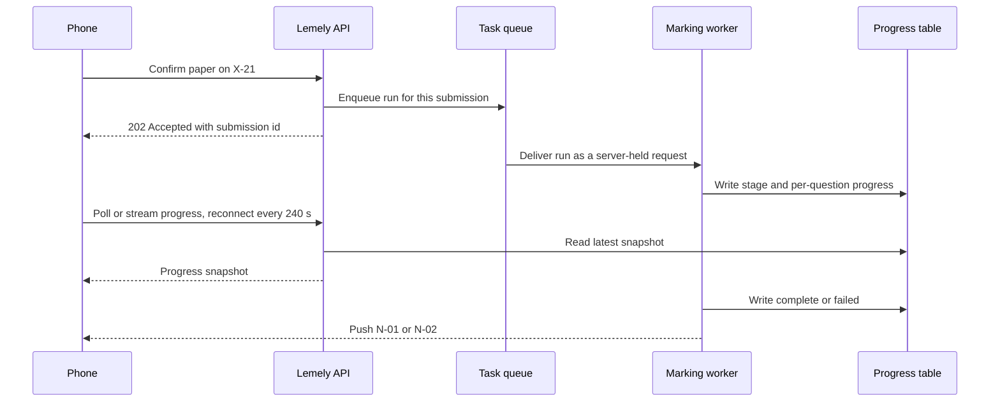

Rules that follow:

| Rule | Goals | Basis |
|---|---|---|
| Any instance can answer progress from `marking_progress`. Coming back on another device or tab shows the same state; the stages are never redrawn from zero. | TR | [repo: redesign/f1-ui-kit:docs/superpowers/plans/2026-11-15-redesign-l06-upload.md:7] |
| One active run per submission. "Start marking again" appears only on `failed`, and at most 2 times per submission. After that: "We've logged this and we're on it. Your pages are saved and no paper was used." | PR, TR | [repo: web/src/portals/student/screens/CorrectPaper.tsx:542-548 (duplicate-run risk)] [assumption: retry cap; failed runs listed in OPS-04] |
| Only terminal states end the progress screen. A `warning` frame is never shown as a failure, which fixes today's defect that invites a second paid run. | PR, TR | [repo: web/src/portals/student/screens/CorrectPaper.tsx:542] |
| Queue position and ETA come from the server estimate. The ETA is shown as "about N min" and never counts down below "almost done". | TR | [repo: redesign/f1-ui-kit:docs/superpowers/plans/2026-11-15-redesign-l06-upload.md:40 (estimate_eta_seconds); lemely/io/run_cap.py] |
| Done is announced by push and in-app (N-01). A teacher's whole set also notifies by email (N-03). Failure sends N-02. A visitor gets no push; X-03 tells them to keep the tab or come back on this device within 7 days. | RM | [assumption: see §6.12] |
| When runs wait for an extraction slot, paid and class work take it first. A free or anonymous run in the queue says "Busy right now. Free papers wait a little longer." | TR, PR | [assumption: queue policy in §2.4; measure queued time by payer_type] |
| The spend cap and kill switch are checked when a run starts and never stop a run that is already going. | PR, TR | [assumption: see §8.3 rules] |

Capacity sets expectations: at most 3 instances, each running one extraction at a time while correction overlaps, so student capacity is above 3 concurrent runs by an unmeasured amount [repo: .github/workflows/deploy.yml:339; lemely/io/run_cap.py:1-20] [assumption: measure with scripts/load_sanity.py on staging].
- The teacher pool is 1 worker per instance and one set goes to one process, so a 28-script set runs one script at a time and can take about 3 hours (28 × 6-7 min) until a task queue exists (B-09) [repo: lemely/web/routers/teacher.py:341-342] [assumption: load test].
- T-02 therefore shows the estimate before the set starts: "28 scripts · about 3 h · we'll email you when they're done."

### 7.5 Progress states and copy (X-03)

| State | Student copy | Teacher copy | Visitor copy | Safe to leave? | Goals | Basis |
|---|---|---|---|---|---|---|
| staged (offline) | "Saved. Waiting for a connection… sends by itself." | "Saved on this device. Sends when you're back online." | same as student | Yes, on this device | RM | [repo: .impeccable/mocks/upload-r1/final.html] |
| uploading | "Sending your pages. Keep Lemely open until this finishes." | "Sending 28 scripts. Keep this tab open until sending finishes." | same as student | **No** | RM | [repo: .impeccable/mocks/upload-r1/final.html] |
| identifying | "Checking which paper this is…" | "Reading cover pages…" | same | Yes | TR | [repo: redesign/f1-ui-kit:docs/superpowers/plans/2026-11-15-redesign-l06-upload.md:128] |
| needs_confirm | X-21 (§7.3) | X-21 once per set | X-21 | Yes; nothing runs until confirmed | TR, PR | [assumption: see §10.8 X-21] |
| queued | "You're next in line. About 6 min." | "Queued · 28 scripts · starts in about 4 min" | same as student | Yes | TR | [repo: lemely/io/run_cap.py (extraction_queued)] |
| marking: reading | "Reading your answers…" | "Reading answers · 9 of 28 scripts" | same | Yes | RM | [repo: web/src/portals/student/screens/CorrectPaper.tsx:196-245] |
| marking: questions | Question tiles fill in; unusual tiles are labelled Blank or Page missing. "14 of 21 marked · about 2 min left" | "17 of 28 marked · about 25 min left" | same as student | Yes | RM, TR | [repo: .impeccable/mocks/upload-r1/processing.html] |
| a page is missing | "Page 9 is missing, so Q9 can't be marked. The rest carries on." | "Omar Saleh: page 9 missing. Q9 left unmarked." | same | Yes | TR | [repo: .impeccable/mocks/upload-r1/final.html] |
| done, instant release | Opens X-10 if the user is still here, otherwise N-01: "Paper 42 is marked. Come see." | — | Opens X-04 | — | RM | [assumption: see §6.12 N-01] |
| done, held for release | "Marked. Ms Hanna releases this set, and we'll tell you when." | N-03 "28 marked, 9 answers to check." | — | — | TR | [assumption: see §7.6, N-03] |
| failed | "Something went wrong on our side before marking finished. Nothing you did. No paper used." [Start marking again] | "Marking stopped for 2 scripts. No papers used." [Start again] | same as student | — | TR, PR | [repo: .impeccable/mocks/upload-r1/final.html] |
| pages unmatched | "We couldn't match some answers to their questions, so this paper hasn't been marked. Check every page is there and in order. No paper used." [Fix my pages] | Same, per script | same | — | TR | [repo: lemely/web/services/grading.py:40-43] |
| status check failed | "Can't reach Lemely right now. Your paper is still marking. We'll keep trying." | same | same | Yes | TR | [repo: .impeccable/mocks/upload-r1/final.html (status-check error)] |

Copy follows PRODUCT.md voice: cheeky but kind for students, precise for teachers, and never "cram", "hack", "easy A" or "guaranteed grade" [repo: PRODUCT.md:96-102]. Marks are never labelled by how they were produced [repo: PRODUCT.md:135].

### 7.6 Submission lifecycle

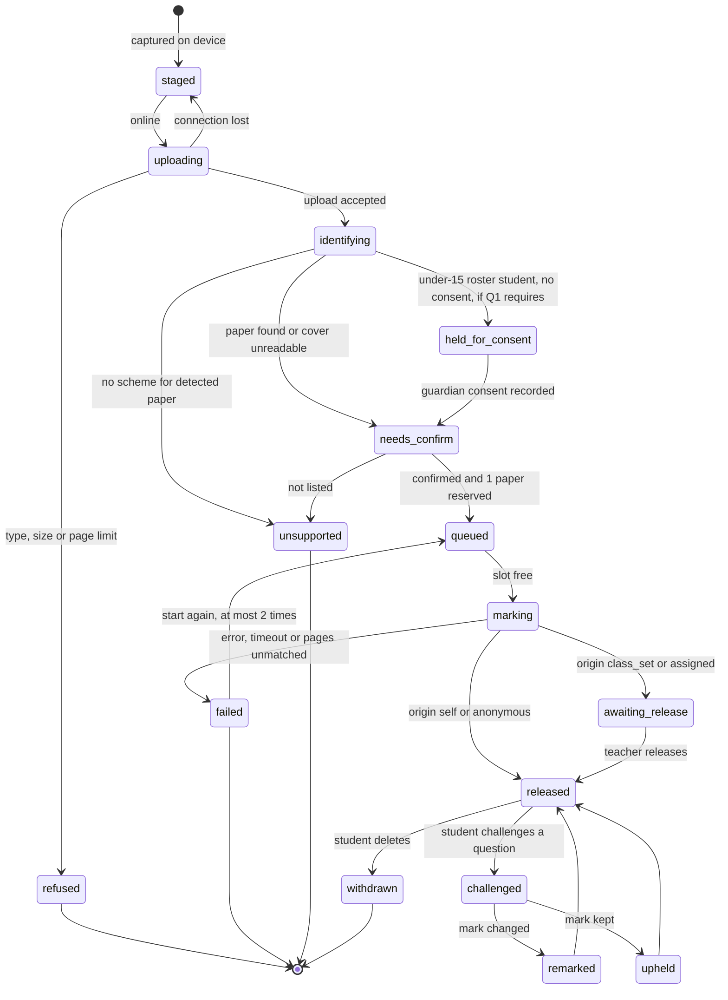

| Transition | Money | Notification | Event | Basis |
|---|---|---|---|---|
| needs_confirm → queued | 1 paper reserved from the payer for that origin (§8.1.5) | — | `marking_started` | [assumption: see §8.1.5] |
| marking → failed | reserved paper returned | N-02 | `marking_failed` | [assumption: see the state notes below] |
| marking → released / awaiting_release | reservation becomes a charge, unless the partial-charge rule in §7.11 applies | N-01, or N-03 to the teacher | `marking_completed` | [assumption: see §3.7] |
| awaiting_release → released | — | N-04 | `set_released` | [assumption: see §6.12] |
| challenged → remarked or upheld | free | N-07 always; N-05 on change | `challenge_resolved`, `mark_changed` | [assumption: see §3.7, §6.12] |
| released → withdrawn | none | — | — | [repo: lemely/core/deletion.py:16 (30-day restore)] |

State notes:
- **identifying**: a cover-page read plus an exact corpus lookup. The detected identity is stored so the marking run does not pay for detection again [repo: lemely/web/routers/student.py:831-871; redesign/f1-ui-kit:docs/superpowers/plans/2026-11-15-redesign-l06-upload.md:23].
- **held_for_consent** ⚠ Minor-data: used only if counsel rules on Q1 that a rostered under-15 student's class-set script needs that student's guardian consent. The script waits unmarked and uncharged, and T-03 shows "Waiting for parent consent" [assumption: A-CS].
- **marking**: survives a closed tab or a locked phone only once the run is server-owned (§7.4) [repo: lemely/web/routers/student.py:750-825].
- **released** (`self`, `anonymous`): visible at once. An anonymous result stays bound to the device until it is claimed or deleted at 7 days (§8.2).
- **awaiting_release** (`class_set`, `assigned`): the student sees "Marked. Ms Hanna releases this set." with no marks. The teacher must open every Low item, then releases (T-04). N-08 reminds at 48 h and 5 days. There is no auto-release; the only exception is the teacher's own per-assignment switch (§7.9) [assumption: D4; watch `set_released.hours_from_marked`].
- **withdrawn**: the student's soft delete, with the 30-day restore window and integrity hold [repo: lemely/core/deletion.py:16].
- **Visibility rule** ⚠ Minor-data: a teacher sees class-context submissions (`class_set`, `assigned`) for active-seat students, plus self-uploads the student shares with that class in X-19 or escalates in a challenge. This narrows today's behaviour, where a teacher sees every rostered student's full history in every subject [repo: lemely/web/routers/classes.py:926-945; lemely/db/class_history.py:43-55]. Trade-off: richer teacher analytics (RM for teachers) against consent and least privilege for minors (TR). **Recommend narrowing** [assumption: counsel]. Parents see released submissions of linked children (§6.8).

### 7.7 The result (X-10, X-11) ⚠ Minor-data

#### 7.7.1 What X-10 shows, top to bottom

| Order | Block | Content | Goals | Basis |
|---|---|---|---|---|
| 1 | Reveal (student only) | Shown on the first view of a fresh result. It is a single "Show my result" button that works by tap or Enter. Under reduced motion the result appears at once. The mock's hold gesture is an optional enhancement, never the only way in. | RM | [repo: redesign/f1-ui-kit:docs/superpowers/plans/2026-11-15-redesign-l07-result-s1.md:5,24] [assumption: departs from hold-only; test reveal completion with assistive tech] |
| 2 | Header | Paper identity, then "52/80", then the grade line with provenance: "Grade B on this paper · Jun 2025 boundary", or "Grade B (estimated from past boundaries)" | TR | [repo: lemely/core/analytics.py:118-173] (§2.6 rule 5) |
| 3 | Confidence summary | Band counts in voice: "We're sure about 19 of 21. 2 are close calls, tap to see why." | TR | [assumption: see §2.6 rule 4] |
| 4 | Swing line (only when Low or unreadable items exist) | "2 answers we're not sure about could move this by up to +5 or −2 marks." | TR | [assumption: upward swing = sum of marks not awarded on Low and unreadable items; downward = sum awarded on Low items. Test: share of challenges that land inside the stated swing] |
| 5 | One next step | The single action that wins back the most marks: "Win back Q8 and Q4(b) with a 10-minute algebra set." Plus "Mark another paper", where PW-3 may show when 1 paper or fewer is left. | RM, PA | [repo: .impeccable/mocks/student-r1/s1.html] (§8.3 PW-3) |
| 6 | Marks you can win | Questions with lost marks, biggest first: "Q8 · Algebra · 1/4 · +3 to win", each with its band label | RM, TR | [repo: .impeccable/mocks/student-r1/student.js] |
| 7 | All questions | Full list in paper order. Each row: question number and part, marks, band label, topic. Tap opens X-11. | TR | [repo: lemely/core/schemas.py:317-493] |
| 8 | Weak topics | Top topics by marks lost on this paper, linked to S-04 | RM | [repo: lemely/core/analytics.py:55-99] |
| 9 | Footer | "Delete this paper" (quiet), and "How marking works" (link to X-20) | TR | [repo: redesign/f1-ui-kit:docs/superpowers/plans/2026-11-15-redesign-l07-result-s1.md (delete kept at foot)] |

First paper: block 6 ends with "This is your starting line. Mark your next paper and we'll show how you're moving." [repo: .impeccable/mocks/student-r1/s1.html]. Full marks: "Nothing to win back on this one." [repo: .impeccable/mocks/student-r1/s1.html].

#### 7.7.2 Per-question row and band labels

The §2.6 bands are used as they stand:
- High: a check icon and the marks.
- Check: "Close call".
- Low: "Not sure".
- Not marked: "Left blank", "We couldn't read this" or "Page missing".

An unmarked question counts 0 toward the total and is never shown as a confident zero. The total line says so: "52/80 · 2 answers not marked (6 marks)" [repo: lemely/core/schemas.py:105-142] (§2.6) [assumption: copy].

#### 7.7.3 "See why" (X-11): evidence without scheme text

| Element | Shown | Never shown | Goals | Basis |
|---|---|---|---|---|
| Marks and band | "2/3 · Close call" | a percentage | TR | [assumption: see §2.6 rule 1] |
| What earns the marks | A paraphrased criterion per mark point, in plain words: "One mark for the correct unit." "Method mark: substitute into the right formula." | `expected_answer` or any scheme sentence | TR | [repo: lemely/core/schemas.py:317-493 (expected_answer, point_verdicts)] |
| Which points you got | Per point: Got it / Missed / Couldn't tell, tied to the criterion | the point id or scheme text | TR | [repo: lemely/core/schemas.py (point_verdicts: awarded, withheld, unverifiable)] |
| Your words | The quoted `evidence_span` from the student's own answer, plus a crop of their page while the scan exists | the question text | TR | [repo: lemely/web/schemas_review.py (crop only while the scan object exists)] |
| Feedback | The marker's student-facing feedback, after the verbatim filter | — | TR, RM | [repo: lemely/core/schemas.py (feedback)] |
| Change history | "Changed from 2 to 3 by Ms Hanna, 14 Nov: 'Your unit was there, just small.'" | — | TR | [assumption: see §7.10.6] |
| Actions | Challenge (inline on Check, primary on Low, in overflow on High). Practise this topic. | — | TR, RM | [assumption: see §2.6] |

Research supports showing the evidence that makes checking cheap rather than a prose justification [source: https://arxiv.org/abs/2212.06823]. A confidence number alone does not make decisions more accurate [source: https://arxiv.org/abs/2001.02114].

**Departure from the mocks.** The student-r1 mock and the L7 plan show "Mark scheme" wording on low-confidence losses [repo: .impeccable/mocks/student-r1/student.js:20; redesign/f1-ui-kit:docs/superpowers/plans/2026-11-15-redesign-l07-result-s1.md:5]. That wording is replaced by the paraphrased criterion, because scheme text is third-party copyright (R5).
- Trade-off: verbatim scheme lines are the cheapest evidence to check (TR+), but carry legal risk on every paid result.
- Recommend paraphrase.

**Verbatim filter.** Every criterion, feedback and teacher-rationale string is checked against the stored scheme text before it is rendered. A string that shares a long run of consecutive words with the scheme is replaced by the point's generic criterion line ("Mark for a correct method").
- [assumption A-K: tune the run length, start at 8 words, and audit the corpus before launch]
- [repo: corpus/README.md:3-10]

#### 7.7.4 Variants

| Variant | Differences from the student X-10 | Goals | Basis |
|---|---|---|---|
| Visitor (X-04) | Headline only: score, grade with provenance, band counts and the top weak topic. Then PW-1 and the claim expiry date. Per-question marks, "See why", challenge and saving need an account. | PA, TR | [assumption: see §8.1.6 T6, §8.3 PW-1] |
| Parent (read-only) ⚠ Minor-data | Released results only; no reveal, no challenge, no paywall. Parent voice: "Omar scored 52/80 on Physics Paper 42, a B on this paper. Two topics cost the most marks." | TR, RM | [repo: PRODUCT.md:98-99] (§8.3 exclusions) |
| Teacher | All bands with chips, "Show rationale" (filtered), override per question with a note shown to the student (T-05) | TR | [repo: lemely/db/review_repo.py:719-814] (§2.6) |
| Awaiting release (student) | No marks, no grade, no band counts: "Marked. Ms Hanna releases this set." [Mark another paper] | TR, RM | [assumption: see §7.6] |

### 7.8 Low-confidence handling

| Band | `self` and `anonymous` | `class_set` and `assigned` | Goals | Basis |
|---|---|---|---|---|
| High | Counts at once | Counts once released; the teacher is not required to open it | TR | [assumption: see §2.6] |
| Check | Counts at once. "Close call" with Challenge inline. | Behind T-04's "Close calls" filter, off by default | TR, RM | [assumption: see §2.6 rule 8] |
| Low | Counts at once. "Not sure" with Challenge as the row's primary action. The swing line explains it. | The teacher must open every Low item before releasing | TR | [assumption: see §2.6, §7.6] |
| Not marked, unreadable | Counts 0. "We couldn't read this. Add a clearer photo?" opens a challenge with the photo attached (§7.10.2). | Shown to the teacher with "Mark manually" | TR | [assumption: see §2.6] |
| Not marked, blank | Counts 0, "Left blank". No challenge prompt. | Same | TR | [repo: lemely/db/review_queue_rules.py (blank opens no row)] |

Never promise teacher review on self-uploads [repo: PRODUCT.md:71; web/src/components/ui/confidence-indicator.tsx:14-38]. A solo student's Low items sit in nobody's queue today; the challenge's automatic re-mark (§7.10) is the replacement [repo: lemely/db/review_repo.py:373-390].

Paper-level note: when more than a quarter of questions are Low or unreadable, X-10 adds "This one was hard to read. Sharper photos get surer marks. Tips." [assumption: threshold; check against `marking_completed.n_low` distribution]. It feeds back into capture and serves TR.

### 7.9 Release: instant vs teacher (D4)

| Origin | Who releases | Student sees before release | Parent sees | Goals | Basis |
|---|---|---|---|---|---|
| `anonymous` | Instant, device-bound until claimed | X-04 headline | — | PA | [assumption: see §8.2] |
| `self` | Instant | Full X-10 with bands | Released result (linked parents) | RM, TR | [assumption: see §7.6] |
| `assigned` | Teacher (T-04), unless the teacher turned on "Show results straight away" for that assignment on T-09 | "Marked. Ms Hanna releases this set." | After release | TR, RM | [assumption: see §7.6] [assumption: per-assignment switch, default off] |
| `class_set` | Teacher (T-04), after opening every Low item. Release covers the whole set or the selected scripts. | The paper appears in S-03 as "Awaiting release" once the script is matched | After release | TR | [assumption: see §7.6, §10.8 T-03] |

- The "Show results straight away" switch trades RM (instant homework feedback) against TR (teacher check). D4 puts release with the teacher, so the default is off and only the teacher can switch it on. [assumption: test second_paper_marked for assigned papers with the switch on vs off]
- A pending-seat student's script can be marked, but cannot be released until the seat is active. T-04 shows "Waiting for a seat" on that script. ⚠ Minor-data [assumption: see §6.10]
- There is no auto-release. N-08 reminds the teacher at 48 h and 5 days [assumption: see §7.6, §6.12] [assumption A-T].

### 7.10 Challenging a mark

#### 7.10.1 Who, when, how many

| Rule | Value | Why | Goals | Basis |
|---|---|---|---|---|
| Who | The student who owns the submission, signed in. Parents, teachers and visitors cannot challenge; a visitor must claim the paper first. | The student knows what they wrote | TR, PA | [assumption: see §8.1.6 T6] |
| When | After release, for 30 days | Re-mark needs the page image, and scans are deleted at 90 days | TR, PR | [repo: scripts/gcs-lifecycle.json (90-day delete)] [assumption: window] |
| Per paper | 3 challenges | Bounds re-mark cost and teacher load | PR, TR | [repo: .impeccable/mocks/student-r1/student.js:22,36] (§2.2) |
| Per question | 1 challenge, plus 1 escalation to a teacher | Stops loops | PR | [assumption: read repeat challenges per question and `challenge_submitted.escalated` in OPS-04] |
| Price | Always free; never uses a paper | A paywall here would read as "pay to be marked fairly" | TR | [assumption: see §8.3] |
| Direction | Marks can go up or down, and the student is told before sending | Discourages fishing | TR, PR | [repo: lemely/db/self_review_repo.py (marks move both ways today)] |
| Framing | "This is Lemely checking its own marking, not a Cambridge remark." | Avoids implying equivalence with an official Enquiry about Results | TR | [source: https://help.cambridgeinternational.org/hc/en-gb/articles/29567926906642-Enquiries-about-Results-General-Queries] |

#### 7.10.2 X-12 Challenge sheet

Steps:
1. On a High or Check question, a confirm comes first: "We were sure on this one. You get 3 challenges per paper." [Keep my mark] [Challenge it]. Wording shows the band, not "82% sure" [repo: .impeccable/mocks/student-r1/student.js:22] (§2.6 rule 1).
2. Pick a reason (required):
   - "You misread my answer"
   - "My working deserves method marks"
   - "My answer continues on another page" (page picker)
   - "The page was unclear" (attach one clearer photo of that page)
   - "Something else"
   [assumption: reason codes; record as `challenge_submitted.reason_code`]
3. Explain it in your own words: 20 characters minimum, 40 for High or Check. Prompt: "Tell us why this answer deserves more. Be specific." [repo: .impeccable/mocks/student-r1/student.js] (§10.8 X-12)
4. Before sending, the sheet shows the route and the rules:
   - "Goes to Ms Hanna (10B)", or "Automatic re-mark · usually a few minutes"
   - "Marks can go down as well as up."
   - "2 of 3 challenges left on this paper."
5. Sent: "Challenge sent." The row shows "Challenged · waiting", and the mark stays as it was until resolved.

The guidance never asks the student to compare against the mark scheme. The mock's tick "I have compared my answer with the mark scheme" is dropped, because Lemely never shows the scheme (R5) [repo: .impeccable/mocks/student-r1/student.js (tick row)].

#### 7.10.3 Routing

- **Class work** (`class_set`, `assigned`) goes to the class teacher, in T-10, with N-06 [assumption: see §7.6].
- **Self-upload** gets an automatic re-mark first. If the student still disagrees and has an active-seat teacher for that subject, they can escalate once: "Ask Ms Hanna?". ⚠ Minor-data: escalating shares that question with the teacher, so the sheet says "Ms Hanna will see this question, your answer and both marks." [assumption: see §7.6 visibility rule]
- **Solo student**: the automatic re-mark is final. The outcome screen offers "Join a class" as a way to get a teacher, and never hides the Challenge button.
  - This departs from L7, which hides Challenge and refuses with `no_reviewer` [repo: redesign/f1-ui-kit:docs/superpowers/plans/2026-11-15-redesign-l07-result-s1.md] (spine D4).
- **Teacher silent for 7 days**: N-06 repeats in the teacher's day-3 digest. At 7 days the student may switch a class-work challenge to the automatic re-mark ("Get a re-mark now"). A later teacher decision still wins, because override outranks the AI.
  - Trade-off: teacher authority (D4) against a student stuck waiting (TR, RM).
  - Recommend the fallback.
  - [repo: lemely/db/models/attempts.py:374-381] [assumption: 7 days; watch `challenge_resolved.hours_to_resolve`]

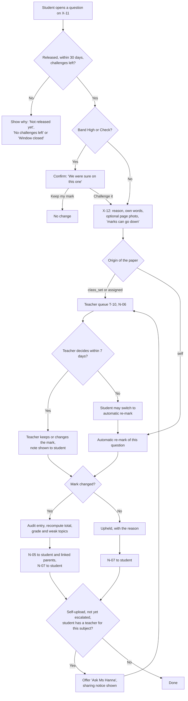

#### 7.10.4 The automatic re-mark

| Rule | Goals | Basis |
|---|---|---|
| Re-marks only the challenged question, from its page crop, plus the extra page or replacement photo the student pointed to | PR | [repo: lemely/io/adjudication.py:232] (§2.2 Re-mark) |
| Uses the structured reason (which page, misread) but never feeds the student's free text to the marker. Free text would let a student instruct the model ("give full marks"). The free text goes to the teacher and to OPS-04. | TR, PR | [assumption: test the change rate with and without the structured hints] |
| Result is binary for the student: kept, raised or lowered, with a one-line paraphrased reason | TR | [assumption: see §10.8 X-13] |
| Cost is recorded per challenge (`challenge_resolved.cost_usd`). The planning estimate is about $0.007 per question, unmeasured, so at most about $0.02 per paper at 3 challenges. | PR | [repo: BUILD/accuracy-runs/claude-e2e2-0625-w24-41-enh1/COST.md (opportunity 3, a leaf-scoped Sonnet estimate, not Haiku)] (§8.1.2 (re-mark allowance)) [assumption A-C] |
| If the re-mark itself fails, the challenge stays open, retries once, and then routes to the teacher if one exists. Otherwise: "We couldn't finish the re-mark. Your mark stands for now and we'll try again." | TR | [assumption: test by forcing a re-mark failure on staging and checking the retry, then the teacher route or OPS-08] |

Relation to self-review:
- The existing self-review asks the student to commit their own per-point verdicts and calls an LLM judge [repo: lemely/db/self_review_repo.py].
- Recommend retiring it from the student result in favour of Challenge, so there is one dispute path. Keep its revision-row pattern and its shared totals and weakness recompute as the engine for applying any change [repo: lemely/db/self_review_repo.py (one apply path shared with teacher override)].
- Trade-off: self-review teaches self-assessment (RM), but it exposes mark points per question, which conflicts with R5 (§7.1) [repo: lemely/db/self_review_repo.py].

#### 7.10.5 Teacher decision (T-10, T-05)

| Element | Design | Goals | Basis |
|---|---|---|---|
| Queue | Challenges first in T-10, oldest first, with waiting time: "Q7 · Omar Saleh · waiting 2 days" | TR | [repo: lemely/web/schemas_review.py (waitingHours)] |
| Item | Student's answer crop, current mark and band, student's reason and free text, filtered rationale, re-mark result if one ran | TR | [repo: lemely/web/routers/review.py] |
| Actions | Keep mark, or set a mark from 0 to max. A note is required on keep and on change; it is shown to the student. | TR | [repo: lemely/db/review_repo.py:719-814 (override with note)] |
| Teacher copy | "14 answers below 'sure' and 3 challenges are waiting." | TR | [repo: PRODUCT.md:100 (teacher voice)] |

#### 7.10.6 Notification and audit trail ⚠ Minor-data

| Item | Design | Goals | Basis |
|---|---|---|---|
| Outcome to student | N-07 for every outcome: "Ms Hanna looked at Q7 and added a mark." · "We re-marked Q7. Your mark stays at 2/4: the method step wasn't shown." | TR | [repo: .impeccable/mocks/student-r1 (teacher reply copy)] (§6.12 N-07) |
| Change to student and parents | N-05 on any change from a challenge, teacher override or re-mark. When the grade moves: "Your grade on Paper 42 is now B." | TR | [assumption: see §6.12 N-05] |
| Result marker | X-10 shows "Updated 14 Nov" in the header, and the changed row shows old → new | TR | [assumption: test in the A-BW comprehension check and with `result_viewed` after `mark_changed`] |
| Audit entry | One append-only record per change: submission, question, from, to, source (`override` / `challenge` / `remark`), actor, reason code, note, time, marker version, cost. The original AI mark is never overwritten. | TR, PR | [repo: lemely/db/models/attempts.py:374-381 (AI mark kept beside the override)] |
| Who sees it | Student: the full history on X-11. Teacher: for scripts in class context. Parent: change lines on released results. Ops: aggregate change rates in OPS-04. | TR | [assumption: see §10.8 OPS-04] |
| Side effects | Total, grade and weak topics are recomputed on the same path as a teacher override. XP is never re-awarded. | TR | [repo: lemely/db/self_review_repo.py; lemely/web/routers/student.py:1150-1198 (XP dedupe on upload)] |
| Learning signal | Changed marks are logged as labelled accuracy data for calibration, which today has no labelled set | TR | [repo: BUILD/ACCURACY-FINAL-REPORT.md (eval/labels empty)] |

### 7.11 Failure states

| Failure | Detected at | User sees | Recovery | Paper charged? | Event reason | Goals | Basis |
|---|---|---|---|---|---|---|---|
| Wrong file type, over 25 MiB, over 40 pages, malformed PDF | Upload (413/422) | The limit, named plainly; other files kept | Fix and resend | No | — | TR | [repo: lemely/web/upload_utils.py; lemely/io/_scan_common.py:63] |
| Render worker busy | Upload (503) | "Busy for a moment. We'll retry sending." | Automatic resend of the upload only (no marking) | No | — | RM | [repo: lemely/web/upload_utils.py (SANDBOX_UNAVAILABLE_DETAIL)] |
| Blurry, cut-off or dark page | On device | "Page 4 is blurry. Retake it?" | Retake or keep anyway | No | — | TR, PR | [assumption: on-device check] |
| Cover unreadable | identifying | Picker (§7.3) | Pick the paper | No | — | TR | [repo: lemely/web/routers/student.py:1055-1063] |
| Paper not in the corpus | identifying or X-21 | X-22 | Notify me, add a scheme (deterministic), or mark another paper | No | `no_scheme` | TR, PR | [repo: lemely/web/routers/student.py:1068-1075] |
| Subject out of scope | X-21 | X-22 scope message | Notify me | No | `unsupported` | TR | [repo: lemely/db/seed.py:6-8] |
| Answers can't be matched to questions | marking | Binding-gate message, then "Fix my pages" opens "Your pages" with the staged pages still on the device | Reorder or add pages, resend | No | `pages_unmatched` | TR | [repo: lemely/web/services/grading.py:40-43] |
| Server error or timeout | marking | "Something went wrong on our side… No paper used." | Start again (at most 2 times) | No | `error` / `timeout` | TR, PR | [repo: .impeccable/mocks/upload-r1/final.html] |
| Run stopped without a terminal state | Processing for more than 20 min | Same as a server error | Start again | No | `stale` | TR | [repo: lemely/web/routers/student.py:766] |
| Partial: some questions unreadable, missing or dropped | marking complete | Result with "Not marked" rows and the total note "2 answers not marked (6 marks)". Paper badge: "Partly marked". | Challenge with a clearer photo (§7.10.2) | Yes if at least half of the paper's marks were marked; otherwise the paper is returned and the result is still shown | — | TR, PR | [repo: lemely/core/schemas.py:105-142 (no partial label today)] [assumption: 50% threshold] |
| Deleted mid-run | marking | Run stops quietly | — | No | `error` | TR | [repo: lemely/web/routers/student.py:1243-1249] |
| Class set: some scripts fail | per script | "26 marked, 2 need you" with a reason per script | Start again per script, or remove | Only for marked scripts | per script | TR, PR | [repo: .impeccable/mocks/upload-r1/desktop.html] |
| Class set: unmatched names | T-03 | "3 names need you" | Match or skip | Skipped scripts are not charged | — | RM | [repo: .impeccable/mocks/upload-r1/final.html (name check)] |

The partial-charge rule trades PR (we paid for the run) against TR, because charging a full paper for a mostly unreadable script feels unfair. **Recommend the 50% rule.** Measure it with `marking_completed.n_not_marked` and `marking_failed.paper_refunded` [assumption: 50% is a proposal the owner confirms in OPS-05; read both fields after the first 100 papers].

### 7.12 Events and notifications this section uses

| Moment | Events (§3.7) | Notifications (§6.12) | Basis |
|---|---|---|---|
| Upload and identification | `anon_upload_started`, `anon_upload_blocked`, `paper_confirmed` | — | [assumption: see §3.7] |
| Marking | `marking_started` (with `retry_n`), `marking_completed`, `marking_failed` | N-01, N-02, N-03 | [assumption: see §3.7, §6.12] |
| Result | `result_viewed`, `question_why_opened`, `anon_result_viewed`, `second_paper_marked` | — | [assumption: see §3.7] |
| Release | `set_released` | N-04, N-08 | [assumption: see §3.7, §6.12] |
| Challenge | `challenge_submitted` (with `reason_code` and `escalated`), `challenge_resolved`, `mark_changed` | N-05, N-06, N-07 | [assumption: see §3.7, §6.12] |

### 7.13 Trade-offs decided in this section

| # | Conflict | Recommendation | Basis |
|---|---|---|---|
| E1 | Server-owned runs (engineering cost) vs the L6 plan of a client-held POST (RM, TR) | Server-owned run (C); `--no-cpu-throttling` only as a stopgap | [repo: redesign/f1-ui-kit:docs/superpowers/plans/2026-11-15-redesign-l06-upload.md:190] |
| E2 | LLM fallback parse for attached schemes (RM, coverage) vs PR | Deterministic parse only | [repo: BUILD/accuracy-runs/e2e-0625-w24-41-2026-10-19/COST.md:18-20] |
| E3 | Verbatim scheme wording as evidence (TR) vs copyright | Paraphrased criteria plus the verbatim filter | [repo: corpus/README.md:3-10] |
| E4 | Hold-to-reveal delight (RM) vs accessibility | Tap or Enter button; hold is optional; skipped under reduced motion | [assumption: test with a reduced-motion and keyboard pass on X-10] |
| E5 | Feeding the student's reason to the re-mark (TR, it fixes misreads) vs gaming (PR, TR) | Structured hints only; free text goes to humans | [assumption: test the change rate with and without the structured hints (§7.10.4)] |
| E6 | Teacher authority over class-work challenges (D4) vs a student stuck waiting | Automatic re-mark offered after 7 days; a teacher decision still wins | [repo: lemely/db/models/attempts.py:374-381] |
| E7 | Charging for a partly marked paper (PR) vs fairness (TR) | Charge only when at least 50% of marks were marked | [assumption: see §7.11; read `marking_completed.n_not_marked` and `marking_failed.paper_refunded`] |
| E8 | Instant homework results (RM) vs teacher release (TR, D4) | Per-assignment switch, off by default | [assumption: owner confirms (Q15); compare `set_released.hours_from_marked` with the switch on and off] |
| E9 | Hiding Challenge from solo students (L7) vs D4 "everyone can challenge" | Always show it; the automatic re-mark is the solo route | [assumption: D4] |

## 8. Monetisation

This section covers what Lemely sells, the free allowance, where paywalls sit, the three card checkouts, what happens after payment (failure, expiry, renewal, downgrade, refunds) and the gateway.
Payment rails follow D2: cards only, through Paymob's hosted Unified Checkout redirect, as built on `feat/paymob-integration`.
All prices and pool sizes are owner-unapproved proposals [assumption A-P: owner sets them in OPS-05; measure PA by SKU and OPS-02 margin].

### 8.1 Plans, prices and free allowance

#### 8.1.1 Principles

| # | Rule | Goals | Basis |
|---|---|---|---|
| M1 | Every price, allowance and balance is shown in **papers**. Units, credits and estimates in ranges never appear. | PA, TR | [repo: feat/paymob-integration:lemely/core/metered_actions.py:85 (ledger stays in units)] [assumption: §8.1.5] |
| M2 | One completed marking costs exactly 1 paper. Failed runs, unsupported papers, challenges and re-marks cost nothing. | TR, PR | [repo: feat/paymob-integration:docs/superpowers/specs/2026-11-02-paymob-billing-design.md §2.4 (the actual-cost charging, 120-unit hold and usage debt this replaces)] [assumption: §8.1.5 rule 2; test with A-FL] |
| M3 | The free allowance is always visible as "N papers left" on S-01, S-02, X-17 and P-02. | PA, RM, TR | D3 [assumption: P3 exit check confirms the meter renders on each listed screen; read `paywall_shown.papers_left`] |
| M4 | Prices are VAT-inclusive EGP. Every one-off pack says "one payment, no renewal". Monthly says "renews every 30 days, cancel any time" on X-14 and again on X-15. | TR, PA | [assumption A-V: accountant rules on VAT] |
| M5 | No countdown discounts, fake scarcity or "most popular" claims aimed at minors. A highlighted SKU is labelled with the reason it suits the user ("Covers a whole session"), not with popularity. | TR | [repo: docs/strategy/2026-11-16-new-user-flows.md:189; feat/paymob-integration:web/src/portals/marketing/Pricing.tsx (no "most popular" badge, no fabricated pricing)] |
| M6 | Under-18 beneficiaries are never put on auto-renew unless a parent is the payer (§8.1.6 T5). | TR, PA | [repo: docs/strategy/2026-11-16-new-user-flows.md:189] |

#### 8.1.2 Cost and fee inputs

| Input | Value | Basis |
|---|---|---|
| FX | 1 USD = EGP 55.8 | [repo: feat/paymob-integration:docs/billing/research/07-egypt-mena-pricing.md §4] |
| LLM cost per paper | Measured mean $0.0492, worst $0.0655; planning range $0.06-0.08 (§2.5) | [repo: BUILD/accuracy-runs/claude-c-2026-10-26-live3/FLIP.md:38-51; BUILD/accuracy-runs/claude-e2e2-0625-w24-41-enh1/COST.md] |
| Re-mark, challenge and failed-run allowance | +15% on the planning cost, giving a loaded cost of $0.069-0.092 (EGP 3.85-5.13) per paper | [assumption: arithmetic. 10% of papers re-run once (+10%), plus 20% of papers × 3 challenged questions × ~$0.007 per question (+~1-2% of a $0.07 paper), rounded up. The per-question figure is an unmeasured estimate (repo: BUILD/accuracy-runs/claude-e2e2-0625-w24-41-enh1/COST.md opportunity 3, a leaf-scoped Sonnet estimate, not Haiku). Test with `challenge_resolved.cost_usd`.] |
| Paymob card fee | 2.75% + EGP 3 per successful charge | [source: https://paymob.com/en/pricing] (via repo: feat/paymob-integration:docs/billing/research/03-payouts-fees-legal.md §2) [assumption: the rate is contractual, so get the signed rate card] |
| VAT on the gateway fee | 14% | [assumption: confirm with the Paymob contract] |
| VAT on Lemely's sales | 14% unless an education exemption applies. Margins are shown both ways, with prices VAT-inclusive. | [repo: feat/paymob-integration:docs/billing/research/03-payouts-fees-legal.md §4; feat/paymob-integration:docs/billing/research/07-egypt-mena-pricing.md §3.5] [assumption: A-V, accountant rules on AI marking and prepaid credits] |
| Research anchors | Packs EGP 99/299/799/1,999; student monthly ~249; teacher 999-1,999 a month (thin evidence) | [repo: feat/paymob-integration:docs/billing/research/07-egypt-mena-pricing.md §4] |

#### 8.1.3 Price list

| SKU | Who buys | Price EGP (USD at 55.8) | What it gives | Rail | Shown to | Goals | Basis |
|---|---|---|---|---|---|---|---|
| Anonymous first paper | visitor | Free | 1 paper per device and network, before signup | none | X-02 | PA, RM | D3 [assumption: test with claim rate and anonymous spend against the OPS-01 cap (A-AN)] |
| Student free allowance | new student | Free | 2 papers, one-time, issued at X-07 | none | S-01 meter | PA | [repo: feat/paymob-integration:lemely/db/usage_catalogue_repo.py:43-45 (250 hidden units ≈ 2 papers; made visible here)] |
| Try pack | student 15+, parent | 99 ($1.77) | 5 papers, 12 months | card pack | X-14 | PA | [repo: feat/paymob-integration:docs/billing/research/07-egypt-mena-pricing.md §4] |
| **Season pack** (highlighted for under-18s and parent payers) | student 15+, parent | 449 ($8.05) | 30 papers, 12 months | card pack | X-14 | PA, PR, RM | [assumption: §8.1.3, size tuned to one session] |
| Monthly | 18+ student, parent | 249 ($4.46) per 30 days | 20 papers a period, no rollover | card subscription | X-14 (hidden for under-18 self-payers) | PR, RM | [repo: feat/paymob-integration:docs/billing/research/07-egypt-mena-pricing.md §4 (anchor)] [assumption: M6] |
| Teacher free workspace | teacher | Free, forever | 10 seats, 15 class-pool papers a month (refills after the first month need 3 joined students, §5.1 T4) | none | T-01 meter | RM, PA | D1 [assumption: sizes tested with the first ten teachers (§13.3 T1, T7); owner confirms in OPS-05] |
| Teacher pilot | teacher | Free for 60 days | 30 seats, 60 class-pool papers | none to the teacher: a priced teacher tier with 30 included seats, activated by OPS-06 as a complimentary subscription (no payer, no charge). The automatic start when 3 students join is new code (B-31). | T-01, T-12 | PA, RM | [repo: feat/paymob-integration:lemely/db/admin_customer_repo.py:846-849 (only an active, priced plan can be activated); feat/paymob-integration:lemely/db/teacher_team_repo.py:1034-1075 (a manual subscription counts toward capacity)] |
| Teacher seat | teacher | 40 ($0.72) per seat a month beyond 10 | Seat plus 4 class-pool papers a month | card subscription on a priced seat tier (code change, see below) | T-08, T-12, X-14 | PA, PR | [repo: feat/paymob-integration:lemely/db/models/billing.py (extra_seat_price_minor); feat/paymob-integration:lemely/db/merchant_charge_repo.py:798 (extra seats only on a live paid plan)] |
| Teacher pack | teacher | 399 ($7.15) | 50 class-pool papers, 12 months | card pack | T-02 (PW-5), X-14 | PA, PR | [assumption: price sits between the EGP 299 and 799 pack anchors (§8.1.2) at EGP 7.98 a paper, a volume rate below the Try pack's EGP 19.80; margin 22-40% per the §8.1.4 arithmetic; test with `payment_succeeded` by sku (§13.3 T7)] |
| Parent purchase | parent | Same student SKUs | payer = parent, beneficiary = child | as above | P-05 | PA | [repo: feat/paymob-integration:docs/superpowers/specs/2026-11-02-paymob-billing-design.md §2.1] |

**Teacher seat mechanics need a code change.** The branch refuses a zero-price tier on every path: complimentary activation raises `plan_not_activatable` [repo: feat/paymob-integration:lemely/db/admin_customer_repo.py:846-849], a purchase raises `PlanNotPurchasable` [repo: feat/paymob-integration:lemely/db/subscription_repo.py:350,1844], and extra seats can only be bought on a live paid subscription [repo: feat/paymob-integration:lemely/db/merchant_charge_repo.py:798]. A "free base plus paid extra seats" subscription therefore does not work as built. Two options:
- (A) Allow `price_minor = 0` teacher tiers and bill only their extra seats. One tier covers everyone, but it loosens three guards that stop unbillable plans (PR risk).
- (B) Give every teacher 10 free seats as the capacity default when no plan is live (code already needed for D1, B-31). Sell paid seats as a priced seat tier: EGP 40 a month with 11 included seats, and extra seats at EGP 40 each. The guards stay intact, and extra seats and proration use the built paths.

**Recommend B.** The seat price model in §8.1.4 still holds, because each paid seat costs EGP 40 a month under either option [assumption: verify in sandbox that the priced seat tier subscribes, adds extra seats and prorates; test with `seat_state_changed` via paid].

Yearly tiers and auto top-up are left out of the launch offer, although the branch builds both.
- **Yearly (360-day) tiers** [repo: feat/paymob-integration:docs/superpowers/specs/2026-11-02-paymob-billing-design.md §2.1]: the Season pack already covers a full session without auto-renewal, so a yearly tier serves no goal that the pack misses. Cut.
- **Auto top-up** [repo: feat/paymob-integration:docs/superpowers/specs/2026-11-02-paymob-billing-design.md §5.5; feat/paymob-integration:web/src/portals/billing/AutoTopupCard.tsx] adds recurring revenue (PR). Against it: it charges a saved card with no customer present (MOTO, with chargeback liability on the merchant), and it puts minors on an automatic charge (TR). No flag exists on the branch: auto top-up is a per-user setting behind a live user API (GET and PUT /billing/auto-topup), and AutoTopupCard renders it [repo: feat/paymob-integration:lemely/web/routers/billing.py:962-1013; feat/paymob-integration:lemely/runtime/config.py]. Recommend adding a server flag that refuses PUT /billing/auto-topup and hides AutoTopupCard, off at launch (B-52), and not seeding 360-day tiers. Revisit for 18+ and teacher payers once PA is measured [assumption: test as an opt-in for teachers whose class pool runs out twice].

#### 8.1.4 Unit economics (full use of every paper; loaded LLM cost $0.069-0.092 = EGP 3.85-5.13 per paper)

The card fee is 2.75% + EGP 3 per successful charge, plus 14% VAT on the fee [source: https://paymob.com/en/pricing] (via [repo: feat/paymob-integration:docs/billing/research/03-payouts-fees-legal.md §2]) [assumption: contractual rate; get the signed rate card].

| SKU | Price | Card fee incl. VAT on fee | LLM + allowance (best–worst) | Gross margin, no sales VAT | Gross margin, 14% sales VAT | Break-even papers per purchase (worst, VAT) | Basis |
|---|---|---|---|---|---|---|---|
| Try pack | 99 | 6.52 | 19.25–25.67 | 66.8–73.2 (67–74%) | 54.7–61.1 (63–70%) | 15.6 (5 included) | [assumption: arithmetic, §8.1.4] |
| Season pack | 449 | 17.50 | 115.5–154.0 | 277.5–316.0 (62–70%) | 222.4–260.9 (56–66%) | 73.3 (30 included) | [assumption: arithmetic] |
| Monthly | 249 | 11.23 | 77.0–102.7 | 135.1–160.8 (54–65%) | 104.5–130.2 (48–60%) | 40.4 per period (20 included) | [assumption: arithmetic] |
| Teacher seat (fee spread over a ≥10-seat charge of 400) | 40 | 1.60 | 15.4–20.5 | 17.9–23.0 (45–58%) | 13.0–18.1 (37–52%) | 6.5 per seat (4 included) | [assumption: arithmetic] |
| Teacher seat, 1 seat bought alone | 40 | 4.67 | 15.4–20.5 | 14.8–19.9 (37–50%) | 9.9–15.0 (28–43%) | 5.9 (4 included) | [assumption: arithmetic, same method as the rows above] |
| Teacher pack | 399 | 15.93 | 192.5–256.7 | 126.4–190.6 (32–48%) | 77.4–141.6 (22–40%) | 65.1 (50 included) | [assumption: arithmetic] |
| Example paid teacher: 30 students, 20 paid seats, 95 pool papers | 800 | 28.50 | 365.8–487.7 | 283.8–405.7 (35–51%) | 185.5–307.4 (26–44%) | n/a | [assumption: arithmetic] |

Margin % is margin over net revenue: the price, divided by 1.14 when sales VAT applies.

Free cost per acquired user (worst, loaded) [assumption: arithmetic, §8.1.4]:

| Free user | Papers | Cost EGP (USD) | Cap |
|---|---|---|---|
| Student: 1 anonymous + 2 at signup | 3 | 15.40 ($0.28) | Once per person; the anonymous paper is bounded by the USD 5/day anonymous cap (§8.2) |
| Teacher pilot | 60 | 308 ($5.52) | Once per teacher, OPS-06 activates it |
| Active free teacher after the pilot | up to 15/month | up to 77/month ($1.38) | Free workspace pool |

Break-even conversion (worst, with sales VAT):
- Students need 1 payer per 3.5 free signups if the first purchase is a Try pack, or 1 per 14 if it is a Season pack.
- No conversion data exists, so §3.7 events instrument PA.

[repo: PRODUCT.md:127 (no pricing or usage numbers exist)] [assumption: arithmetic]

Margin trade-offs specific to this section:
- **Small baskets.** The card fee (2.75% + EGP 3, plus VAT on the fee) takes 6.6% of a Try pack but 3.9% of a Season pack, most of the gap coming from the fixed EGP 3. Keeping the Try pack costs margin (PR) but lowers the first-purchase barrier (PA). Recommend keeping it at 99 and steering minors and parents to the Season pack with the highlight.
  - [assumption: if Try pack buyers rarely buy again, raise it to 7 papers for 129, or drop it; read `payment_succeeded` by sku and `is_first_payment`]
  - A Paymob convenience fee is possible [source: https://developers.paymob.com/paymob-docs/payments-and-features/core-features/convenience-fee] (via [repo: feat/paymob-integration:docs/billing/research/03-payouts-fees-legal.md:92]), but surcharging a EGP 99 pack hurts TR. Do not use it.
- **Teacher pack.** This is the thinnest SKU (22–40% with VAT). It exists so a class set is never stranded at PW-5. Recommend keeping it, but presenting "Add seats" first on PW-5, because seats carry recurring margin (PR) and seat students (RM).

#### 8.1.5 Charging mechanics (binding for UI)

1. Every surface shows papers, never units or credits. The ledger stays in units [repo: feat/paymob-integration:lemely/core/metered_actions.py:85].
2. A completed `mark_paper` job costs exactly 1 paper; actual LLM cost is recorded for margin only (OPS-02). This replaces actual-cost charging, the 120-unit hold and usage debt. The branch spec leaves the acceptability of usage debt and expiry open for counsel [repo: feat/paymob-integration:docs/superpowers/specs/2026-11-02-paymob-billing-design.md §2.4, §10], and actual-cost charging is also hard for minors and parents to predict [assumption: test with A-FL]. A run where less than half of the paper's marks could be marked returns its paper (§7.11). Trade-off: long scripts (up to $0.066 measured) cost more than short ones ($0.013), so PR carries the variance; TR and PA gain a predictable price. **Recommend flat** [assumption: A-FL; watch p95 cost per paper in OPS-02, since the tier cliff sits above ~22 pages per repo: lemely/runtime/config.py:276].
3. Drawing order: `class_set` and `assigned` submissions draw from the class pool, then from teacher packs. `self` submissions draw from the student's free allowance, then the subscription period, then packs, so the papers that expire soonest go first. `anonymous` submissions draw from the anonymous allowance [assumption: new rule; B-32 changes the branch's seat-allowance draw].
4. When the class pool is exhausted, assigned uploads fall back to the student's own papers only after the student confirms. They are never silently charged to a student [assumption: test with `marking_started.payer_type` on assigned work].
5. Non-paper LLM actions are free and unmetered in v1: flashcards, quick-check generation and the practice redo (at most 5 questions per marked paper, one redo per question, §9.3). Smoke cost was $0.0001-0.0005 per call (n=1 each); OPS-02 monitors it, and the OPS-01 kill switch pauses the redo with free marking [repo: .superpowers/sdd/c-p4-smoke.md:3-9] [assumption: cost per call logged, B-01].
6. The enforcement flags `LEMELY_USAGE__ENFORCE` and `LEMELY_TEAM__ENFORCE_TEACHER_SEATS` ship OFF on merge (D5) and are turned on only when this price list is live [repo: feat/paymob-integration:lemely/runtime/config.py:1263,1296].

#### 8.1.6 Pricing trade-offs

| # | Conflict | Options | Recommendation | Basis |
|---|---|---|---|---|
| T1 | Card-only rails (D2) vs wallet-first Egyptian parents (PA) | Cards as built, or wallets, Fawry and InstaPay | **Cards as built (D2, not reopened).** About 4.8M credit-card holders, but card checkout may accept 19.7M debit and 21.6M prepaid cards. The real gap is wallets (about 60M), Fawry and InstaPay, and debit and Meeza authorisation is untested. The Season and Try packs are one-off card buys, so a household without its own card can use a relative's or a prepaid card. Wallets stay assumption A-W, with the trigger in §8.6. | [repo: feat/paymob-integration:docs/billing/research/07-egypt-mena-pricing.md:18,203] [assumption: A-W; track `payment_failed` by reason and X-14 "no card" exits] |
| T2 | Anonymous first paper (PA, RM) vs cost and abuse (PR) | No anonymous paper, or one guarded paper | **One guarded paper (D3).** The guards are in §8.2. Worst-case exposure is bounded by the daily anonymous spend cap. | [repo: lemely/io/cost_ledger.py (web enforces no spend cap today); docs/deployment.md:145] |
| T3 | Monthly free refill (RM) vs PR and PA | None, or 1 free paper a month for free students | **None at launch.** RM comes from teacher-assigned work (the teacher pays) and the result → next-paper loop. A refill costs up to EGP 5.13 per active free student a month, against a Try-pack margin of EGP 54.7. Test the refill as an RM experiment once PA is measured. | [assumption: A/B test, primary metric second paper within 14 days, guardrail paid conversion] |
| T4 | Teacher free forever (RM, distribution) vs PR | 15 papers a month forever, or the pilot only | **15 papers and 10 seats forever**, refilled monthly while at least 3 students are joined. A teacher who stops paying keeps the class alive, and its students keep marking on their own allowance, which feeds the student funnel. Cost is capped at EGP 77 per active free teacher a month. | [assumption: D1; §5.1 T4] |
| T5 | Season pack hero (PA for parents) vs Monthly (recurring PR) | Highlight one of the two | **Highlight the Season pack** for under-18 beneficiaries and parent payers. Monthly is listed first for 18+ self-payers, offered to parents, and hidden from under-18 self-payers, because a minor is never put on auto-renew without a parent payer. | [repo: docs/strategy/2026-11-16-new-user-flows.md:189] [assumption: test with `paywall_shown` → `payment_succeeded` by sku] |
| T6 | Anonymous result depth (TR, PA) vs signup conversion (PA) | Full result before signup, headline only, or nothing | **Headline before signup** (score, grade with provenance, band counts, top weak topic). Per-question marks, "See why", challenge and saving need an account. It is a complete headline, never a blurred teaser. This departs from the strategy draft's "gate the whole result". | [repo: docs/strategy/2026-11-16-new-user-flows.md:94-101] [assumption: test `anon_result_viewed` → `signup_completed`] |

### 8.2 Anonymous first paper and the free allowance (D3) ⚠ Minor-data

The anonymous paper exists to show value before any signup. Its guards bound cost and abuse, keep a minor's script out of reach of strangers, and lead the visitor into an account.

| Guard or rule | Design | Basis |
|---|---|---|
| Bot check | Cloudflare Turnstile before the upload. It already exists on main and develop for the waitlist. | [repo: origin/main:lemely/web/turnstile.py; origin/develop:lemely/web/turnstile.py; origin/main:web/src/portals/marketing/waitlist/turnstile.ts] |
| Per-device and per-network cap | 1 anonymous submission per device token (httpOnly cookie plus local storage) and per IP per 24 h. A failed run returns the allowance. Abandoning at X-21 after detection still spends the device's try, which stops repeat probing (detection is about 2% of a run's cost). | [repo: docs/strategy/2026-11-16-new-user-flows.md:74; BUILD/accuracy-runs/claude-e2e2-0625-w24-41-enh1/COST.md] [assumption: measure repeat attempts via `anon_upload_blocked`] |
| Global daily anonymous spend cap | USD 5 a day of anonymous LLM spend (about 54-72 papers at the loaded cost), set in OPS-01 and sized again from measured p95 cost. When it is hit, X-02 shows "Free marking is full for today. Create an account to use your 2 free papers." | [repo: docs/deployment.md:145 (no spend cap in the web process today)] [assumption: tune from 14 days of data] |
| Platform kill switch | One OPS-01 toggle pauses all new free marking (anonymous, allowance and practice redo). Paid, pack and class-pool marking continue, and running jobs finish. | [assumption: new; B-06] |
| Age check | Before the upload: "Are you 15 or older?" "No" accepts no script and routes to X-05 (student signup with date of birth), then X-08 and X-24 for guardian consent. A visitor has no account, so X-24 cannot open before signup. | [source: https://www.tamimi.com/our-knowledge/publications/general/Articles/from-policy-to-practice-egypt-issues-executive-regulations-of-the-personal-data-protection-law/] [assumption: A-L, self-declared age; counsel confirms it suffices] |
| Age conflict | A visitor who answered "15 or older" and later gives a date of birth under 15 at X-05 goes to X-08. The anonymous result stays unclaimed and is claimed only after guardian consent, or deleted at its 7-day deadline. | [assumption: A-L, A-R] |
| Data collected | Script, subject and device token only. No name or email. Copy asks the visitor to leave their name off the cover; a cover name is never stored as an identity. | [assumption: data minimisation; counsel] |
| Third-party processing notice | Before the upload: "Your pages are read by our AI providers (Anthropic, Google) and deleted after marking". This also fixes the stale /data copy. | [repo: web/src/portals/marketing/dataHandling.ts:108; lemely/runtime/config.py:174-184] |
| While marking | X-03 visitor variant: "Keep this tab, or come back on this device within 7 days." A visitor gets no notifications. | [assumption: no contact is collected] |
| Shown before signup | X-04 headline only (T6): score, grade with provenance, band counts and the top weak topic, then PW-1. Per-question marks, "See why", challenge and saving need an account. | [assumption: §8.1.6 T6] |
| Claim | Signup on the same device within 7 days moves the submission into the new account, and the full X-10 opens. X-04 shows the expiry date because no contact exists to send a reminder. A cleared cookie loses the result, and the visitor is told this in advance. | [assumption: test the claim rate `anon_result_claimed` / `anon_result_viewed`] |
| Retention | Unclaimed scans and results are deleted 7 days after the result; claimed ones follow account retention. Scans are never used for training. The uploads bucket deletes at 90 days today, so anonymous scans need a shorter rule. | [repo: docs/deployment.md:139] [assumption: A-R, counsel] |
| Allowance after signup | 2 papers, one-time, issued at X-07 verification. Always visible as "N papers left" on S-01, S-02, X-21, X-10, X-17 and the header. No monthly refill at launch (T3). | [repo: feat/paymob-integration:lemely/db/usage_catalogue_repo.py:43-45 (250 hidden units ≈ 2 papers, made visible here)] [assumption: A-P] |

Cost and abuse trade-off. Each free paper costs up to EGP 5.13 with no revenue, so a student's free papers (1 anonymous plus 2 at signup) cost up to EGP 15.40 (§8.1.4). The anonymous paper buys an early value moment (PA, RM) and puts a proven result in front of the visitor before any price (TR). The daily cap bounds the worst day, and the device and network cap bounds repeats. **Recommend the guards as specified**, with the anonymous paper shipped last, after checkout exists (§12.1), and `anon_upload_blocked` read against `anon_result_claimed` [assumption: A-AN; tune the cap after 14 days of data].

### 8.3 Where the paywall sits and why

Rules for every position:
- A paywall never interrupts a running job or an open result.
- A staged script is never lost.
- Challenges and failed runs are always free.
- Every button states its cost in papers or EGP.

[repo: docs/strategy/2026-11-16-new-user-flows.md:189] [assumption: test reach and conversion per position with `paywall_shown`]

| ID | Screen | Trigger | What the user sees | Options | Checkout it opens | Goals |
|---|---|---|---|---|---|---|
| PW-1 | X-04 Anonymous result | Result ready for a visitor | Headline result, then "Save it and see every mark: create a free account. You get 2 more papers." | Sign up · Not now | None (account gate). It is the highest-intent signup moment. | PA, RM |
| PW-2 | S-02 Scan, entry | Balance = 0 at Scan | "You're out of papers. Your next one is a tap away." Shown before the camera opens. A script captured through the share target stays staged on the device and is never uploaded unpaid. | Season pack (highlighted) · Try pack · Monthly (18+ only) · Ask a parent | (b) student, or (c) through Ask a parent. Value is proven and intent is highest. | PA, PR |
| PW-3 | X-10 Result, under "Mark another paper" | Balance ≤ 1 | Inline card under the next-step block: "1 paper left. Season pack covers 30." | Same as PW-2 · dismiss | (b) or (c). Rides the result without blocking it. | PA, RM |
| PW-4 | S-01 Home | Balance = 1 | The papers-left meter turns into a non-blocking nudge | View plans | X-14, no checkout until chosen. A warning, not a block. | PA |
| PW-5 | T-02 Class set estimate | Set size > class pool | "This set: 28 papers. You have 15." | Mark the first 15 now · Add seats · Teacher pack | (a) "Add seats" first, or a Teacher pack. Before the run, never mid-run; a half-marked set is never stranded. | PA, PR |
| PW-6 | T-08 Seats | A student joins with no free seat | "Ahmed is waiting for a seat." | Add 1 seat (EGP 40/mo) · Add all waiting · Leave pending | (a). Nobody is refused (D1), and the teacher sees concrete names. | PA, RM |
| PW-7 | T-12 Pilot summary | 7 days before and on day 60 | Value summary (papers marked, sets released, students seated), then the seat choice | Keep N seats · Stay on the free workspace | (a). A value moment, not a countdown. | PA |
| PW-8 | X-24 Ask a parent, then P-01 and P-05 ⚠ Minor-data | Student taps Ask a parent at PW-2 or PW-3 | Share sheet with a prefilled message and a pay-for-me link. Before linking, the parent sees only the child's first name, the ask and papers marked (§8.4.3). | Parent: Season pack · Try pack · Monthly | (c). Puts the purchase with the payer of a minor. | PA |
| PW-9 | X-17 billing banner, app-wide | Subscription past_due | "Your card didn't go through. You have until <date>." | Pay with another card · Switch to a pack | Recovery (§8.5.1). Keeps the paying user. | PA, PR |

Positions left out on purpose:
- No paywall on a result before its marks are seen, on Challenge, on a marking failure, or on a parent reading a child's result.
- Non-paper actions (practice, flashcards, the redo) stay free in v1 (§8.1.5 rule 5).
- No countdown discounts or fake scarcity aimed at minors [repo: docs/strategy/2026-11-16-new-user-flows.md:280].

These keep TR and RM intact at the moments a user is judging the marks.

Why no paywall before the first result: D3 and the 2 signup papers mean every user sees at least 1 marked paper before any price. Trade-off: each free paper costs up to EGP 5.13 with no revenue (PR down), but a proven result is the strongest trust signal before payment (TR, PA up). Recommend as decided (D3), and watch free cost per signup in OPS-02 [assumption: §3.4 free cost per signup].

### 8.4 Checkout flows

#### 8.4.0 Shared mechanics (all three flows)

| Step | What happens | Rule | Basis |
|---|---|---|---|
| Price | The server prices every purchase from the catalogue. The browser sends only a SKU or tier id, and a beneficiary id for parents. | The amount never comes from the client. | [repo: feat/paymob-integration:docs/superpowers/specs/2026-11-02-paymob-billing-design.md §5.1] |
| Payment row | A `payments` row is written before Paymob is called. `special_reference` = payment id. | A failed request never charged anyone, and the copy says so. | [repo: feat/paymob-integration:docs/superpowers/specs/2026-11-02-paymob-billing-design.md §6; feat/paymob-integration:web/src/lib/billingOutcome.ts (header comment)] |
| X-15 handoff | Order summary, payer and beneficiary, phone number (required by checkout, prefilled when known), the cardholder statement (§8.4.2), "You'll pay on Paymob's secure page, then come back here." | Billing data requires a phone number. | [repo: feat/paymob-integration:docs/superpowers/specs/2026-11-02-paymob-billing-design.md §5.1 step 2; feat/paymob-integration:web/src/portals/billing/CheckoutPhonePrompt.tsx] |
| Hosted page | Redirect to Paymob Unified Checkout. Cards only. Paymob hosts 3DS. Lemely never touches card data. Intention expiry is 3600 s. | Counts as in-app checkout (D2). | [repo: feat/paymob-integration:lemely/db/billing_repo.py:660-690; feat/paymob-integration:docs/superpowers/specs/2026-11-02-paymob-billing-design.md §2.7] |
| X-16 return | `/billing/return/:paymentId` ignores Paymob's query parameters. It polls our payment every 2 s for at most 3 minutes, then shows "Check again". | The redirect never sets state. | [repo: feat/paymob-integration:web/src/lib/hooks/useBillingApi.ts:173-192; feat/paymob-integration:web/src/portals/billing/CheckoutReturn.tsx] |
| Webhook | HMAC-SHA512 is verified. Amount and currency are checked against our row. The grant (papers or seats) commits in one transaction. Duplicates are no-ops. | Only the verified callback grants. | [repo: feat/paymob-integration:lemely/web/routers/paymob_webhooks.py:191,265; feat/paymob-integration:docs/superpowers/specs/2026-11-02-paymob-billing-design.md §5.1 step 4, §6] |
| Reconcile | A payment still created or pending after 15 minutes is checked by transaction inquiry, with backoff for up to 24 h. Then it is marked failed. | Covers missed callbacks and abandoned 3DS, which send no callback. | [repo: feat/paymob-integration:docs/superpowers/specs/2026-11-02-paymob-billing-design.md §5.10] |
| Double-buy guard | A second purchase for the same thing while one is confirming is refused with "A payment for this is already being confirmed." | No duplicate charges | [repo: feat/paymob-integration:web/src/lib/billingOutcome.ts (charge_in_flight)] |
| Rate limit | Checkout starts are rate-limited per user (429 with retry time). | Abuse guard | [repo: feat/paymob-integration:lemely/web/routers/billing.py:311-330] |
| Signup return | A plan chosen before signup is carried through X-05 and X-07 back to X-15. | The branch does not do this yet ("accepted gap"), so it needs a fix. | [repo: feat/paymob-integration:docs/superpowers/plans/2026-11-05-paymob-billing-00-index.md (Accepted gaps)] |

X-16 payment return states (all goals: PA, TR):

| Phase (branch status) | Heading and body | Actions | Basis |
|---|---|---|---|
| confirming (created, pending), polling | "Confirming your payment." "This usually takes a few seconds." | none | [repo: feat/paymob-integration:web/src/lib/billingFormat.ts:62-83] |
| confirming, polling stopped at 3 min | "Still confirming with your bank." "You can leave this page. We'll add your papers and email the receipt the moment it lands." | Check again · Back to <where they came from> | [repo: feat/paymob-integration:web/src/portals/billing/CheckoutReturn.tsx (pollingStopped)] [assumption: copy] |
| paid | Role copy (per flow below), then the amount and line description | Continue to the staged script or set, or Back | [repo: feat/paymob-integration:web/src/portals/billing/CheckoutReturn.tsx] |
| failed | "Your bank said no. Nothing was charged." | Try again (new intention, since the client secret is single-use) · Use another card · Ask a parent (students) | [repo: feat/paymob-integration:web/src/portals/billing/CheckoutReturn.tsx (Try again)] [assumption: extra actions] |
| mismatch (failed_mismatch) | "We're checking this payment. If you were charged, we'll refund you in full." Neutral tone, no red. | Back | [repo: feat/paymob-integration:docs/superpowers/specs/2026-11-02-paymob-billing-design.md §6 (mismatch → manual refund); feat/paymob-integration:web/src/portals/billing/CheckoutReturn.tsx header (no red for states the user did not cause)] |
| reversed (refunded, voided) | "This payment was refunded." | Back | [repo: feat/paymob-integration:web/src/lib/billingFormat.ts:75-78] |

Accessibility for X-15 and X-16:
- The status sits in a polite live region, and the heading takes focus on load.
- There is no automatic redirect after "paid". The user presses Continue (WCAG 2.2.1) [assumption: accessibility audit of X-16 before launch].
- Phase icons carry a text heading, so colour is not the only signal.
- Both screens are a single column at 320px.
- Paymob's hosted page is outside our control [assumption: audit Unified Checkout at 320px with a screen reader in sandbox before launch].

Events on every flow: `paywall_shown` → `checkout_started` → `checkout_returned` → `payment_succeeded` or `payment_failed` (§3.7).

#### 8.4.1 (a) Teacher buys seats ⚠ Minor-data (shows pending students' names)

Entry points:
- PW-6 on T-08: pending students.
- PW-7 on T-12: pilot ending.
- PW-5 on T-02: "Add seats" when a set exceeds the pool.

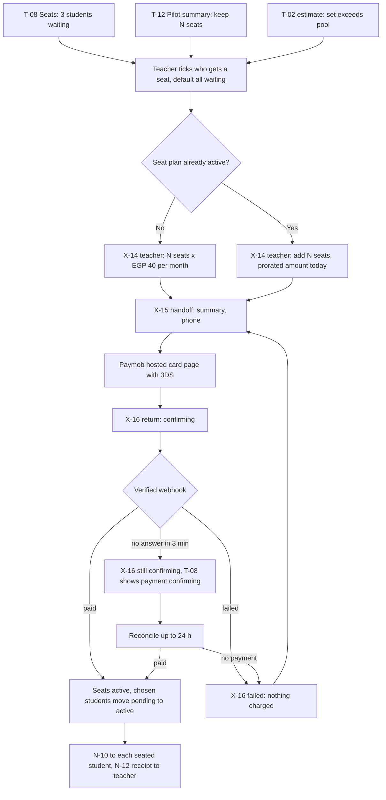

| Step | Screen | What the teacher sees (copy) | System | Goals | Basis |
|---|---|---|---|---|---|
| 1 | T-08 | "Ahmed, Sara and Omar are waiting for a seat. They can still self-mark; you can't release class work to them yet." Each name has a checkbox, all ticked by default. Buttons: "Add 3 seats: EGP 120/mo" · "Leave pending". | Pending seats from D1. The 409 `no_free_seat` is replaced. | PA, RM | [repo: feat/paymob-integration:web/src/lib/billingOutcome.ts (no_free_seat); feat/paymob-integration:lemely/db/class_repo.py:841-860] [assumption: D1] |
| 2a | X-14 teacher, first purchase | "10 seats free. You're adding 3 at EGP 40 each per month. Each seat adds 4 papers a month to your class pool. Renews every 30 days; cancel any time." Total: EGP 120/mo. | Subscription checkout on the priced seat tier (EGP 40, 11 included seats) with `extra_seats = 2`. | PA, PR | [repo: feat/paymob-integration:lemely/web/routers/billing.py:610-660 (create_subscription_checkout with extra_seats)] [assumption: §8.1.3 option B, extra_seat_price_minor = 4000; confirm S14 and proration in sandbox] |
| 2b | X-14 teacher, has a seat plan | "Adding 3 seats. EGP 84 today for the 21 days left, then EGP 120 more each month." (Numbers illustrative.) | Seat quote, then a 3DS checkout for `extra_seats`. Seats are added on the callback. | PA, PR | [repo: feat/paymob-integration:lemely/web/routers/billing.py:858-906 (seats/quote, start_extra_seats); feat/paymob-integration commit 84843fe3] |
| 3 | X-15 | Summary, phone, "You'll pay on Paymob's secure page." | Payment row, then Intention, then redirect | PA | [assumption: see §8.4.0] |
| 4 | Paymob | Card entry and 3DS | Hosted | PA | [repo: feat/paymob-integration:docs/superpowers/specs/2026-11-02-paymob-billing-design.md §2.7] |
| 5 | X-16 paid | "3 seats added. Ahmed, Sara and Omar are in. Your class pool is now 27 papers a month." Continue → T-08, or back to T-02 with the set estimate refreshed. | Webhook activates seats. Seat cache invalidated. | PA, RM | [repo: feat/paymob-integration:web/src/portals/billing/CheckoutReturn.tsx (invalidateTeam on extra_seats)] |
| 5' | X-16 still confirming | "Still confirming with your bank. Your students get their seats the moment it lands." T-08 rows show "Payment confirming". | Reconcile job | TR | [repo: feat/paymob-integration:docs/superpowers/specs/2026-11-02-paymob-billing-design.md §5.10] |
| 6 | Notifications | Students: N-10 "You're in Ms Hanna's class." Teacher: N-12 receipt by email. | Notification only | RM, TR | [assumption: see §6.12] |

Seat rules on this flow:
- The teacher picks who is seated, rather than first-come.
  - Trade-off: auto-seating oldest-first is one fewer step (PA), but it can seat a stranger who joined through a leaked join code (TR, PR).
  - Recommend explicit picking, with all ticked by default.
  - [repo: lemely/db/class_repo.py:505,930 (join codes never expire, cannot be rotated)]
- Removing a seat in mid-period takes effect at renewal. Nothing is refunded for the rest of the period.
  - The branch refuses a reduction that would leave fewer seats than seated students: "Remove students first."
  - [repo: feat/paymob-integration:docs/superpowers/specs/2026-11-02-paymob-billing-design.md §5.4; feat/paymob-integration:web/src/lib/billingOutcome.ts (seats_in_use)]
- If Paymob cannot change a subscription's amount (S14 open), seat changes fall back to a charge on the saved card at each renewal. The teacher sees one line on X-17: "Seats are billed separately at each renewal." [repo: feat/paymob-integration:docs/superpowers/specs/2026-11-02-paymob-billing-design.md §5.4 (Fallback); .claude/worktrees/paymob-integration/.superpowers/sdd/progress.md (S14, git-excluded)] [assumption: confirm in sandbox]

#### 8.4.2 (b) Student pays by card ⚠ Minor-data (minor as payer, age-dependent options)

Entry points: PW-2 (S-02, balance 0), PW-3 (X-10), PW-4 (S-01 meter), X-17.

```mermaid
flowchart TD
    A["PW-2 S-02: out of papers, script staged on device"] --> B["X-14 student plans"]
    A2["PW-3 X-10 or PW-4 S-01"] --> B
    B --> C{"Age band"}
    C -->|"under 15"| D["Only Ask a parent, go to flow c"]
    C -->|"15 to 17"| E["Season pack or Try pack, plus Ask a parent"]
    C -->|"18 or older"| F["Season, Try or Monthly"]
    E --> G["X-15: cardholder statement, phone"]
    F --> G
    G --> H["Paymob hosted card page with 3DS"]
    H --> I["X-16 return: confirming"]
    I -->|"paid"| J["X-16: papers added"]
    I -->|"failed"| K["X-16: bank said no, nothing charged"]
    I -->|"still pending"| L["Safe to leave, S-01 banner when it lands"]
    J --> M["Back to staged script, X-21 Confirm paper"]
    K --> N{"Next"}
    N -->|"Try again or another card"| G
    N -->|"Ask a parent"| D
```

| Step | Screen | What the student sees (copy, student voice) | System | Goals | Basis |
|---|---|---|---|---|---|
| 1 | S-02 (PW-2) | "You're out of papers. Your next one is a tap away." Shown before the camera opens. A script shared in from the gallery stays on this phone until it's paid for. | `paywall_shown` (PW-2). Script held locally, not uploaded. | PA, PR | [assumption: see §8.3] |
| 2 | X-14 student | Season pack first: "30 papers, EGP 449. Covers a whole session, about EGP 15 a paper. One payment, no renewal." Then Try pack ("5 papers, EGP 99"). Monthly appears only for 18+. "Ask a parent" is a full-width secondary button. "I don't have a card" is a text link to X-24 that also records the exit. | Age band from the DOB given at X-05. The SKU set is chosen on the server. | PA, PR | [assumption: M6; A-W exit measure] |
| 3 | X-15 | Checkbox: "This card is mine and I'm 18 or older, or the cardholder said yes to this payment." Phone prefilled. | Required before redirect. Stored with the payment. | TR, PA | [assumption A-L: counsel on minors' contracting capacity] |
| 4 | Paymob | Card and 3DS | Hosted | PA | [repo: feat/paymob-integration:docs/superpowers/specs/2026-11-02-paymob-billing-design.md §2.7] |
| 5 | X-16 paid | "You're topped up. 30 papers, ready when you are." Primary: "Mark your paper" (if a script is staged) → X-21. | `payment_succeeded`. Balance invalidated. | PA, RM | [repo: feat/paymob-integration:web/src/portals/billing/CheckoutReturn.tsx (invalidateOnPaid)] |
| 5' | X-16 failed | "Your bank said no. Nothing was charged. Some debit and prepaid cards need online payments switched on in the bank app." Actions: Try again · Use another card · Ask a parent. | `payment_failed` with gateway reason | PA | [assumption A-W: debit, prepaid and Meeza authorisation untested, per repo: feat/paymob-integration:docs/billing/research/07-egypt-mena-pricing.md:18,203] |
| 5'' | X-16 still confirming | "Still confirming with your bank. You can leave; your papers appear the moment it lands." S-01 shows a banner when it lands. | Reconcile job | TR | [repo: feat/paymob-integration:docs/superpowers/specs/2026-11-02-paymob-billing-design.md §5.10] |

Rules on this flow:
- The staged script is uploaded only after X-21 confirms, which happens after payment. If the user abandons, the script stays staged on the device and the S-02 banner reads "1 paper waiting to be marked".
- An under-15 student never reaches X-15. Their scripts are not processed without guardian consent either (§6.11).
- 18+ Monthly subscribers who later choose a pack keep the subscription. Papers draw from the period first, then packs (§8.1.5 rule 3), so the papers that expire soonest are used first.

#### 8.4.3 (c) Parent pays for a child through a pay-for-me link ⚠ Minor-data

Entry points: PW-8 from PW-2 or PW-3 ("Ask a parent"), X-14 "I don't have a card", S-08 "Ask a parent".

The branch only lets a parent pay for a **linked** child: the server checks `parent_child_links` [repo: feat/paymob-integration:lemely/web/routers/billing.py:610-660 (docstring); feat/paymob-integration:docs/superpowers/specs/2026-11-02-paymob-billing-design.md §5.1 step 1]. So the pay-for-me link is the existing child-issued parent link code with two extra fields, `purpose = payment` and a suggested SKU. A guest payer with no account cannot pay.
- Trade-off: guest checkout would remove the parent signup step (PA). Against it: it breaks payer ownership of receipts and cancellation, and it lets anyone holding a forwarded link pay for, and see, a minor's account (TR).
- Recommend linked-parent only, as built.

```mermaid
flowchart TD
    A["Student taps Ask a parent at PW-2 or PW-3"] --> B["X-24: pick Season or Try pack to suggest"]
    B --> C["Share via WhatsApp, SMS or copy link"]
    C --> D["Parent opens link"]
    D --> E{"Parent signed in and linked?"}
    E -->|"Yes"| H["P-05 Fund a child, suggested pack preselected"]
    E -->|"No"| F["P-01: first name, the ask, papers marked so far"]
    F --> G["X-05 parent signup, link created"]
    G --> G2{"Child under 15 without consent?"}
    G2 -->|"Yes"| G3["X-09 Guardian consent first"]
    G2 -->|"No"| H
    G3 --> H
    H --> I["X-15: payer parent, beneficiary child, cardholder 18 or older"]
    I --> J["Paymob hosted card page with 3DS"]
    J --> K["X-16 return: confirming"]
    K -->|"paid"| L["Papers granted to child"]
    K -->|"failed"| M["X-16 failed, nothing charged"]
    M --> I
    L --> N["N-12 receipt to parent, N-24 to child"]
```

| Step | Screen | What each person sees (copy) | System | Goals | Basis |
|---|---|---|---|---|---|
| 1 | X-24 | Student: "Ask a parent to add papers. Pick what to ask for." Season pack is preselected. The prefilled message reads: "Can you add 30 papers to my Lemely? It's EGP 449, one payment. [link]" | `parent_ask_sent` (purpose payment). The link carries the child link code and the SKU. Valid 7 days. Reuses the child's parent-link cap of 4. | PA | [repo: lemely/db/parent_repo.py:66; lemely/db/invite_repo.py:395-511] [assumption: purpose and SKU fields are new] |
| 2 | P-01 (not signed in) | Parent: "Omar asked you to add papers to Lemely. He's marked 4 papers so far." Then "Create a parent account to see his results and pay." No grade or topics before linking. | Minimised view before linking | PA, TR | [assumption: minimised pre-link view; test `parent_ask_sent` → parent `signup_completed`] |
| 3 | X-05 parent | Name, phone or email, password. The link is created automatically, with no code entry. | invited → linked | PA | [assumption: see §6.11] |
| 3' | X-09 (child under 15, no consent yet) | Consent first: what is processed, who sees it, how long it is kept. Then "Yes, and continue to payment". | Consent recorded before any payment for processing that cannot run without it | TR | §6.11 [assumption A-L] |
| 4 | P-05 | "Season pack for Omar: 30 papers, EGP 449. One payment, no renewal. Papers are Omar's to use for 12 months." Other options: Try pack, Monthly ("Renews every 30 days, you can cancel any time from Billing"). Once linked, Omar's real progress (predicted grade, two weakest topics) shows above. | Beneficiary = child, payer = parent | PA, PR | [repo: feat/paymob-integration:web/src/portals/billing/ParentBilling.tsx] |
| 5 | X-15 | "You're paying for Omar. Receipts come to you; Omar can't change or cancel this." Cardholder 18+ checkbox. Phone. | `checkout_started` (payer_role parent) | TR | [repo: feat/paymob-integration:web/src/lib/billingOutcome.ts (managed_by_another_payer)] |
| 6 | X-16 paid | Parent: "Done. Omar has 30 more papers. Your receipt is on its way." Continue → P-02. | Grant to the child. N-12 to the parent. N-24 to the child. | PA, RM | [repo: feat/paymob-integration:docs/superpowers/specs/2026-11-02-paymob-billing-design.md §5.5] |
| 7 | Child's S-01 | "Mum added 30 papers. Your staged paper is ready to mark." | Balance refresh | RM | [assumption: test with N-24 `notification_opened` → `marking_started`] |

Rules on this flow:
- A parent sees the child's billing (papers left by source, plan) on P-02 and P-05. The child sees "Paid by a parent" on X-17 and no card details [repo: feat/paymob-integration:docs/superpowers/specs/2026-11-02-paymob-billing-design.md §2.1].
- If the parent unlinks, purchased papers stay with the child, and a parent-paid Monthly stops renewing at period end (§6.11).
- The pay-for-me link is a bearer token that gets forwarded in group chats, so before linking P-01 shows only the first name, the ask and the number of papers marked. Trade-off: real progress sells (PA), but least exposure of a minor's data protects TR. Recommend the minimised view; grade and topics appear once the parent is linked. ⚠ Minor-data [assumption: compare ask → payment conversion against the D-flow baseline once data exists]
- An unanswered ask expires after 7 days. The child can send a new one, and S-08 shows "Waiting for a parent" with the date sent [assumption: 7 days is a placeholder the owner sets in OPS-05; read `parent_ask_sent` → `payment_succeeded` by days elapsed].

### 8.5 After payment: failure, expiry, renewal, downgrade, refunds

#### 8.5.0 Subscription lifecycle (student Monthly and teacher seats)

```mermaid
stateDiagram-v2
    [*] --> pending_first_payment
    pending_first_payment --> active : paid
    pending_first_payment --> [*] : abandoned
    active --> past_due : renewal failed
    past_due --> active : retry or new card payment
    past_due --> expired : grace ends
    active --> expired : cancelled at period end
    expired --> downgraded
    downgraded --> active : resubscribe
```

States map to the branch statuses `pending_first_payment | active | past_due | cancelled | expired`; "downgraded" is the user-facing state after expiry [repo: feat/paymob-integration:lemely/db/models/billing.py:186-395].
- **active**: the period's papers are granted, and unused papers expire at period end [repo: feat/paymob-integration:docs/superpowers/specs/2026-11-02-paymob-billing-design.md §2.6].
- **cancel**: keeps access to period end. Internally this is `cancel_at_period_end`, which then expires [repo: feat/paymob-integration:docs/superpowers/specs/2026-11-02-paymob-billing-design.md §5.3].
- **past_due**: a 3-day grace period with Paymob retries. The payer gets N-13 and the app shows the PW-9 banner. Papers already granted stay usable [repo: feat/paymob-integration:lemely/core/billing_defaults.py].
- **expired → downgraded**: a student falls back to free (no refill) plus any unexpired pack papers. A teacher falls back to the free workspace (10 seats, 15 pool papers), and extra seats go leaving, then pending (§6.10). N-14 is sent [assumption: D1].
- **Upgrades** (more seats, or a higher tier on a live subscription) take effect at once, with a prorated charge through 3DS checkout [repo: feat/paymob-integration:docs/superpowers/specs/2026-11-02-paymob-billing-design.md §2.6, §5.3; feat/paymob-integration:lemely/web/routers/billing.py:836]. A pack holder starting Monthly is a new subscription checkout (§8.4), with no proration.
- **Packs** have no lifecycle beyond their 12-month expiry. A refunded pack claws back only unspent papers [repo: feat/paymob-integration:docs/superpowers/specs/2026-11-02-paymob-billing-design.md §6].

#### 8.5.1 Failed payments

| Case | What the user sees | System | Goals | Basis |
|---|---|---|---|---|
| Declined at checkout | X-16 failed copy. Nothing charged. Retry builds a new Intention. | Payment `failed`. `payment_failed` with gateway reason. | PA | [repo: feat/paymob-integration:web/src/lib/billingFormat.ts:71-72] |
| Abandoned 3DS or closed tab | Nothing on return. The pending payment is marked failed after up to 24 h of inquiry. Any staged script stays staged. | Reconcile | PA, TR | [repo: feat/paymob-integration:docs/superpowers/specs/2026-11-02-paymob-billing-design.md §5.10] |
| Three declines in a row by one user | X-14 adds "Cards not working? Ask a parent" (students) or "Contact us" (teachers and parents). The "I don't have a card" exit is counted. | Input to A-W | PA | [assumption A-W] |
| Renewal failed (Monthly or seats) | PW-9 banner: "Your card didn't go through. You have until <date>." N-13 to the payer. Papers already granted stay usable. Seats stay active. | `past_due`, 3-day grace, Paymob retries | PA, PR | [repo: feat/paymob-integration:docs/superpowers/specs/2026-11-02-paymob-billing-design.md §2.6, §5.2; feat/paymob-integration:lemely/core/billing_defaults.py:16] |
| Recovery choices on PW-9 | "Pay with another card": cancels the past_due plan and opens a new subscription checkout, so a new period starts on payment. "Switch to a pack": a one-off checkout, and the plan lapses at grace end. | "Update card" is not built: no branch route changes the card on a live Paymob subscription [repo: feat/paymob-integration:lemely/web/routers/billing.py] | PA | [assumption: ask Paymob whether a subscription's card can be changed] |
| Seat charge failed (fallback path) | Same grace. Then extra seats drop. The newest seated students go to "leaving", then pending. Nobody is removed. | §6.10 | PA, RM | [repo: feat/paymob-integration:docs/superpowers/specs/2026-11-02-paymob-billing-design.md §5.4] |
| Amount mismatch | "We're checking this payment" (neutral). Full refund through OPS-03. | `failed_mismatch`, admin alert | TR | [repo: feat/paymob-integration:docs/superpowers/specs/2026-11-02-paymob-billing-design.md §6] |

#### 8.5.2 Expiry

| What expires | When | What the user sees | Goals | Basis |
|---|---|---|---|---|
| Checkout session | 60 minutes after the Intention | Returning to a stale checkout gets "This checkout timed out. Nothing was charged." · Start again | PA | [repo: feat/paymob-integration:docs/superpowers/specs/2026-11-02-paymob-billing-design.md §5.1 step 2 (expiration 3600)] |
| Pack papers | 12 months after purchase | X-17 lists papers by source with expiry dates. S-01 meter shows "12 papers expire on 3 Jun" 30 days before. N-27 goes to the payer. | TR | [repo: feat/paymob-integration:docs/superpowers/specs/2026-11-02-paymob-billing-design.md §2.1; feat/paymob-integration:lemely/core/billing_defaults.py:13] |
| Monthly period papers | End of each 30-day period, no rollover | "Resets on <date>" under the meter. The draw order uses period papers before packs. | TR, PR | [repo: feat/paymob-integration:docs/superpowers/specs/2026-11-02-paymob-billing-design.md §2.6] |
| Anonymous result | 7 days if unclaimed | §8.2 | PA | [assumption: A-R] |
| Teacher pilot | Day 60 | T-12 summary. Seats beyond 10 follow the downgrade rules below. | PA | [assumption: see §6.10] |

Reminding users before pack papers expire gives up revenue from papers that would otherwise go unused (PR down). It also shows the user that Lemely does not profit quietly from expiry (TR up). Recommend the reminder [assumption: compare repurchase within 30 days of an N-27 with the pre-launch baseline once both exist].

#### 8.5.3 Renewal

| Step | What happens | Goals | Basis |
|---|---|---|---|
| 7 days before | N-15 to the payer: "Your Monthly plan renews on <date> for EGP 249. 6 papers left this period." Cancel link to X-17. | TR | [assumption: see §6.12] |
| Renewal day | Paymob charges on its own schedule. A verified subscription webhook grants the next period's papers once. | PR, RM | [repo: feat/paymob-integration:docs/superpowers/specs/2026-11-02-paymob-billing-design.md §5.2; subscription_periods uniqueness] |
| Success | N-12 receipt. Meter resets. | TR | [assumption: see §6.12] |
| Failure | §8.5.1 | PA | [assumption: see §8.5.1] |
| Price change | Worse terms apply only from the first renewal at least 14 days after N-16. Existing subscribers keep their terms until then. | TR | [repo: feat/paymob-integration:lemely/core/billing_defaults.py:22; .claude/worktrees/paymob-integration/.superpowers/sdd/ud13-admin-rates-plan.md (UD13-A, git-excluded)] |
| Drift | A daily check against Paymob repairs any state drift | TR | [repo: feat/paymob-integration:docs/superpowers/specs/2026-11-02-paymob-billing-design.md §5.2] |

#### 8.5.4 Cancel and downgrade: what the user keeps

Cancelling keeps access to period end, and nothing is refunded pro rata [repo: feat/paymob-integration:docs/superpowers/specs/2026-11-02-paymob-billing-design.md §2.6, §5.3]. Cancel is one tap on X-17, followed by a confirm. The confirm lists what stays (below), with no retention offer aimed at minors [assumption: §8.3 exclusions].

| Role | Loses at expiry | Keeps (always) | Goals | Basis |
|---|---|---|---|---|
| Student (Monthly ends) | Future period papers | Every result, question detail, feedback, progress, weak topics and forecast stay readable. Challenges on old papers stay open and free. Unexpired pack papers remain. Practice and flashcards stay free. | TR, RM | [assumption: history is never gated; §8.5] |
| Parent-paid child | Same as student | Same. The parent keeps receipts and P-02 access while linked. | TR | [assumption: see §6.11] |
| Teacher (seat plan ends or fails) | Paid seats beyond the free 10 (leaving → pending after grace). The class pool drops to 15 papers a month. | All classes, rosters, released results, analytics and challenge history. Marked but unreleased sets can still be released, because release costs nothing. The oldest 10 seats stay active. Pending students keep self-marking on their own papers. | RM, TR | §6.10 [assumption: release stays free] |
| Teacher downgrade request with more seated students than seats | Refused: "Remove students first. A removed student's seat frees up at the end of the month." | | TR | [repo: feat/paymob-integration:web/src/lib/billingOutcome.ts (seats_insufficient, seats_in_use)] |

Downgrade is not a separate action at launch: there is one student tier and one teacher seat SKU. "Change plan" exists only as an upgrade (adding seats, or a pack holder starting Monthly), and it takes effect immediately with a prorated 3DS checkout [repo: feat/paymob-integration:docs/superpowers/specs/2026-11-02-paymob-billing-design.md §2.6; feat/paymob-integration commit 84843fe3].

#### 8.5.5 Refunds

As built:
- Refunds are made by an admin only, through the Paymob refund API.
- A refunded pack claws back only its unspent papers.
- Refunding a subscription payment can also stop it renewing.
- The stated policy is "no cash refunds".

[repo: feat/paymob-integration:docs/superpowers/specs/2026-11-02-paymob-billing-design.md §6; feat/paymob-integration:docs/superpowers/specs/2026-11-02-paymob-billing-design.md §2.1] Egyptian consumer-law refund rules for online services were not found [repo: feat/paymob-integration:docs/billing/research/03-payouts-fees-legal.md:141].

Proposed policy:

| Case | Outcome | How | Goals | Basis |
|---|---|---|---|---|
| Marking failed, paper unsupported | The paper is returned automatically. No money moves. | Ledger release | TR | [repo: feat/paymob-integration:docs/superpowers/specs/2026-11-02-paymob-billing-design.md §2.1 (failed jobs cost nothing)] |
| Disputed mark | Challenge (free). Never a money refund. | X-12 | TR | [assumption: see §2.2] |
| Double charge, mismatch, or paid but not credited | Full refund, proactive, within 1 business day of detection | OPS-03 problem queue | TR | [repo: feat/paymob-integration:docs/superpowers/specs/2026-11-02-paymob-billing-design.md §6, §8 (problem queue)] [assumption: SLA] |
| Unused pack, asked within 7 days, 0 papers used from it | Full refund on request | X-17 receipt → "Ask for a refund" → OPS-03 → N-25 | TR, PA | [repo: docs/strategy/2026-11-16-new-user-flows.md:198 (7-day not-used refund)] [assumption A-L: counsel] |
| Partly used pack | No cash refund. Ops may refund the unspent part at its discretion. | OPS-03 | PR | [repo: feat/paymob-integration:docs/superpowers/specs/2026-11-02-paymob-billing-design.md §2.1] |
| Monthly renewal charged, 0 papers used, asked within 7 days | Refund, and the plan is cancelled | OPS-03 | TR | [repo: feat/paymob-integration:docs/superpowers/specs/2026-11-02-paymob-billing-design.md §6 (refund reverses the change)] [assumption A-L: counsel confirms] |
| Teacher seats | No refund for removed seats in mid-period; the reduction applies at renewal. Mischarges are refunded as above. | | PR | [repo: feat/paymob-integration:docs/superpowers/specs/2026-11-02-paymob-billing-design.md §5.4] |
| Parent-paid | Money goes back to the parent's card. Only unspent papers are taken from the child's balance. The child sees a neutral line: "A parent payment was refunded. 30 papers removed." | | TR | [repo: feat/paymob-integration:docs/superpowers/specs/2026-11-02-paymob-billing-design.md §6] |
| Chargeback | Unspent papers are clawed back. Account history stays readable. | Paymob dispute | TR | [assumption: confirm the dispute flow and clawback with Paymob in writing] |

Trade-off: the 7-day unused refund costs the card fee on refunded charges and some ops time (PR down). It lowers the risk of a parent's first purchase and matches the strategy draft (PA and TR up). Recommend it [assumption: whether Paymob returns the EGP 3 fixed fee on a refund is unknown, per repo: feat/paymob-integration:docs/billing/research/03-payouts-fees-legal.md:87; track `payment_refunded` against `payment_succeeded`].

Refunds stay ops-mediated rather than self-serve. Volume is near zero before launch, and a self-serve button would invite abuse through cycles of buying, using and refunding. Revisit when manual handling becomes a burden. The figure of 20 requests a month is a placeholder for the owner to set, not a derived threshold [assumption: owner sets it in OPS-03; count `refund_requested` per month].

### 8.6 Gateway

**Recommended: Paymob, cards only, hosted Unified Checkout redirect, as built (D2).**

| Reason | Basis |
|---|---|
| Already built: Intention API, HMAC-SHA512 webhooks with deduplication, return polling, card subscriptions, packs, extra seats, parent payer, refunds, reconcile job | [repo: feat/paymob-integration:lemely/io/paymob/client.py:145-507; feat/paymob-integration:lemely/io/paymob/hmac.py; feat/paymob-integration:docs/superpowers/specs/2026-11-02-paymob-billing-design.md §3, §5] |
| Domestic EGP acquirer, so it avoids the cross-border limits on Egyptian cards that a foreign merchant of record charging USD would likely hit | [repo: feat/paymob-integration:docs/billing/research/07-egypt-mena-pricing.md §1.1] [assumption: confirm debit cards authorise] |
| Card recurring is native: plans need a MOTO integration ID, and one 3DS transaction saves the card | [source: https://developers.paymob.com/paymob-docs/payments-and-features/core-features/subscriptions] |
| Paymob operates in EGY, KSA, UAE and Oman for the later Gulf phase | [repo: feat/paymob-integration:docs/billing/research/03-payouts-fees-legal.md §3.4 (Apple Pay region list only)] [assumption: Paymob integration skill v3.6.0 lists EGY, KSA, UAE, OMN on one Intention API; confirm per-country accounts] |
| Alternatives are weaker for v1. Stripe does not list Egypt. Dodo does not onboard new Egypt-domiciled merchants. Kashier is the best backup (InstaPay documented) but is not integrated, and the developer is working alone. | [source: https://stripe.com/global] [source: https://docs.dodopayments.com/miscellaneous/accepted-countries-and-territories] [source: https://developers.kashier.io/docs/accept-payments/instapay] |

Launch preconditions (not UX, but they block every flow above):
- **Enforcement flags.** Merge with `LEMELY_USAGE__ENFORCE` and `LEMELY_TEAM__ENFORCE_TEACHER_SEATS` off (D5). Both default to true on the branch today, so they must be flipped [repo: feat/paymob-integration:lemely/runtime/config.py:1263,1296].
- **Live account.** Paymob live approval is needed, plus written answers to the spec's 7 Paymob questions (among them MOTO enabled, subscriptions for Egypt accounts and amount change, S14). This design adds an 8th: whether a subscription's card can be changed [repo: feat/paymob-integration:docs/superpowers/specs/2026-11-02-paymob-billing-design.md §10; .claude/worktrees/paymob-integration/.superpowers/sdd/progress.md (S13, S14, git-excluded)].
- **Apple Pay** is configured but disabled. It has live IDs only and needs certificates. It is a card-token rail, not a wallet, and it can follow go-live without changing these flows [repo: feat/paymob-integration:lemely/runtime/config.py:1419; feat/paymob-integration:docs/superpowers/specs/2026-11-02-paymob-billing-design.md §2.7] [source: https://support.apple.com/en-us/109516 (Egyptian issuers)].

Trade-off stated, not reopened (D2):
- Egyptian payment accounts are wallet-heavy: about 60M wallets against 4.8M credit-card holders. Card checkout may still accept 19.7M debit and 21.6M prepaid cards [repo: feat/paymob-integration:docs/billing/research/07-egypt-mena-pricing.md:18,203].
- A card-only launch risks losing parents who pay by wallet (PA down). In return it ships what is built and tested, with one rail to support (PR, and delivery time).
- Local edtech shows that wallet and Fawry payers cannot auto-renew and buy prepaid terms instead [source: https://www.abjjad.com/faq]. That is why the Season pack is a one-off pack, ready for a wallet rail later.

What adding Paymob mobile wallets would change (assumption A-W, to test):

| Area | Change | Basis |
|---|---|---|
| SKUs | Wallets carry Try and Season packs only. Monthly and seats stay card-only, because wallets cannot hold a Paymob subscription. | [repo: feat/paymob-integration:docs/billing/research/07-egypt-mena-pricing.md §1.1 (inference); .claude/worktrees/paymob-integration/.superpowers/sdd/paymob-skill-audit.md (I9, git-excluded)] |
| X-14 and X-15 | X-14 shows "Pay by card or wallet" on packs. X-15 asks for the wallet phone number. | [assumption A-W: confirm the wallet flow in the Paymob sandbox before building] |
| X-16 | A wallet OTP or PIN step on the hosted page. The callback shape differs from cards, so log the first real callback and re-check HMAC on it. | [repo: feat/paymob-integration:docs/billing/research/02-webhooks-refunds-recurring.md §2.1] [assumption: Paymob integration skill v3.6.0 payment-methods.md lists wallets for EGY with sandbox and full/partial refund; confirm with Paymob] |
| Account | Paymob enables a wallet integration ID per mode. Fees are contractual and unknown. | [assumption: ask Paymob] |
| Refunds | Full and partial supported, so the policy in §8.5.5 is unchanged | [assumption: Paymob integration skill v3.6.0 payment-methods.md; confirm with Paymob] |
| Kiosk/Fawry (later) | Async, so the callback can arrive days later or never. No refunds. Needs a "Pay at Fawry by <date>" pending state and a long-lived pending payment. | [assumption: Paymob integration skill v3.6.0 payment-methods.md (kiosk: async, no refunds); confirm with Paymob] |

**Trigger to add wallets.** After the first 100 checkout starts, add Paymob wallets for packs if either of these is true:
- "I don't have a card" exits plus card declines with a no-card reason exceed 25% of `checkout_started`.
- The ask-a-parent → `payment_succeeded` rate is under half the self-pay rate.

[assumption A-W: thresholds are proposals; read `payment_failed.reason`, the X-14 no-card exit, and the `parent_ask_sent` funnel]

### 8.7 Alignment with feat/paymob-integration

First read at 3de1944d and re-checked at 6209f65f on 2026-11-16; the branch is still moving (1ddf8866 later the same day), so re-check each row before relying on it. Between those reads it gained a committed auto top-up user API (GET and PUT /billing/auto-topup). [assumption: verified by running `git log -1 feat/paymob-integration` on 2026-11-16; re-run before relying] [repo: feat/paymob-integration:lemely/web/routers/billing.py:962-1013]

| Area | Branch | This section | Status | Basis |
|---|---|---|---|---|
| Hosted card checkout, Intention, HMAC webhooks, return polling, reconcile | Built | Used as is | Aligned | [repo: feat/paymob-integration:lemely/web/routers/paymob_webhooks.py; feat/paymob-integration:web/src/portals/billing/CheckoutReturn.tsx; feat/paymob-integration:docs/superpowers/specs/2026-11-02-paymob-billing-design.md §5.10] |
| Card subscription, 30-day period, 3-day grace, cancel at period end | Built | Used as is | Aligned | [repo: feat/paymob-integration:docs/superpowers/specs/2026-11-02-paymob-billing-design.md §2.6, §5.2] |
| Packs, 12-month expiry, admin-only refund, clawback of unspent papers | Built | Used as is, plus a 7-day unused-refund policy (ops only) | Policy change, no code | [repo: feat/paymob-integration:docs/superpowers/specs/2026-11-02-paymob-billing-design.md §2.1, §6] |
| Parent pays for a linked child | Built | Pay-for-me link adds purpose and SKU to the child's link code | Small change | [repo: feat/paymob-integration:web/src/portals/billing/ParentBilling.tsx; lemely/db/invite_repo.py] |
| Upgrade and extra seats through 3DS checkout | Built (feat/paymob-integration commit 84843fe3) | Used | Aligned | [repo: feat/paymob-integration:lemely/web/routers/billing.py:806-906] |
| Actual-cost charging, 120-unit hold, usage debt, hidden allowance, "credits" wording | Built | Flat 1 paper, shown in papers | **Conflict.** Metering and copy change. | [repo: feat/paymob-integration:docs/superpowers/specs/2026-11-02-paymob-billing-design.md §2.1, §2.4] |
| Free teacher: `seat_capacity` = 0, 409 `no_free_seat` | Built | 10 free seats forever, pending seats | **Conflict (D1).** Capacity default and pending state needed. | [repo: feat/paymob-integration:lemely/db/class_repo.py:841-860; feat/paymob-integration:lemely/db/teacher_team_repo.py:1036-1075] |
| Per-student seat allowance per month | Built | Teacher-level class pool (15 free + 4 per paid seat) | **Conflict.** Model change, or map the pool onto seat allowances. | [repo: feat/paymob-integration:docs/superpowers/specs/2026-11-02-paymob-billing-design.md §2.2, §5.9] [assumption: §2.2] |
| Seat SKU | Extra seats on a priced teacher tier; zero-price tiers refused on activation, purchase and plan sync | Free 10 seats as a capacity default, paid seats on a priced seat tier (§8.1.3 option B) | **Code change** (capacity default), and depends on S14 | [repo: feat/paymob-integration:lemely/db/subscription_repo.py:350,1844; feat/paymob-integration:lemely/db/merchant_charge_repo.py:798] [assumption: confirm S14 in sandbox] |
| Plan chosen before signup carried through | Accepted gap | Required | Change | [repo: feat/paymob-integration:docs/superpowers/plans/2026-11-05-paymob-billing-00-index.md (Accepted gaps)] |
| Update card on past_due | Not built | "Pay with another card" (cancel and resubscribe) | Gap | [repo: feat/paymob-integration:lemely/web/routers/billing.py] |
| Auto top-up, yearly tiers | Built: auto top-up is a per-user setting with a live user API (GET and PUT /billing/auto-topup); yearly tiers are catalogue rows an admin creates | Off at launch | New flag or UI removal needed (no flag exists). Do not seed 360-day tiers. | [repo: feat/paymob-integration:lemely/web/routers/billing.py:962-1013; feat/paymob-integration:lemely/runtime/config.py; feat/paymob-integration:web/src/portals/billing/AutoTopupCard.tsx] |
| Under-18 rules, cardholder statement, under-15 payment block | Not built | Required | New | ⚠ Minor-data [assumption: see §6.11] |
| Receipts only, no VAT line | Built | Kept until the accountant rules | Open | [repo: feat/paymob-integration:docs/superpowers/specs/2026-11-02-paymob-billing-design.md §2.5] [assumption A-V] |
| Enforcement flags default on | Built | Off at merge (D5) | Config change | [repo: feat/paymob-integration:lemely/runtime/config.py:1263,1296] |

## 9. Retention

Retention here means one thing: the student marks another paper (RM). The RM metric is the share of activated users who mark a second paper within 14 days (§3.7 `second_paper_marked`). Everything else is there to bring the student back to the next paper: practice, flashcards, the plan and the notifications. A feature that keeps users busy without leading toward a marked paper or a trusted mark is cut [assumption: test with the §9.10 events. A feature whose users show no higher `second_paper_marked` rate than non-users after 8 weeks is a cut candidate].

### 9.1 Principles

| # | Principle | Goals | Basis |
|---|---|---|---|
| RT1 | Every result ends in one next step, and that step leads back to a paper. Weakness is treated as opportunity. | RM | [repo: PRODUCT.md:131-132 (Product Principles 1-2)] |
| RT2 | Teacher-assigned work is the main return engine. The class pool pays and the student pays nothing, so the habit grows without student spend. | RM, PR | [assumption: see §8.1.5 rule 3, §8.1.6 T3] [assumption: compare second-paper rates for `assigned` and `self` origins] |
| RT3 | The rhythm is weekly, not daily. A CAIE paper is a long sitting and costs a paper, so a daily marking habit is neither realistic nor cheap. | RM, PR | [repo: PRODUCT.md:140 (exam stress)] (§8.1.4 (cost per paper)) [assumption: check the weekly marking-user distribution after launch] |
| RT4 | No retention mechanic uses loss, shame, ranking by grade, or purchase rewards on minors. | TR | [repo: PRODUCT.md:69, 102, 111-112] [source: https://ico.org.uk/for-organisations/guide-to-data-protection/ico-codes-of-practice/age-appropriate-design-a-code-of-practice-for-online-services/] (secondary summary; applies if UK/EU students use the product) |
| RT5 | Practice never shows past-paper or mark-scheme text. It works from the student's own answers, paraphrased criteria and original questions. | TR | [repo: corpus/README.md:3-10] (§2.6 rule 7) |
| RT6 | Free practice must not compete with paid marking on cost. Every practice LLM call is capped and logged with `cost_usd`. | PR | [assumption: see §8.1.5 rule 5] [assumption: OPS-02 shows practice cost per active student] |

### 9.2 What follows a result

The result screen (X-10) puts the next-step block directly under the score, grade and band summary, above the per-question list. It shows one primary action and at most one secondary action [repo: PRODUCT.md:133 (clarity over completeness)]. When the balance is 1 or less, PW-3 appears under the block without replacing it (§8.3).

```mermaid
flowchart TD
    R["X-10 Result released"] --> B{"Any Low or Not marked<br/>questions?"}
    B -->|yes| W["Band summary invites See why<br/>X-11, challenge X-12"]
    B -->|no| N
    W --> N["Next-step block"]
    N --> P1["Primary: Redo lost questions<br/>S-05 redo mode"]
    N --> P2["Secondary: Next paper<br/>named by identity"]
    P1 --> SC["S-02 Scan, redo variant<br/>max 5 questions"]
    SC --> RR["S-05 redo result:<br/>marks won back"]
    RR --> P2
    P2 --> BAL{"Papers left?"}
    BAL -->|"1 or more"| SC2["S-02 Scan, full paper"]
    BAL -->|"0"| PW["PW-2 at Scan entry"]
    SC2 --> X21["X-21 Confirm paper"]
    X21 --> X03["X-03 Marking progress"]
    X03 --> R
    N -.->|"no paper in hand"| PL["S-07 Exam plan:<br/>this week's papers"]
```

Rules for choosing the next step, in order (first match wins) [assumption: test the order with `next_step_tapped` by step_type]:

| Order | Condition | Primary action | Secondary action | Student copy (example) | Goals |
|---|---|---|---|---|---|
| 1 | Result is class work and the teacher assigned a follow-up paper | Open S-06 assigned paper | none | "Ms Hanna set Paper 42 next. Due Thursday." | RM |
| 2 | Marks were lost on 1 or more questions that can be marked (not Not marked) | Redo the top-loss questions, at most 5 | Next paper | "Q7 owes you 4 marks. Redo it and take them back." | RM, TR |
| 3 | No marks lost, or every lost question is already redone | Next paper | Practice checks on the weakest topic | "Full marks on the ones that count. Next up: 0625 Paper 42, Oct/Nov 2024." | RM |
| 4 | First ever result and no exam plan set | Set up S-07 (session, target grade) | Next paper | "When's your exam? We'll pace your papers." | RM, PA |

Constraints:
- The next step never covers the marks, and nothing about it blocks reading the result [assumption: see §8.3].
- The next-step block is not shown on the anonymous result (X-04). The claim gate PW-1 takes its place there, because practice and history need an account [assumption: see §8.1.6 T6].
- On class work held for release, no next step appears until release. The student sees "Marked. Ms Hanna releases this set." [assumption: see §7.6].

### 9.3 Practice on weak topics (S-05)

S-05 has three modes. All are free and none costs a paper (§8.1.5 rule 5). Every session ends with "Mark a paper to see the change" (§10.8 S-05).

| Mode | What the student does | What Lemely shows | Marking and cost | Goals | Basis |
|---|---|---|---|---|---|
| **Redo lost questions** | Re-answers up to 5 top-loss questions of one marked paper on their own copy, then photographs only those pages through S-02 in redo mode (max 4 pages) | Question numbers, marks lost, the paraphrased criterion that was missed, and the student's own earlier words. Never the question or scheme text. | Re-marked against the already-identified scheme, with no identification step. Estimated ~$0.007 per question, so at most ~$0.035 per paper (EGP 1.95). One redo per question. | RM, TR | [assumption: see §8.1.2 (per-question estimate, unmeasured, BUILD/accuracy-runs/claude-e2e2-0625-w24-41-enh1/COST.md opportunity 3, a leaf-scoped Sonnet estimate)] [assumption: measure `practice_completed.cost_usd` for mode=redo] |
| **Quick checks** | Answers short multiple-choice checks on one weak topic, 6 per set | Original questions written for the topic, labelled "Practice question, not from a past paper" | Generation ~$0.0005 per call (n=1 smoke). Multiple choice is marked locally at $0. | RM | [repo: .superpowers/sdd/c-p4-smoke.md:3-9] [assumption: audit generated items for verbatim CAIE phrasing (A-K); "Report this question" sends the item to OPS-04] |
| **Flashcards** | Reviews due cards. Each review takes one tap with a 4-step grade. | Cards made from the student's own lost points: the front is a concept prompt, the back is the paraphrased criterion plus "what you wrote" | SM-2 scheduling exists. Deck generation is an LLM call whose cost has not been measured. | RM | [repo: lemely/core/spaced_repetition.py; lemely/web/routers/flashcards.py] [assumption: measure generation cost; cap at 1 deck per marked paper] |

The redo result is a practice result. It never changes the paper's original mark, grade or history. That keeps the record honest (TR) and keeps redo separate from a challenge, which disputes the original mark [repo: docs/quiz-model.md:106-111 (non-paper attempts carry no grade)] (§2.2 "Challenge"). Weak-topic standing on S-04 may show "+3 marks won back in practice" as a separate line, never folded into the grade forecast [assumption: test in the A-BW comprehension check that students do not read it as a grade change].

**Cut from student surfaces:** the question-bank practice generator and the placement test. Both serve verbatim CAIE past-paper stems [repo: lemely/db/question_bank_repo.py:55-70; lemely/web/routers/practice.py; lemely/web/routers/placement.py]. This is a departure from the built features and from redesign lanes L3/L4 [repo: .claude/worktrees/l03-practice-run; .claude/worktrees/l04-practice-tab]. The bank only covers 0625 anyway [repo: DELIVERY.md:95,100,184-186].

**Trade-off TO-9.1: free redo (RM, TR) vs cost (PR).**

| Option | RM / TR | PR (worst loaded, 14% VAT) | Basis |
|---|---|---|---|
| Free, capped at 5 questions per paper | The learning loop sits right after the result, and the student sees marks go up | If every paper gets a full redo, margin per pack falls by EGP 1.95 per paper: Season pack 222.4 → 163.8, Try pack 54.7 → 44.9, Monthly 104.5 → 65.5. Free cost per student rises from EGP 15.40 to 19.30, since the 2 signup papers can be redone. All margins stay positive. | [assumption: arithmetic on §8.1.4, EGP 1.95 = $0.035 × 55.8] |
| Redo uses 1 paper | Weakens the loop. Students will compare it with "just mark a new paper". | No added cost | [assumption: compare `practice_started` → `second_paper_marked` against the free option if this is ever tried] |
| No redo; quick checks only | Loses the link between practice and the student's own paper | Lowest cost | [assumption: compare `practice_started` → `second_paper_marked` against the redo options] |

**Recommend free and capped.** Switch to "uses 1 paper" if p95 redo cost per marked paper exceeds 50% of the loaded paper cost in OPS-02 [assumption: test via `practice_completed.cost_usd`]. The OPS-01 kill switch pauses free redo together with free marking.

### 9.4 Exam plan (S-07) and the next-paper suggestion

S-07 is the student's pacing tool. It answers "how many papers, which ones, by when". It feeds S-01's one next action [assumption: see §10.8 S-07].

| Element | Rule | Goals | Basis |
|---|---|---|---|
| Session and date | The student picks the session. The date comes from the operator-loaded exam calendar. If no date is loaded, S-07 says "Exam date not added yet" and never guesses one. | RM, TR | [repo: lemely/web/routers/exam_calendar.py:1-17 (operator-only ingestion); DELIVERY.md:222-231 (exam dates absent for lack of an honest source)] |
| Target grade | Optional. Shown with its boundary provenance ("B on the Jun 2025 boundary"). The forecast is always marked "estimated". | RM, TR | [repo: lemely/core/analytics.py:166-168] (§2.6 rule 5) |
| Weekly pace | 1 paper per subject per week by default. At most 2 per subject per week in the last 6 weeks before the session. Computed deterministically, with no LLM call. | RM, PR | [repo: lemely/core/study_plan.py:1-40 (deterministic, pure)] [assumption: pace values to test against `second_paper_marked`] |
| Papers in the plan vs papers held | One factual line: "This plan uses 12 papers. You have 4." It links to X-14 with no highlight and no countdown. | PA | [assumption: see §8.3 ("No countdown discounts or fake scarcity aimed at minors")] |
| Practice slots | Weekly flashcard and redo suggestions drawn from S-04 weak topics | RM | [repo: lemely/core/study_plan.py (weakness weight 0.5)] |

**Trade-off TO-9.2: plan size (PR, PA) vs trust (TR).** A plan that recommends more papers sells more papers. Students and parents who see it as an upsell lose trust in the whole product. **Recommend capped pacing (above) and a single factual purchase line.** The plan never says "buy" in its own voice [assumption: watch `paywall_shown` from S-07 → `payment_succeeded` against the plan abandonment rate].

**Next-paper suggestion rules** (first match wins):

1. A teacher-assigned paper not yet uploaded (S-06). The class pool pays [assumption: test with `next_paper_suggested` source assigned → `marking_started`].
2. This week's paper in S-07 [assumption: test with `next_paper_suggested` source plan → `marking_started`].
3. Same component as the last marked paper, at the next older session that is in the corpus and not yet marked by this student. A paper missing from the corpus is never suggested, so the suggestion cannot land on X-22 [repo: corpus/manifest.json (289 parsed of 479); lemely/web/routers/student.py:1068-1075 (missing scheme fails the run)].

Lemely names the paper but never shows it: "Next up: 0625 Paper 42, Oct/Nov 2024. Uses 1 paper · 4 left." [assumption: see §2.6 rule 7]. The student works on their own copy. An "I don't have this one" option moves to the next candidate and logs the reason [assumption: students can get the papers; test with `next_paper_suggested` followed by a no-copy skip].

### 9.5 Teacher-side "what next" (T-07 → T-09)

After a set is released, T-07 class analytics shows the class's biggest mark losses by topic, with question numbers. It offers one action: "10B lost the most marks on Waves (Q3, Q7). Assign Paper 42, Oct/Nov 2024?", which opens T-09 pre-filled. The same corpus-only rule as §9.4 applies [assumption: test with `class_set_uploaded` per teacher per month]. Assigned uploads draw from the class pool. The teacher sees the cost before confirming ("Up to 28 papers from your class pool. You have 41.") [assumption: see §8.1.5 rule 3, PW-5].

### 9.6 What brings each role back

```mermaid
flowchart LR
    T1["T-09 Teacher assigns paper"] --> S1["N-21 to student"]
    S1 --> S2["S-02 Student uploads,<br/>class pool pays"]
    S2 --> T2["N-03 to teacher:<br/>set marked"]
    T2 --> T3["T-04 Teacher releases"]
    T3 --> S3["N-04 Student sees result X-10"]
    T3 --> P1["N-04 opt-in and N-22 digest<br/>to parent"]
    S3 --> S4["Next step: redo or<br/>next paper on own allowance"]
    S4 --> PW["PW-2 or PW-3<br/>when papers run out"]
    PW --> P2["X-24 Ask a parent"]
    P1 --> P3["P-02 Parent home"]
    P2 --> P3
    P3 --> P4["P-05 Fund a child"]
    P4 --> S4
    T3 --> T4["T-07 class losses"]
    T4 --> T1
```

| Role | Return trigger | Channel (§6.12) | Lands on | Copy (voice per PRODUCT.md:96-100) | Goals | Basis |
|---|---|---|---|---|---|---|
| Teacher | Set marked | N-03 push, in-app, email | T-04 | "28 marked. 9 answers to check before you release." | RM, TR | [assumption: see §6.12] |
| Teacher | Set unreleased for 48 h, again at 5 days | N-08 in-app, email | T-04 | "10B's Paper 42 is ready to release. 3 Low answers left." | RM, TR | [assumption: see §6.12] [assumption A-T] |
| Teacher | Challenge on class work | N-06 in-app, daily email digest | T-10 | "2 challenges on Paper 42. Both on Q7." | TR | [assumption: see §6.12] |
| Teacher | Student waiting for a seat | N-09 in-app, daily summary email | T-08 | "Ahmed is waiting for a seat in 10B." | PA, RM | [assumption: see §6.12, PW-6] |
| Teacher | Pilot ending | N-17 email, in-app | T-12 | "Your pilot ends in 7 days. 124 papers marked so far." | PA | [assumption: see §6.12, PW-7] |
| Teacher | Class losses after release | In-page only (T-07), no notification | T-09 | See §9.5 | RM | [assumption: email budget, Resend 100/day, repo: lemely/runtime/config.py:1244-1252] |
| Student | Teacher assigned a paper / due tomorrow | N-21 push, in-app | S-06 | "Paper 42 is due tomorrow. Your class has this one covered." | RM | [assumption: see §6.12] |
| Student | Result ready or released | N-01, N-04 push, in-app | X-10 | "Paper 42 is marked. 61 out of 80." | RM, TR | [assumption: see §6.12] |
| Student | Mark changed or challenge answered | N-05, N-07 push, in-app | X-13 or X-11 | "Q7 went from 2 to 4 marks. Ms Hanna explains why." | TR | [assumption: see §6.12] |
| Student | Weekly plan has an open paper (N-28) | Push, in-app, at most once a week | S-07 | "One Physics paper this week keeps your plan on track." | RM | [repo: lemely/db/models/enums.py:255 (study_plan_reminder exists)] [assumption: test `notification_opened` for N-28] |
| Student | Seat granted | N-10 push, in-app | S-01 | "You're in 10B. Ms Hanna's papers are on your class now." | RM | [assumption: see §6.12] |
| Student | Papers running low | N-11 in-app | S-01 (PW-4) | "1 paper left. Make it a good one." | PA | [assumption: see §6.12] |
| Parent | Weekly digest when there is activity or balance ≤ 1 | N-22 email | P-02 | "Omar marked 2 papers this week. Latest: Grade B on the Jun 2025 boundary. Two topics need attention: Waves and Electricity." | RM, PA | [repo: PRODUCT.md:98-99] (§6.12) [source: https://support.sparxmaths.com/en/articles/342337-why-and-how-we-engage-parents-with-sparx-maths] (vendor-reported, correlational) |
| Parent | Result released (opt-in) | N-04 push, in-app | P-03 | "Omar's Paper 42 result is in." | RM, TR | [assumption: see §6.12] |
| Parent | Mark changed | N-05 email, in-app | P-03 | "A mark on Omar's Paper 42 changed after review." | TR | [assumption: see §6.12] |
| Parent (payer) | Child's papers low | N-11 email | P-05 | "Omar has 1 paper left before his May/June session." | PA | [assumption: see §6.12] |

⚠ Minor-data: every student and parent row above. Notifications carry no script images, no answer text and no rank. Parent copy names the child's own results only and never compares the child with other children [repo: PRODUCT.md:69 (grades private)] [assumption: counsel confirms; test that no parent notification template references another child]. Lapsed students: N-28 stops after 3 consecutive unopened weeks and resumes only when the student next opens the app. There is no "we miss you" chain aimed at minors [assumption: watch `notification_opened` decay; counsel on direct marketing to minors].

Delivery caveat: scheduled pushes (N-28, N-21 "due tomorrow") are sent by the in-process sweeper. With `--min-instances=0` they can arrive late or be skipped for the day [repo: docs/deployment.md:416-435]. Scheduled retention pushes are therefore unreliable until a separate scheduler or min-instances=1 exists. Event-driven notifications (N-01 to N-07) are not affected [assumption: verify per type].

### 9.7 Engagement mechanics: keep, change or cut

PRODUCT.md calls XP, daily streaks with freeze and five leaderboard scopes "non-negotiable" [repo: PRODUCT.md:66]. Several decisions below reverse that, so they need the owner's sign-off. They are stated here and not applied silently.

| Mechanic | Built today | Decision | Goal served | Minors consideration | Basis |
|---|---|---|---|---|---|
| "Marks you can win back" (per topic and question) | Redesign Home and result | **Keep.** It feeds §9.2 and the S-05 redo. | RM, TR | Framed forward, never as a deficit list | [repo: PRODUCT.md:132; .claude/worktrees/l01-home-me (Home "Win marks back")] |
| XP (effort points) | Real: paper 50, quiz 30, session 20, card 1, daily caps, 250/day ceiling; takes no grade argument | **Keep, with limits.** Shown on the S-05 result and S-08 only. Never awarded for purchases. Never buyable. Never convertible into papers. Never shown to parents or teachers. | RM (hypothesis) | Effort, not ability, per the existing rule. Converting XP into papers would turn it into a currency for minors. | [repo: lemely/db/xp_repo.py:1-40, 80-104] [assumption: no evidence that XP raises RM; compare XP viewers and non-viewers on `second_paper_marked`] |
| Levels and level ring | Redesign Me mock | **Cut v1.** No goal link and no data beyond XP. | none | n/a | [repo: .claude/worktrees/l01-home-me; .impeccable/mocks] |
| Badges | Mock only; L1 dropped "badge earned" rows for lack of a data source | **Cut v1.** | none | n/a | [repo: redesign/l01-home-me:docs/superpowers/plans/2026-11-15-redesign-l01-home-me.md ("Needs user decision" 6, 8)] |
| Daily streak with freeze; 19:00 "streak at risk" push | Real (civil-day streak, 1 freeze per 7 days, max 2), and the push exists | **Change to a weekly rhythm.** A week counts when the student marks a paper or completes one practice session. Freeze is kept: 1 per 4 weeks. The 19:00 loss push is retired and replaced by N-28. | RM, PR | Midnight-loss pushes put loss pressure on stressed minors. The "streak ends at midnight" mock line is dropped. | [repo: lemely/db/xp_repo.py:16-23; docs/deployment.md:420-423; PRODUCT.md:140] [assumption: daily streaks might raise opens, but those opens buy free practice, not papers (RM unproven)] |
| Leaderboards: global, school, per-subject | Real (XP-based), with opt-out | **Cut v1.** | none proven | They would show minors' names to strangers. The school scope has no schools in v1. | [repo: lemely/web/routers/leaderboard.py:1-25] (§10.8 Cut) [source: https://ico.org.uk/for-organisations/guide-to-data-protection/ico-codes-of-practice/age-appropriate-design-a-code-of-practice-for-online-services/] (high-privacy defaults; secondary) |
| Leaderboard: friends, and the friends graph | Real | **Cut v1.** | none | Builds a peer graph between minors with no goal behind it | [repo: lemely/web/routers/friends.py] |
| Leaderboard: class | Real | **Keep, restricted.** The teacher turns it on per class in T-07, and each student opts in (default off). It ranks practice XP only, not paper XP, because paper XP tracks how many papers a family bought. It is shown as a section of the class row in S-08, with no separate destination. | RM (hypothesis) | Default off, consent per student. Never grades [repo: PRODUCT.md:69]. Never shown to parents. | [assumption: test `class_board_opt_in` share and RM delta; cut if no lift] |
| Practice combo counter | Redesign L3 | **Cut.** | none | Adds time pressure | [repo: .claude/worktrees/l03-practice-run] |
| Binny moments | Redesign Home | **Keep as the voice of the next step** on student surfaces only. Binny never reacts negatively to a grade: the D-U "sad" reaction is dropped. | RM | "The student is never mocked" | [repo: PRODUCT.md:111-115] [assumption: verify the D-U "sad" reaction in redesign/f1-ui-kit:docs/superpowers/plans/2026-11-15-redesign-l07-result-s1.md] |
| Exam countdown | Redesign Home pill | **Keep, neutral**, in S-07 and S-01. Never tied to an offer. | RM | No urgency sales to minors | [assumption: see §8.3] |
| Daily three-part "Today" ring | Redesign Home | **Replace** with weekly plan progress from S-07 ("1 of 2 papers this week"). | RM | Weekly, no daily pressure | [repo: redesign/l01-home-me:docs/superpowers/plans/2026-11-15-redesign-l01-home-me.md (Home "Today line")] [assumption: test with `exam_plan_set` and weekly `second_paper_marked`] |
| Announcements, tutoring, quiz builder as student destinations | Real | **Cut v1** (§10.8 Cut). | none | n/a | [assumption: see §10.8 Cut] |
| Monthly free refill | none | **No at launch** (§8.1.6 T3). | n/a | n/a | [assumption: see §8.1.6 T3] |

**Trade-off TO-9.3: engagement breadth (RM, hypothetical) vs minors' privacy and focus (TR) and build cost.** The repo holds no evidence that any of these mechanics raises RM (PRODUCT.md:127, no usage data). The cut items carry real costs: exposure for minors, loss pressure and pay-to-climb. **Recommend the restricted set above**, measure it, and add a scope back only when there is data [assumption: read the §9.10 retention events after the first cohort; owner signs off (Q16)].

### 9.8 Minors safeguards in retention ⚠ Minor-data

| Rule | Basis |
|---|---|
| No student push between 21:00 and 07:00 in the student's zone. Scheduled pushes go out at most once a week, except deadline (N-21) and result notifications. | [repo: lemely/db/xp_repo.py:16-23 (per-user zone exists)] [assumption: quiet-hour window for counsel] |
| No reward of any kind for paying, referring a parent or buying a pack. | [assumption: see §8.3] |
| No rank, percentile or comparison with other students on any parent or teacher surface. The class board is opt-in and teacher-side only shows who opted in. | [repo: PRODUCT.md:69] |
| Weak topics and the plan are personalisation of the core service. X-20 discloses this in plain language, and there are no marketing profiles. | [source: https://ico.org.uk/for-organisations/guide-to-data-protection/ico-codes-of-practice/age-appropriate-design-a-code-of-practice-for-online-services/] (profiling off by default; secondary) [assumption: counsel] |
| An under-15 student without recorded guardian consent gets no practice LLM calls, the same as marking. | [assumption: see §6.11] |
| Redo photos follow the same retention and deletion as scripts. | [repo: lemely/core/deletion.py:16] (§8.2) |

### 9.9 Retention states

| Screen | First run | Sparse | Lapsed (no paper in 21 days) | Goals | Basis |
|---|---|---|---|---|---|
| S-01 Home | "Your first paper unlocks everything here." One action: Scan. | 1 paper: the next-step card from that result | "Good to see you. Pick up with 0625 Paper 42." No streak-loss message. | RM | [assumption: test lapsed-return copy with `next_step_tapped`] |
| S-04 Progress | Outline of the trend, with "Two papers draw your trend." | 1 paper: weak topics from that paper only, labelled "from 1 paper" | Unchanged data, plus "Last paper 3 weeks ago" | RM, TR | [repo: PRODUCT.md:131] |
| S-05 Practice | "Mark a paper and we'll build practice from it." | Redo for the latest paper only | Due flashcards first | RM | [assumption: test with `practice_started` from S-05 by state] |
| S-07 Exam plan | Session picker | Plan with 1 subject | Plan re-paced to the remaining weeks, with no "you're behind" copy | RM | [assumption: test with `exam_plan_set` and `next_step_tapped` from S-07] |
| P-02 Parent home ⚠ | "Omar hasn't marked a paper yet. Here's what you'll see after his first." | One result | "No papers this month." Plain, no blame. | RM, PA | [repo: PRODUCT.md:98-99] |
| T-07 Class detail | Roster and join link | 1 set: per-question losses for that set | n/a | RM | [assumption: test in the §13.3 interviews ("What did you do with the results afterwards?")] |

### 9.10 Retention measurement

The events that read retention are `next_step_shown`, `next_step_tapped`, `practice_started`, `practice_completed`, `next_paper_suggested` and `exam_plan_set`, defined in §3.7 [assumption: new events].

Headline retention readout [assumption: computed from §3.7 events; first read after 4 weeks of data]: `second_paper_marked` within 14 days, split by origin (`assigned` vs `self`), by whether practice was used, and by payer type. Also weekly marking users per active class.

## 10. Navigation and screen inventory

### 10.1 Navigation principles

| # | Principle | Basis |
|---|---|---|
| N1 | Each role gets its own nav, built for that role's ambient scene: the student on a phone, the parent glancing on a phone, the teacher at a desk. | [repo: PRODUCT.md:55, 142] |
| N2 | Phone layout (below 768px, verified down to 320px): bottom tab bar of at most 5 items, each with icon plus a visible text label, at least 44×44 px targets. At 320px, 5 tabs leave 64px each, so labels stay at 8 characters or fewer. | [repo: redesign/f2-groundwork:docs/superpowers/specs/2026-11-08-native-mobile-feel-brief.md (native tab bar below 720px)] [assumption: 768px breakpoint; confirm against the F1 shell and test at 320×568] |
| N3 | Desktop (1280px and up): a side rail with the same destinations in the same order, plus the role's primary action as a button at the top. Between 768 and 1279px: the same items as top tabs. | [assumption: breakpoints (rail ≥1280, top tabs 768-1279); confirm against the F1 shell] |
| N4 | The header on every signed-in screen holds the bell (X-18), with an unread count given as text for screen readers ("3 unread"), and the account entry. Students and parent payers also see the papers-left count, which links to X-17. The allowance is always visible (D3). | [assumption: see §2.2 "Free allowance"] |
| N5 | Badges carry numbers with a text equivalent, never colour alone. Tabs keep a fixed order. Tapping the active tab returns to its root. | [assumption: see §2.6 rule 6; verify in the pre-launch screen-reader pass] |
| N6 | Every notification deep-links to one screen. Back from a deep link goes to the role's home, never out of the app. A staged script survives any navigation (§8.3). | [assumption: see §8.3, §6.12] |
| N7 | Logical start/end ordering only, so the nav survives a future RTL flip. Focus order follows visual order, and the desktop layout has a "Skip to content" link. | [repo: PRODUCT.md:143-147] |
| N8 | The PW-9 billing banner (X-17) sits above the page content, below the header, on every screen for the payer and the beneficiary, and can be dismissed for 24 h. | [assumption: see §8.3 PW-9] [assumption: dismissal window] |

### 10.2 Visitor

No tab bar. Header: wordmark (to X-01) and "Sign in" (to X-06). Flow: X-01 → X-02 → X-21 → X-03 → X-04 → X-05 (claim) [assumption: see §8.2, §10.8]. X-03 says "Keep this tab open, or come back on this device within 7 days" because a visitor gets no notifications [assumption: see §6.12 closing note]. Footer: X-20.

### 10.3 Student ⚠ Minor-data

| Position | Tab label (320px) | Screen | Badge | Goals |
|---|---|---|---|---|
| 1 | Home | S-01 | none | RM, PA |
| 2 | Papers | S-03 | Count of results not yet viewed | RM, TR |
| 3 (centre, emphasised) | Scan | S-02 | none | RM, PA |
| 4 | Progress | S-04 | none | RM |
| 5 | Me | S-08 | Dot with text when a seat or consent action is pending | PA, TR |

Header: "N papers" (to X-17), bell (to X-18). The desktop rail has the same 5 items in the same order, plus a "Scan a paper" button at the top. [assumption: tab set per trade-off N-T1 below; test with `result_viewed` opened from the Papers tab]

Contextual (no tab): S-05 from the X-10 next step and S-04. S-06 from S-01 and N-21. S-07 from S-01 and from onboarding during X-03. X-23 and X-24 from S-08 [assumption: see §10.8].

**Trade-off N-T1: tab set.** The redesign F1 ruling uses Home, Practice, Scan, Plan, Me [repo: .claude/worktrees/f1-ui-kit/.superpowers/sdd/progress.md (git-excluded; Task 10 user ruling)]. This design uses Home, Papers, Scan, Progress, Me.
- Practice and Plan as tabs: free activity gets a permanent door, which may raise app opens. It costs no papers, but it also does not move the RM metric.
- Papers as a tab: the release, challenge and mark-change states (TR) and the history (RM) are one tap away. Practice and Plan are reached at the moment they matter (§9.2).

**Recommend Home, Papers, Scan, Progress, Me.** The cost is real: F1's tabs were user-approved, so changing them costs a rework round in F1, L1, L4 and L9 (§11.3). The owner decides (Q2). Revisit if `practice_started` from contextual entries is low and practice users show higher `second_paper_marked` [assumption: compare after 8 weeks].

```mermaid
flowchart TD
    TB["Student tab bar"] --> S01["S-01 Home"]
    TB --> S03["S-03 Papers"]
    TB --> S02["S-02 Scan"]
    TB --> S04["S-04 Progress"]
    TB --> S08["S-08 Me"]
    S01 --> S06["S-06 Assigned work"]
    S01 --> S07["S-07 Exam plan"]
    S01 --> X10["X-10 Result"]
    S03 --> X10
    X10 --> X11["X-11 Question detail"]
    X11 --> X12["X-12 Challenge"]
    X10 --> S05["S-05 Practice"]
    S04 --> S05
    S02 --> X21["X-21 Confirm paper"]
    X21 --> X03["X-03 Marking progress"]
    S08 --> X17["X-17 Billing"]
    S08 --> X19["X-19 Settings and privacy"]
    S08 --> X23["X-23 Join a class"]
    S08 --> X24["X-24 Ask a parent"]
    HDR["Header: papers count, bell"] --> X17
    HDR --> X18["X-18 Inbox"]
```

### 10.4 Parent ⚠ Minor-data

| Position | Tab label (320px) | Screen | Badge | Goals |
|---|---|---|---|---|
| 1 | Home | P-02 | none | RM, PA |
| 2 | Papers | P-03 | Count of new released results | TR |
| 3 | Topics | P-04 | none | RM |

Header: child switcher (a static name when there is one child), "N papers" for the selected child (to P-05), bell (to X-18), and the account menu. The account menu is a sheet, not a screen. It holds Fund a child (P-05), Billing (X-17), Settings and privacy (X-19, which contains Links and consent P-06), and Data and privacy notice (X-20). The parent has no Scan or Practice: parents read results and never mark [assumption: see §2.1]. Three tabs keep the nav at the lowest jargon load for the least frequent visitor [repo: PRODUCT.md:28]. Desktop: the same three in the rail, with the child switcher at the top of the rail.

```mermaid
flowchart TD
    PTB["Parent tab bar"] --> P02["P-02 Parent home"]
    PTB --> P03["P-03 Child's papers"]
    PTB --> P04["P-04 Child's topics"]
    P03 --> X10P["X-10 Result, parent variant"]
    P02 --> P05["P-05 Fund a child"]
    P05 --> X15["X-15 Checkout handoff"]
    X15 --> X16["X-16 Payment return"]
    MENU["Account menu sheet"] --> P05
    MENU --> X17["X-17 Billing"]
    MENU --> X19["X-19 Settings and privacy"]
    X19 --> P06["P-06 Links and consent"]
    N22["N-22 weekly digest"] --> P02
    N11["N-11 papers low"] --> P05
    ASK["X-24 link from child"] --> P01["P-01 Parent landing"]
    P01 --> X09["X-09 Guardian consent"]
```

### 10.5 Teacher

| Position | Desktop rail item | Phone tab (320px) | Screen | Badge | Goals |
|---|---|---|---|---|---|
| Top button | "Mark a class set" | Centre tab "Mark" | T-02 | none | RM, PA, PR |
| 1 | Home | Home | T-01 | none | RM, TR |
| 2 | Release | Release | T-04 | Sets awaiting release | TR, RM |
| 3 | Challenges | (via Home) | T-10 | Open challenges | TR |
| 4 | Classes | Classes | T-06 | Pending seats | RM |
| 5 | Mark schemes | (account menu) | T-11 | none | PR, TR |

Header: class-pool meter "41 papers this month" (to X-17), bell, and the account menu (Seats T-08, Billing X-17, Settings X-19). The phone has 4 tabs (Home, Release, Mark, Classes) because the teacher mostly works at a desk [repo: PRODUCT.md:27]. On a phone the teacher mostly releases a set or answers a challenge on the move [assumption: check the device split of `set_released`]. T-10 is reached on the phone from the T-01 counts and from N-06. T-12 appears as a T-01 banner and through N-17.

```mermaid
flowchart TD
    RAIL["Teacher rail"] --> T01["T-01 Teacher home"]
    RAIL --> T02["T-02 Mark a class set"]
    RAIL --> T04["T-04 Release queue"]
    RAIL --> T10["T-10 Challenges"]
    RAIL --> T06["T-06 Classes"]
    RAIL --> T11["T-11 Mark schemes"]
    T02 --> T03["T-03 Match scripts"]
    T03 --> X03T["X-03 Marking progress"]
    T04 --> T05["T-05 Script review"]
    T06 --> T07["T-07 Class detail"]
    T07 --> T08["T-08 Seats"]
    T07 --> T09["T-09 Assign a paper"]
    T01 --> T12["T-12 Pilot summary"]
    T01 --> T08
    N17["N-17 pilot ending"] --> T12
    N03["N-03 set marked"] --> T04
```

### 10.6 Lemely ops

Desktop rail, which becomes a single list menu at 320px: Spend and switches (OPS-01), Margin (OPS-02), Payments (OPS-03, badge = problem queue count), Mark quality (OPS-04), Catalogue (OPS-05), Teacher pilots (OPS-06), Coverage (OPS-07), Escalations (OPS-08, badge = waiting items), Abuse and data jobs (OPS-09) [assumption: see §10.8]. OPS-01 is first because the kill switch must be reachable in one tap [assumption: test that OPS-01 opens first and the switch is one action at 320px].

### 10.7 Shared entries across roles

| Entry | Where it sits | Opens | Roles |
|---|---|---|---|
| Bell | Header | X-18 | All signed-in |
| Papers count / class-pool meter | Header | X-17 (student, teacher), P-05 (parent) | student, parent, teacher |
| Billing banner | Below header when past_due | X-17 | payer, beneficiary |
| Account | Avatar in header (S-08 tab for students) | Account menu sheet, or S-08 | All |
| Footer links (signed-out and settings) | Footer | X-20 | All |

These entries are [assumption: proposals; check that every notification and banner lands where N6 says].

### 10.8 Screen inventory

This is the single screen inventory. IDs are stable and every other section uses them. ⚠ marks a screen that touches minor data, consent or parent linking. Every screen works as a single column from 320px; T and OPS screens get desktop density above that [repo: PRODUCT.md:137-147]. Each screen's goal is read from the §3.7 events [assumption: the screen set is a proposal; cut a screen whose events show no use after launch].

**Shared**

| ID | Screen | Purpose | Goal(s) | Reached from |
|---|---|---|---|---|
| X-01 | Landing | Role-first entry ("I teach" / "I'm a student" / "I'm a parent"). Claims carry denominators only. | PA | Web, links, shares |
| X-02 | Anonymous upload ⚠ | Subject (3 choices), age check, Turnstile, data notice, then camera or file | PA, PR | X-01 student CTA |
| X-03 | Marking progress | Live stages, "Safe to leave, we'll tell you". States for queued, unreadable pages, paper not supported, and failed (free). Visitor variant: "Keep this tab, or come back on this device within 7 days". | RM, TR | After X-21 or T-02 |
| X-04 | Anonymous result | Headline result and the PW-1 claim gate | PA, TR | X-03 complete (visitor) |
| X-05 | Sign up ⚠ | Role, name, email, password (phone and Google later, B-13). Students give their date of birth. Under 15 goes to X-08. | PA | X-04, X-01, invites, class link, parent ask |
| X-06 | Sign in | Returning users | RM | Anywhere |
| X-07 | Verify | Email code. Issues the free allowance (2 papers for students, the free workspace for teachers). | PA | X-05 |
| X-08 | Waiting for guardian consent ⚠ | Under-15 student: "Ask a parent to say yes". Share link. No scripts are processed until consent. | PA, TR | X-05 when DOB < 15 years |
| X-09 | Guardian consent ⚠ | Parent reviews what Lemely processes, who sees it and how long it is kept, then grants or declines. Creates the parent account and the link. | PA, TR | Link from X-08 or X-24 |
| X-10 | Result | Score, grade with provenance, band summary, weak topics, one next step, per-question list. Variants: student (full), parent (read-only), teacher (with override). | TR, RM | X-03, S-03, notifications |
| X-11 | Question detail | Marks, band, "See why" (paraphrased criterion and the student's words), feedback, change history | TR | X-10 row |
| X-12 | Challenge | Reason (20 characters minimum, 40 for High or Check), "marks can go down" notice, route shown ("Automatic re-mark" or "Goes to Ms Hanna"), 3-per-paper counter | TR | X-11, X-10 row |
| X-13 | Challenge outcome | Upheld, raised or lowered, with the reason. Escalate to a teacher if a self-upload student has one. | TR | Notification N-07, X-10 |
| X-14 | Plans and packs ⚠ | SKU choice, papers framing, payer choice ("I'll pay" / "Ask a parent"). Variants for student, parent-for-child and teacher. | PA, PR | PW-2/3/4/6/7/8, X-17 |
| X-15 | Checkout handoff | Order summary, phone number (required by checkout), cardholder statement, redirect to Paymob hosted checkout | PA | X-14 |
| X-16 | Payment return | Polls the payment: paid, pending or failed. Paid returns the user to the staged script or set. | PA, TR | Paymob redirect |
| X-17 | Billing | Papers left (by source, with expiry dates), subscription state, receipts, cancel, "Pay with another card", "Problem with this payment" (opens an OPS-03 case). Variants for student, parent-for-children and teacher seats. | PA, PR | Me, Settings, PW-9; header papers count |
| X-18 | Inbox | All in-app notifications, each deep-linked | RM, TR | Bell |
| X-19 | Settings and privacy ⚠ | Profile, notification preferences, linked people (parents, teachers), class visibility, data export, delete paper, delete account | TR | Me; account menu |
| X-20 | Data and privacy notice ⚠ | Plain-language processing, providers, retention and minors' rights | TR | Footer, X-02, X-05, X-09 |
| X-21 | Confirm paper | Detected paper identity: "0625 Paper 42, May/June 2025, right?" Change it, or report "not listed". Cost shown: "Uses 1 paper". | TR, PR | After upload, before marking |
| X-22 | Paper not supported | Out-of-scope syllabus or a paper missing from the corpus. No paper is charged. Notify-me option; teachers can add a scheme (T-11). | TR | X-21 or X-03 |
| X-23 | Join a class ⚠ | Enter a code or open a link, see the teacher's name and what the teacher will see, confirm. Results in an active or pending seat. | RM, PA | Teacher link, S-08 |
| X-24 | Ask a parent ⚠ | Prefilled share (WhatsApp, SMS or copy link) carrying the child's link code, for consent, payment or progress | PA | X-08, X-14, S-08 |

**Student** ⚠

| ID | Screen | Purpose | Goal(s) | Reached from |
|---|---|---|---|---|
| S-01 | Home | One next action (assigned paper, or next paper in the exam plan), papers-left meter, released results, pending-seat banner | RM, PA | Sign in, tab |
| S-02 | Scan | Camera or file upload, PW-2 check at entry, assigned-paper picker | RM, PA | Centre tab, S-01, S-06; S-05 redo mode |
| S-03 | Papers | History of all submissions with state (marking, awaiting release, released, challenged) | RM, TR | Tab |
| S-04 | Progress | Weak topics by marks lost, trend across papers, grade forecast (always "estimated") | RM | Tab, X-10 |
| S-05 | Practice | Weak-topic practice and flashcards from the student's own papers. Free, ends with "mark a paper to see the change". | RM | X-10 next step, S-04 |
| S-06 | Assigned work | Papers a teacher assigned, due dates, "uses your class's papers" | RM | S-01, N-21 |
| S-07 | Exam plan | Session, target grade, papers needed to the session. Feeds the next action on S-01. | RM, PA | Onboarding during X-03, S-01; N-28 |
| S-08 | Me | Classes (active or pending), linked parents, billing, settings, Ask a parent ⚠ | PA, TR | Tab |

**Parent** ⚠ (all parent screens touch minor data)

| ID | Screen | Purpose | Goal(s) | Reached from |
|---|---|---|---|---|
| P-01 | Parent landing from a child's ask | Before linking: the child's first name, the ask and papers marked. Sign up links the parent automatically, then the child's progress shows (subject, predicted grade, two weakest topics). | PA | X-24 link |
| P-02 | Parent home | Child switcher, on-track sentence, next session, papers left, recent released results | RM, PA | Sign in, N-22; Nav |
| P-03 | Child's papers | Released results only, read-only X-10 parent variant | TR | P-02; Nav |
| P-04 | Child's topics | Weak topics and trend | RM | P-02; Nav |
| P-05 | Fund a child | X-14 with payer = parent, beneficiary = child; low-balance state | PA, PR | P-02, N-11, PW-8; account menu, header papers count |
| P-06 | Links and consent | Linked children, consent status, withdraw consent, unlink | TR | Settings |

**Teacher**

| ID | Screen | Purpose | Goal(s) | Reached from |
|---|---|---|---|---|
| T-01 | Teacher home | Sets awaiting release, open challenges, pending seats, class-pool meter. One next action. | RM, TR | Sign in; Nav |
| T-02 | Mark a class set | Drop one PDF or many photos, pick the paper (X-21 logic), estimate in papers (PW-5) | RM, PA, PR | T-01, T-06; Nav |
| T-03 | Match scripts | Cover-name to roster matching, unmatched scripts, "save these students as a class" for a first set | RM | T-02 after identification |
| T-04 | Release queue | Per set: Low items first (required), Close calls filter, accept or override, Release set | TR, RM | T-01, N-03; Nav |
| T-05 | Script review | One student's script, per-question override with a note (the note is shown to the student) | TR | T-04 |
| T-06 | Classes | Class list with seats (active / pending / free) | RM | Nav |
| T-07 | Class detail | Roster, join link and code with rotate, what students see, class analytics and at-risk students | RM, TR | T-06 |
| T-08 | Seats | Active and pending students, add seats (PW-6), remove a student | PA, RM | T-01, T-07, N-09; account menu |
| T-09 | Assign a paper | Pick the paper identity and due date. Students upload, the class pool pays, the teacher releases. | RM | T-07 |
| T-10 | Challenges | Student challenges on class work: uphold or change, with a note | TR | T-01, N-06; Nav (desktop) |
| T-11 | Mark schemes | Add a scheme for a paper not in the corpus (deterministic parse, $0 when it succeeds) | PR, TR | X-22, T-02; Nav (desktop) |
| T-12 | Pilot summary | PW-7 value summary and seat choice | PA | N-17, T-01 banner |

**Lemely ops (platform_admin)**

| ID | Screen | Purpose | Goal(s) | Reached from |
|---|---|---|---|---|
| OPS-01 | Spend and switches | Daily anonymous and free spend vs cap, kill switch, enforcement flags | PR | Ops nav |
| OPS-02 | Margin | Revenue vs LLM cost per paper, per SKU, per origin; p50 and p95 cost per paper | PR | Ops nav |
| OPS-03 | Payments | Problem queue (mismatch, pending > 1 h, HMAC failures), refund | PA, TR | Ops nav |
| OPS-04 | Mark quality | Challenge rate, change rate, override rate by subject and band | TR | Ops nav |
| OPS-05 | Catalogue | SKUs, prices, pool sizes, pilot length | PA, PR | Ops nav |
| OPS-06 | Teacher pilots | Activate or extend a pilot (priced tier, complimentary activation); group pilots for a school's teachers | PA | Ops nav |
| OPS-07 | Coverage | Unsupported-paper requests grouped by paper identity; add a scheme by deterministic parse or mark out of scope; N-26 to waiting users | PR, TR | Ops nav |
| OPS-08 | Escalations ⚠ | Failed re-marks on solo self-uploads and class challenges aged over 7 days | TR | Ops nav, OPS-04 |
| OPS-09 | Abuse and data jobs ⚠ | Abuse signals and actions (network block, forced code rotation, suspension); status of the 7-day, 30-day and account deletion jobs | PR, TR | Ops nav |

**Cut from v1:** school admin screens, tutoring marketplace entry points, leaderboards and the quiz builder as separate destinations. §9.7 also cuts levels, badges, friends, the global, school and per-subject boards, the practice combo, the bank-based practice generator and the placement test. The branch-built auto top-up and teacher assistants ship with no v1 UI (B-52), yearly tiers are left out (§8.1.3), and an opt-in human review for solo challenges is not built (Q13). None of these has a screen in the inventory.

**Phase 2 (not built in v1, not counted below)**

| ID | Screen | Purpose | Goal(s) | Reached from |
|---|---|---|---|---|
| SA-01 | Create school | Put a department or school on one bill | PA | T-01, X-17 "Bring your school", X-01 "I run a school" |
| SA-02 | Teachers | Invite and remove the school's teachers | PA, RM, TR | SA-01 |
| SA-03 | Seats | Buy seats in bulk and allocate them | PA, PR, RM | SA-02 |
| SA-04 | Billing and receipts | X-17 school variant | PA, PR, TR | SA nav |
| SA-05 | Usage by teacher | Seats, pool papers and release times per teacher | PR, RM, PA | SA nav |

[assumption: phase-2 sketches from §5.2; build only when a school asks to be billed as one]

### 10.9 Notes on the inventory

The inventory has 59 IDs: X 24, S 8, P 6, T 12, OPS 9. SA-01 to SA-05 are phase-2 sketches (§5.2), listed in their own table above and not counted.
- The redo mode lives in S-05 and S-02.
- The class board is a section of S-08 (student) and a toggle in T-07 (teacher).
- The account menu is a sheet, not a screen.

## 11. Build requirements

### 11.1 How to read this section

- **Status** says what the repo holds today against what this design needs. **exists**: usable as is. **needs change**: code exists but its behaviour differs from the design. **new**: nothing exists. **planned Lx**: a redesign lane plan covers it but no code exists yet. [repo: redesign/f1-ui-kit:docs/superpowers/plans/2026-11-15-redesign-00-master.md]
- "Today" means the checked-out branch (perf/staging-cold-start-and-parallel-deploy @ a5ee813e) unless a row names a branch. Branch-only evidence is written as `branch:path`. [assumption: verified by running `git worktree list` on 2026-11-16; re-run before relying]
- **Effort** is for one developer: S = 1-2 dev-days, M = 3-5, L = 6-12. [assumption: the scale is a starting guess; recalibrate it against Phase 0's actual cycle times before committing Phase 1 dates]
- **Phase** points to §12. Rows marked ⚠ Minor-data touch consent, parent linking or a minor's data.

### 11.2 Capabilities by flow

#### A. Measurement, safety and ops

| ID | Capability | Serves (screens, goals) | Status | Effort | Phase | Evidence |
|---|---|---|---|---|---|---|
| B-01 | Persist per-submission `cost_usd`, duration, pages and failure reason. The cost is already computed per upload but thrown away. | OPS-02; `marking_completed`, `marking_failed`. PR, TR | needs change | S | P0 | [repo: lemely/web/routers/student.py:1053; lemely/db/models/attempts.py:66-98] |
| B-02 | First-party event store for the §3.7 catalogue. Events carry IDs and age bands only. No third-party tracker on minors' screens. ⚠ Minor-data | All §3.7 metrics. PA, RM, TR, PR | new | M | P0 (core events), then grows each phase | [assumption: verified by grepping web/src and lemely for posthog, mixpanel, amplitude and plausible on 2026-11-16 (no analytics vendor found); re-run before relying] |
| B-03 | Server-computed `display_band` per question (High, Check, Low, Not marked). The client never recomputes it. | X-10, X-11, T-04, P-03. TR | needs change | S | P0 | [repo: lemely/core/schemas.py:54-81; web/src/lib/markingConfidence.ts:175-188] |
| B-04 | Strip verbatim mark-scheme and question text from every DTO a user can reach. "See why" is built from the marker's feedback plus the student's own evidence span, after an audit for verbatim scheme phrases. | X-11, T-05, P-03. TR | needs change | M | P1 | [repo: lemely/core/schemas.py:317-493 (expected_answer, feedback); corpus/README.md:3-10; redesign/f1-ui-kit:docs/superpowers/plans/2026-11-15-redesign-l07-result-s1.md:5,25] |
| B-05 | The data notice names the AI providers actually used (Anthropic and Google). /data omits Anthropic today. | X-20, X-02. TR | needs change | S | P0 | [repo: web/src/portals/marketing/dataHandling.ts:108; lemely/runtime/config.py:174-184] |
| B-06 | Global daily free-spend cap (anonymous and allowance), plus a kill switch, checked before a free paper is reserved. The web process has no spend cap today. The existing CostLedger is a file-based ledger built for the Gemini client, not a cap across the web service. | OPS-01, X-02 "free marking is full". PR | new | M | P3 | [repo: docs/deployment.md:145; lemely/io/cost_ledger.py:23,57] |
| B-07 | OPS-01 Spend and switches screen, on the branch's admin billing shell | OPS-01. PR | new | S | P3 | [repo: feat/paymob-integration:web/src/portals/admin/screens/billing (shell to extend)] |
| B-08 | OPS-04 Mark quality: challenge, change and override rates by subject and band | OPS-04. TR | new | M | P2 | [assumption: built on B-02 events `challenge_resolved` and `mark_changed`] |
| B-09 | Run length and capacity. A full theory paper took 371-442 s (n=1 script, 4 runs) against a 300 s Cloud Run timeout. The teacher pool is 1 worker, with a maximum of 3 instances. L6 proposes `--no-cpu-throttling`, a cost decision still awaiting approval. This design recommends a server-owned run through a task queue, with `--no-cpu-throttling` only as a stopgap (§7.4). | X-03, T-02 (a 30-script set). RM, TR | needs change + cost decision | M | P1 | [repo: .github/workflows/deploy.yml:339; lemely/web/routers/teacher.py:342; BUILD/accuracy-runs/claude-e2e2-0625-w24-41-enh1/COST.md:143-161; redesign/f1-ui-kit:docs/superpowers/plans/2026-11-15-redesign-l06-upload.md:188-190] |

#### B. Accounts, age and consent ⚠ Minor-data

| ID | Capability | Serves | Status | Effort | Phase | Evidence |
|---|---|---|---|---|---|---|
| B-10 | Date of birth at student signup, a stored `age_band`, and the under-15 route to X-08. ⚠ | X-05, X-08. PA, TR | new | M | P3, or P1 if counsel rules on Q1 that way | [repo: lemely/db/models/users.py:68-71 (no DOB field)] |
| B-11 | Guardian consent record: scope, policy version and timestamp. Includes a processing block for under-15 students without consent, a withdrawal that pauses the account, and deletion after 30 days. ⚠ | X-08, X-09, P-06, N-18, N-19. PA, TR | new | L | P3 | [repo: lemely/db/parent_repo.py:66; lemely/db/invite_repo.py:395-511 (link mechanics to reuse)] [source: https://www.tamimi.com/our-knowledge/publications/general/Articles/from-policy-to-practice-egypt-issues-executive-regulations-of-the-personal-data-protection-law/] |
| B-12 | A parent joins from the child's link with no code entry, and P-01 shows the minimised pre-link view (first name, the ask, papers marked), then the child's progress once linked. Parent signup already stamps terms and auto-verifies email. ⚠ | P-01, X-24. PA | needs change | M | P3 | [repo: lemely/db/invite_repo.py:395-511; lemely/web/routers/auth.py:500-507] |
| B-13 | Verification channel capacity. Account mail shares Resend's free quota of 100 a day, and email verification is required before a student's first mark. Phone OTP has only a mock provider, and no Google sign-in code was found. | X-05, X-07. PA | needs change | M | P3 | [repo: lemely/runtime/config.py:1244-1252; lemely/web/routers/student.py:962; lemely/auth/sms.py:1-40] |
| B-14 | Terms of service and privacy policy, linked from X-05, X-09 and X-20. This is legal drafting; the engineering part is S. ⚠ | X-20. TR | new | S | P1 | [repo: web/src/portals/marketing/dataHandling.ts (only a promise-free /data page exists)] |
| B-15 | Open the access gate now on main/develop (signup and login allow-listed by email domain, merged in #332), or exempt the anonymous route from it | X-01, X-02, X-05. PA | needs change | S | P4 | [repo: origin/main:lemely/core/access.py; origin/main:lemely/web/routers/access.py; origin/develop:lemely/core/access.py] |

#### C. Anonymous first paper (D3) ⚠ Minor-data

| ID | Capability | Serves | Status | Effort | Phase | Evidence |
|---|---|---|---|---|---|---|
| B-16 | Anonymous submission: a device token (httpOnly cookie), a cap of 1 per device and 1 per IP per 24 h, `origin=anonymous`, no stored identity, and deletion of unclaimed scans and results after 7 days. The uploads bucket deletes after 90 days today. ⚠ | X-02, X-03. PA, PR | new | L | P4 | [repo: docs/deployment.md:139] [assumption: §8.2 rules] |
| B-17 | Turnstile on the anonymous upload. It already exists on main and develop for the waitlist. | X-02. PR | needs change | S | P4 | [repo: origin/develop:lemely/web/turnstile.py; origin/main:lemely/web/turnstile.py] |
| B-18 | Claim: signup on the same device within 7 days moves the submission into the new account | X-04, X-05. PA | new | M | P4 | [assumption: §8.2] |
| B-19 | Anonymous headline result: score, grade with provenance, band counts and the top weak topic, then PW-1 | X-04. PA, TR | new | S | P4 | [repo: lemely/core/analytics.py:118-173 (grade provenance exists)] |

#### D. Upload, identify, mark

| ID | Capability | Serves | Status | Effort | Phase | Evidence |
|---|---|---|---|---|---|---|
| B-20 | A submission `origin` (anonymous, self, assigned, class_set) shared by student attempts and teacher papers. Today teacher-console papers are a separate dead end: never attributed to a student and never overridable. | All result, billing and visibility rules. RM, TR, PR | new | L | P1 | [repo: lemely/db/review_repo.py:20-26,767-781; lemely/web/routers/teacher.py:879-949] |
| B-21 | Async marking with progress events, polling and the X-03 states (safe to leave, unreadable, not supported, failed and free) | X-03. RM, TR | planned L6 | L (lane budget) | P1 | [repo: redesign/f1-ui-kit:docs/superpowers/plans/2026-11-15-redesign-l06-upload.md:42-43] |
| B-22 | Confirm the paper before marking. L6 plans `detect` and choose-paper. This design adds "Uses 1 paper" and the payer line. | X-21. TR, PR | planned L6 + delta | S (delta) | P1 | [repo: redesign/f1-ui-kit:docs/superpowers/plans/2026-11-15-redesign-l06-upload.md:42,128] |
| B-23 | Paper not supported: no charge, a notify-me option, and a T-11 route for teachers. Today a paper missing from the corpus fails the run. | X-22. TR | needs change | S | P2 | [repo: lemely/web/routers/student.py:1068-1075] |
| B-24 | Never re-POST a marking run automatically, and fix the suspected defect where a `warning` frame is treated as fatal | X-03. TR, PR | needs change | S | P0 | [repo: web/src/portals/student/screens/CorrectPaper.tsx:542-548] |

#### E. Result, challenge and mark changes

| ID | Capability | Serves | Status | Effort | Phase | Evidence |
|---|---|---|---|---|---|---|
| B-25 | Result with the band summary, grade provenance and one next step. L7 plans the result but drops the confidence summary, which this design keeps. | X-10. TR, RM | planned L7 + delta | M | P2 | [repo: redesign/f1-ui-kit:docs/superpowers/plans/2026-11-15-redesign-l07-result-s1.md:106] |
| B-26 | Challenge table, 3 per paper, reason minimums, routing by origin. L7 refuses with `no_reviewer` when there is no class teacher, but D4 requires an automatic re-mark there instead. | X-12, X-13, T-10. TR | planned L7 + needs change | M | P1 (teacher route), P2 (solo route) | [repo: redesign/f1-ui-kit:docs/superpowers/plans/2026-11-15-redesign-l07-result-s1.md:834,1375] |
| B-27 | Automatic re-mark of the challenged questions only, with cost recorded on `challenge_resolved`. Candidate engine: the adjudication re-read on page crops. | X-13. TR, PR | new | M | P2 | [repo: lemely/io/adjudication.py:232; lemely/db/self_review_repo.py (marks move both ways today)] |
| B-28 | Change history per question, plus N-05 "Your mark changed" and N-07 "Challenge answered". No notification fires on an override today. Each new type needs a same-named preferences column, which a schema test pins. ⚠ | X-11, N-05, N-07. TR | new | M | P1 | [repo: lemely/db/models/enums.py:245-267] |
| B-29 | The teacher's override note is shown to the student | T-05, X-11. TR | needs change | S | P1 | [repo: lemely/db/review_repo.py:719-814] |

#### F. Teacher workspace, seats, class sets, release

| ID | Capability | Serves | Status | Effort | Phase | Evidence |
|---|---|---|---|---|---|---|
| B-30 | Pending seat instead of the 409 `no_free_seat`, with T-08, N-09 and N-10. With the seat flag off, the branch already enrols a student without a seat, so nothing is refused while the flags are off. ⚠ | X-23, T-08, PW-6. PA, RM | needs change | M | P3 | [repo: feat/paymob-integration:lemely/web/team_http.py:36-38; feat/paymob-integration:lemely/db/class_repo.py:209-214] |
| B-31 | Free workspace (10 seats, 15 papers a month, forever) (granted at verification) and a 60-day pilot (30 seats, 60 papers) that starts when 3 students join, or by OPS-06 (§5.1 T4). The branch instead grants 2,000 units for 30 days, and a teacher with no live plan has seat capacity 0. A manual complimentary subscription does count toward capacity, but only on a priced tier: a zero-price tier cannot be activated, so the pilot is a priced tier with 30 included seats activated as complimentary [repo: feat/paymob-integration:lemely/db/admin_customer_repo.py:846-849]. | OPS-06, T-01. PA | needs change | M | P3 (OPS-06 manual activation covers the pilot until then) | [repo: feat/paymob-integration:lemely/db/usage_catalogue_repo.py:41-52; feat/paymob-integration:lemely/db/teacher_team_repo.py:289-291,1044-1069] |
| B-32 | Class pool: free plus 4 papers per paid seat, drawn only by `class_set` and `assigned`. The branch draws a seated student's in-scope self-uploads from the seat allowance first, which contradicts §8.1.5. | T-01, T-02, PW-5. PA, PR | needs change | L | P3 | [repo: feat/paymob-integration:docs/superpowers/specs/2026-11-02-paymob-billing-design.md:81-85] |
| B-33 | Class-set drop with cover-name matching. Cover detection is calibrated only on synthetic pages, and the upload cap is 25 MB, about 15 papers. ⚠ | T-02, T-03. RM | planned L12 | L (lane budget) | P1 | [repo: redesign/f1-ui-kit:docs/superpowers/plans/2026-11-15-redesign-l12-pipeline.md:4652 (Needs user decision 2: 25 MB holds about 15 papers of 16 pages), :4655 (cover calibration on synthetic pages)] |
| B-34 | Matched class-set results are written into the student's history, which is L12's open decision 1. Today a confirmed name sets `teacher_papers.student_id` and nothing more. ⚠ | S-03, S-04, P-03. RM, TR | needs change | M | P1 | [repo: redesign/f1-ui-kit:docs/superpowers/plans/2026-11-15-redesign-l12-pipeline.md:38] |
| B-35 | Release gate. Includes the `awaiting_release` state, release filters on every student and parent read, the "open every Low item" rule before release, the Release set action, and N-04 and N-08. ⚠ | T-04, S-03, P-03. TR, RM | new | L | P1 | [assumption: new; §7.6] |
| B-36 | Release queue: L5's queue grouped per set, Low by default, a Close calls filter, and Release set. L5 adds a 0.70 "clear" band where this design draws the line at 0.72. | T-04. TR | needs change (delta on L5) | M | P1 | [repo: redesign/l05-review-queue:lemely/db/review_repo.py; redesign/l05-review-queue:docs/superpowers/plans/2026-11-15-redesign-l05-review-queue.md:32] |
| B-37 | Assign a past paper with a due date, plus N-21. Only quiz assignments exist today. ⚠ | T-09, S-06. RM | new | M | P2 | [repo: lemely/db/models/quizzes.py:327] |
| B-38 | Narrow teacher visibility to class-context submissions plus any self-uploads the student chooses to share. X-23 states this scope before the student joins. Today a teacher sees every rostered student's full history in every subject. ⚠ | X-19, X-23, T-07. TR | needs change | M | P1 | [repo: lemely/web/routers/classes.py:926-945; lemely/db/class_history.py:43-55] |
| B-39 | Join-code rotation. Codes are unlimited-use and never expire today. | T-07. PA, RM | needs change | S | P0 | [repo: lemely/db/class_repo.py:505,930] |
| B-40 | Pilot summary with papers marked, students seated and the seat choice, plus N-17 | T-12, PW-7. PA | new | S | P3 | [assumption: built on B-02 events] |
| B-41 | Teacher mark-scheme library (deterministic parse, $0 when it succeeds) | T-11. PR, TR | exists | none | none | [repo: lemely/web/routers/teacher.py:1413-1447] |

#### G. Billing (feat/paymob-integration)

| ID | Capability | Serves | Status | Effort | Phase | Evidence |
|---|---|---|---|---|---|---|
| B-42 | Merge the Paymob backend with both enforcement flags off (D5). Both flags default to true. The branch's 0052-0059 migrations collide with the 0052-0054 waitlist migrations on develop and on main, and with L3's 0055. | All billing. PR, then PA | needs change | L | P0 | [repo: feat/paymob-integration:lemely/runtime/config.py:1255-1263,1288-1296; origin/develop:lemely/db/migrations/versions/0052_waitlist_applicants.py; origin/main:lemely/db/migrations/versions/0052_waitlist_applicants.py; redesign/l03-practice-run:lemely/db/migrations/versions/0055_practice_question_states.py] |
| B-43 | Flat charge of 1 paper per completed `mark_paper`, with no 120-unit hold and no debt on paper jobs. The branch charges actual cost, allows debt and gates on the top of a 40-120 unit estimate. | X-21, X-17. PA, TR, PR | needs change | M | P3 | [repo: feat/paymob-integration:lemely/core/metered_actions.py:85,96-120; feat/paymob-integration:docs/superpowers/specs/2026-11-02-paymob-billing-design.md:117-119] |
| B-44 | Show papers, never units or credits, and make the allowance visible. The branch hides allowances and shows an abstract credits balance, and /pricing hides allowance sizes. | S-01 meter, X-14, X-17. PA, TR | needs change | M | P3 | [repo: feat/paymob-integration:docs/superpowers/specs/2026-11-02-paymob-billing-design.md:41-43; feat/paymob-integration:web/src/portals/marketing/Pricing.tsx] |
| B-45 | Catalogue SKUs: Try, Season, Monthly, Teacher seat, Teacher pack. Admin-editable, nothing seeded. The teacher seat needs the priced seat tier and the free capacity default (§8.1.3 option B), because zero-price tiers are refused. | OPS-05. PA, PR | exists (config after B-43) for Try, Season, Monthly and Teacher pack; needs change for Teacher seat | S | P3 | [repo: feat/paymob-integration:lemely/db/admin_billing_repo.py; feat/paymob-integration:lemely/db/subscription_repo.py:350] |
| B-46 | Plans, checkout handoff with the phone prompt, return polling and billing, rebuilt as redesign screens on the branch's existing logic | X-14, X-15, X-16, X-17. PA | needs change | M | P3 | [repo: feat/paymob-integration:web/src/portals/billing/CheckoutPhonePrompt.tsx; feat/paymob-integration:web/src/portals/billing/CheckoutReturn.tsx; feat/paymob-integration:web/src/routes.tsx:392] |
| B-47 | After payment, return the user to the staged script or class set | X-16. PA, RM | new | S | P3 | [assumption: §8.3 rule "never lose a staged script"] |
| B-48 | A parent pays for a child (payer≠beneficiary). This design adds the Ask a parent deep link into P-05. ⚠ | P-05, X-24, PW-8. PA | needs change | M | P3 | [repo: feat/paymob-integration:web/src/portals/billing/ParentBilling.tsx] |
| B-49 | Paywall positions PW-2 to PW-9 in redesign screens. The meter and blocked-notice components already exist on the branch. | S-01, S-02, X-10, T-02, T-08. PA, PR | new | M | P3 | [repo: feat/paymob-integration:web/src/components/billing/usage-meter.tsx; feat/paymob-integration:web/src/components/billing/usage-blocked-notice.tsx] |
| B-50 | Subscription lifecycle: 3-day grace, past_due, cancel at period end, receipts, refunds that claw back unspent papers | X-17, PW-9, N-13, N-14, N-16 (`billing` type, SubscriptionNotice and plan_terms emails). The N-12 receipt email and N-15 reminder are new (B-54). PA, PR | exists | none | P0 (arrives with the merge) | [repo: feat/paymob-integration:lemely/db/models/billing.py:186-395; feat/paymob-integration:lemely/core/billing_defaults.py] |
| B-51 | Cardholder statement at checkout handoff ("This card is mine and I'm 18 or older, or the cardholder said yes to this payment"); under-15 students never reach X-15 ⚠ | X-15. PA, TR | new | S | P3 | [assumption: §6.11] |
| B-52 | Auto top-up and teacher assistants ship dormant, with no v1 UI. Add a new auto top-up server flag (none exists) that refuses PUT /billing/auto-topup and hides AutoTopupCard, off at launch. | none in v1 | exists, to hide | S | P0 | [repo: feat/paymob-integration:lemely/web/routers/billing.py:962-1013; feat/paymob-integration:lemely/runtime/config.py; feat/paymob-integration:web/src/portals/billing/AutoTopupCard.tsx; feat/paymob-integration:docs/superpowers/specs/2026-11-02-paymob-billing-design.md:76-85] |

#### H. Notifications, parent, cross-cutting

| ID | Capability | Serves | Status | Effort | Phase | Evidence |
|---|---|---|---|---|---|---|
| B-53 | Weekly parent digest sender. L11 plans a switch with no sender behind it, and the Resend quota applies. ⚠ | N-22, P-02. RM, PA | new | M | P3 | [repo: redesign/f1-ui-kit:docs/superpowers/plans/2026-11-15-redesign-l11-parent.md:7,19-21; lemely/runtime/config.py:1244-1252] |
| B-54 | The other new notification types in the enum and preferences (N-02, N-03, N-04, N-06, N-08 to N-12, N-15, N-17, N-19, N-21, N-24 to N-28). N-13, N-14 and N-16 reuse the branch's `billing` type (B-50). ⚠ | X-18. RM, TR, PA | new | M (spread across phases) | P1 to P3 | [repo: lemely/db/models/enums.py:245-267] |
| B-55 | Delivery channels: inbox, web push, Resend email | X-18. RM | exists | none | none | [repo: lemely/io/notify_email.py:195-356] |
| B-56 | Licence position on the CAIE corpus. The public repo holds verbatim mark-scheme text. This is legal work, not engineering. | All marking. TR, PR | open | none | Prerequisite to P3 | [repo: corpus/README.md:3-10] |
| B-57 | Landing claims carry denominators, and the "before it counts" copy is removed | X-01. TR | needs change | S | P2 | [repo: docs/superpowers/specs/2026-10-28-brand-landing-page-design.md:7,18; PRODUCT.md:71] |

#### I. Ops screens and retention

| ID | Capability | Serves | Status | Effort | Phase | Evidence |
|---|---|---|---|---|---|---|
| B-58 | OPS-07 Coverage queue: unsupported-paper requests grouped by paper identity, a deterministic scheme add, and N-26 to waiting users | OPS-07, X-22, N-26. PR, TR | new | S | P2 | [repo: lemely/web/routers/teacher.py:1413-1447 (deterministic parse exists); corpus/manifest.json] |
| B-59 | OPS-08 Escalations: failed re-marks on solo self-uploads and class challenges aged over 7 days, with every view logged ⚠ | OPS-08. TR | new | S | P2 | [assumption: built on B-27 and B-02] |
| B-60 | OPS-09 Abuse signals and data-job status: network-range block for anonymous uploads, forced join-code rotation, suspension, and the 7-day, 30-day and account deletion jobs ⚠ | OPS-09. PR, TR | new | M | P4 | [repo: lemely/core/deletion.py:16; docs/deployment.md:139] |
| B-61 | Practice redo: re-mark up to 5 top-loss questions of a marked paper against the stored scheme, free, with cost logged and the kill switch applied | S-05, S-02. RM, TR | new | M | P2 | [repo: lemely/io/adjudication.py:232] [assumption: §9.3] |
| B-62 | Engagement changes: weekly rhythm in place of the daily streak and its 19:00 push, N-28, class board opt-in; global, school, subject and friends boards, levels and bank-based practice removed from student surfaces | S-01, S-05, S-08, T-07. RM, TR | needs change | M | P2 | [repo: lemely/db/xp_repo.py:16-23; lemely/web/routers/leaderboard.py:1-25; lemely/db/question_bank_repo.py:55-70] |

### 11.3 Where in-progress work matches this design and where it conflicts

Worktree state was read at 2026-11-16 ~11:15. F1, L3, L5, L9 and the paymob branch all committed within the last hour, so re-check `git -C <worktree> log -1` before relying on any row. [assumption: verified by running `git worktree list` and `git -C <worktree> log -1` on 2026-11-16; re-run before relying]

| Source (state) | Matches this design | Conflicts with this design | Recommended resolution | Basis |
|---|---|---|---|---|
| redesign/f1-ui-kit (tasks in progress, last commit 11201e5f) | Scan is the raised centre tab, which matches S-02. The parent shell has a child switcher, which matches P-02. Phone frame and single-column layout. | The student tabs are Home, Practice, Scan, Plan, Me, while this design makes S-03 Papers and S-04 Progress tabs. The parent shell has a Tutoring tab, but this design cuts tutoring entry points. | §10.3 recommends Home, Papers, Scan, Progress, Me, because Papers puts release, challenge and mark-change states one tap away (TR). Keeping F1's user-approved tabs avoids a rework round; the owner decides (Q2). Hide the parent Tutoring tab only if the owner confirms the tutoring cut (Q11). | [repo: .claude/worktrees/f1-ui-kit/.superpowers/sdd/progress.md (git-excluded; Task 10 user ruling)] (§10.3, §10.8 Cut) |
| redesign/l01-home-me (backend and hook, b006df93) | Home has one main action and moment rows, which matches the S-01 "one next action". | No slot for the papers-left meter (PW-4), the pending-seat banner or the "awaiting release" state. | Add the three as moments or rows in L1's view model before its screens are built. Lowest cost now, since no web screens exist yet. | [repo: redesign/f1-ui-kit:docs/superpowers/plans/2026-11-15-redesign-l01-home-me.md] |
| redesign/l02-subject (backend, a5b46578) | Grade provenance and the "estimated" honesty line match §2.6 rule 5. | The goal is always the A* line, while S-07 uses the student's target grade. | No change for v1. S-07's target can be added on the plan screen. | [repo: redesign/f1-ui-kit:docs/superpowers/plans/2026-11-15-redesign-l02-subject.md] |
| redesign/l03, l04 practice (in progress) | Practice from the student's own papers matches S-05. | Per-question typed checks each call the marker, while this design leaves non-paper LLM actions unmetered. The homework row covers quizzes only, not assigned past papers (T-09). L3 builds on the question bank, which serves verbatim past-paper stems (§9.3). | Keep practice unmetered but log its cost per call (B-01) and watch it in OPS-02. Add an "assigned paper" row type when B-37 lands. Re-scope L3 to the redo, quick checks and flashcards from the student's own papers (§9.3, B-61). | [repo: redesign/f1-ui-kit:docs/superpowers/plans/2026-11-15-redesign-l04-practice-tab.md] (§8.1.5 rule 5) |
| redesign/l05-review-queue (backend committed, cd593a94) | Sort, multi-filter, search, bulk select and the "Student challenged a mark" reason are the base T-04 and T-10 need. | `CLEAR_CONFIDENCE = 0.7` disagrees with this design's 0.72 Low/Check line. The side panel shows "Mark scheme wording" (the expected answer), which breaks the copyright rule. There is no per-set grouping or Release set. | Set the clear band to the server's `display_band` (B-03) so one threshold exists. Replace scheme wording with the paraphrased criterion (B-04). Add set grouping and Release set as a follow-up PR (B-36). The panel copy needs owner approval because the mock was approved. | [repo: redesign/l05-review-queue:docs/superpowers/plans/2026-11-15-redesign-l05-review-queue.md:32,113-114,4776] |
| redesign/l09-study-plan (web, 3387d5a0) | An all-subject week plan supports the S-07 "papers needed to the session". | None found. | None. | [repo: redesign/l09-study-plan:docs/superpowers/plans/2026-11-15-redesign-l09-study-plan.md; redesign/l09-study-plan:lemely/core/study_plan.py] |
| L6 upload plan (no worktree yet) | Safe to leave, the detect-then-confirm step (X-21), the no-mark-scheme state (X-22), never re-POSTing automatically, and the `/teacher/upload` route (T-02). | No PW-2 state at Scan entry, no "Uses 1 paper" line, no anonymous variant (X-02). `--no-cpu-throttling` is unapproved. | Amend the L6 plan before it starts: add the PW-2 entry check, the cost line and an `origin` parameter. Decide B-09 first. | [repo: redesign/f1-ui-kit:docs/superpowers/plans/2026-11-15-redesign-l06-upload.md:42,128,188-190] |
| L7 result plan (no worktree yet) | Challenge capped at 3 per paper with 20/40-character reasons. Read-only parent view (P-03). | `no_reviewer` refusal (D4 requires the solo re-mark). The confidence summary is dropped. Scheme wording is shown on low-confidence losses (copyright). Its 0.70 threshold disagrees with this design's 0.72. | Amend before start: route solo challenges to B-27, keep the band summary (B-25), use paraphrased criteria (B-04), take thresholds from B-03. | [repo: redesign/f1-ui-kit:docs/superpowers/plans/2026-11-15-redesign-l07-result-s1.md:5,25,106,1375] |
| L8 teacher papers plan | Class tiles, heatmap and CSV support T-06 and T-07 analytics. | "Mark papers" points at the old console until L6 lands. | No change. | [repo: redesign/f1-ui-kit:docs/superpowers/plans/2026-11-15-redesign-l08-teacher-papers.md] |
| L11 parent plan | Topics (P-04) and per-subject weekly flags. | The weekly switch has no sender behind it. | Build B-53, or hide the switch until the sender exists. | [repo: redesign/f1-ui-kit:docs/superpowers/plans/2026-11-15-redesign-l11-parent.md:7,19-21] |
| L12 pipeline plan | Cover-name read and the teacher fix-it list match T-03, and the blank flag matches the "Not marked" band. | Class-set results never reach student history. No release gate. Cover detection is uncalibrated on real sets. | Decide L12's decision 1 as "write history once released" (B-34, B-35). Calibrate on real pilot sets, which costs no model calls. | [repo: redesign/f1-ui-kit:docs/superpowers/plans/2026-11-15-redesign-l12-pipeline.md:38,4655] |
| design/teacher-home-variants (merged) | The sparse-teacher setup path and the one-next-action home match T-01. | Setup order is class first (create class, then upload, then review), while T-03 lets a first set create the class ("mark first, organise later"). | Keep both entries. The setup path's second step opens T-02, and T-03 offers "save as class". | [repo: origin/develop:web/src/portals/teacher/home/setup.ts:1-35] |
| nf/* and design/student-home-variants (merged) | Native phone frame, bottom sheets, pull-to-refresh, swipe-back. They support the 320px single-column rule. | None found. | None. | [repo: origin/develop:docs/superpowers/specs/2026-11-08-native-mobile-feel-brief.md:13-60] |
| .impeccable mocks (approved) | upload-r1 copy matches X-03, X-21, X-22 and T-03 ("21 of 24 matched automatically"). The review-r1 queue is the base of T-04. | No monetisation state in any mock. student-r1 shows a raw percentage ("Lemely was 82% sure"), where this design uses band words. | Design PW-2 to PW-9 and the X-14 to X-17 screens as new mocks inside the redesign process. Replace the percentage with band words, which needs owner approval. | [repo: .impeccable/mocks/upload-r1/final.html; .impeccable/mocks/student-r1/student.js:22] |
| feat/paymob-integration (read at 3de1944d with uncommitted billing UI edits; re-checked at 6209f65f; moving, re-check before relying) | Hosted redirect checkout with 3DS, the required phone prompt, return polling, payer≠beneficiary, receipts, 3-day grace, cancel at period end, packs with 12-month expiry, the admin catalogue, margin and payments console (OPS-02, 03, 05), complimentary activation (OPS-06), and Apple Pay off (D2). | Flags default to ON. A no-seat join returns 409. A teacher with no plan has capacity 0. Seat allowances pay a seated student's own self-uploads. Allowances are hidden and shown as units and credits. Charging is actual-cost with debt and a 120-unit hold. The teacher grant is 2,000 units for 30 days. Auto top-up and assistants have no slot. Migrations collide. | Merge the backend with the flags off (B-42). Change the charge model (B-43), the display (B-44), seats and pool (B-30 to B-32) and grants (B-31) in Phase 3. Rebuild the user-facing billing screens in the redesign IA (B-46). | [repo: feat/paymob-integration:lemely/runtime/config.py:1263,1296; feat/paymob-integration:lemely/web/team_http.py:36-38; feat/paymob-integration:docs/superpowers/specs/2026-11-02-paymob-billing-design.md:41-43,81-85,117-119] |

## 12. Roadmap

### 12.1 Ordering rule

- Phases are ordered by impact on the four goals per unit of effort, under the constraint of one developer. Hard prerequisites (legal, D3 guards) override the ordering. [assumption: impact is judged qualitatively; there are no users or usage data, per repo: PRODUCT.md "Absent — must not be fabricated"]
- **Teacher pilot before paid launch.** D1 makes teachers the first channel, and teacher payment happens only after the free pilot (PW-7). So the class-set loop has to work before any teacher can be charged. [assumption: D1]
- **Paid launch before the anonymous paper.**
  - Trade-off: the anonymous paper (D3) feeds the top of the student funnel (PA, RM). Every anonymous paper costs EGP 3.85-5.13 loaded, with no revenue path until checkout exists (PR).
  - It also needs the age route to X-24 and the consent flow (B-11), which Phase 3 builds anyway.
  - **Recommend:** ship it in Phase 4, after checkout. [assumption: §8.1.2 loaded cost; §8.2 guards]
- **Measurement first.** Margin (PR) cannot be managed without persisted cost (B-01) and events (B-02), and the D3 spend cap needs a measured p95 cost per paper to set its size. [repo: lemely/web/routers/student.py:1053] [assumption: §13.1 A-C]
- **Amend lane plans before they start.** L6, L7 and L12 have no code yet, so changing their plans now is cheaper than reworking merged screens later. [assumption: verified by running `git worktree list` on 2026-11-16 (no l06, l07 or l12 worktree); re-run before relying] [repo: redesign/f1-ui-kit:docs/superpowers/plans/2026-11-15-redesign-00-master.md]

```mermaid
flowchart TD
    P0["Phase 0: measure and merge Paymob backend, flags off (D5)"]
    P1["Phase 1: teacher pilot loop"]
    P2["Phase 2: student trust loop"]
    LEG["Counsel and accountant: consent, retention, VAT, corpus licence"]
    PAY["Paymob live account, rate card, sandbox S13 and S14"]
    P3["Phase 3: paid activation, flags on"]
    T10["Ten-teacher test, 60-day pilot"]
    GATE["D3 guard checklist all green"]
    P4["Phase 4: anonymous first paper"]
    P0 --> P1
    P1 --> T10
    P1 --> P2
    P2 --> P3
    LEG --> P3
    PAY --> P3
    T10 -->|"day 60 needs PW-7"| P3
    P3 --> GATE
    GATE --> P4
```

### 12.2 Phases

| Phase | Builds (§11 IDs) | Goals moved | Effort (dev-days) | Exit check | Basis |
|---|---|---|---|---|---|
| P0 Measure and merge | B-01, B-02 (core events), B-03, B-05, B-24, B-39, B-42, B-50 (via merge), B-52 | PR (margin visible), TR (bands, honest notice) | 15-29 | `cost_usd` persisted on every completed or failed run. Flags verified off by a failing case (below). Paymob tests green on develop. | [assumption: effort scale §11.1] |
| P1 Teacher pilot loop | B-04, B-09, B-14, B-20, B-21 (L6), B-22, B-26 (teacher route), B-28, B-29, B-33 (L12), B-34, B-35, B-36, B-38, B-54 (N-03, N-04, N-08), plus B-10 if counsel requires it (Q1) | RM (class sets reach students), TR (release, challenge, change notices) | 51-94, of which 12-24 are already budgeted in L6 and L12 | One real class set: uploaded, matched, released, seen by the student, challenged and resolved, with every event recorded. | [assumption] |
| P2 Student trust loop | B-08, B-23, B-25, B-26 (solo route), B-27, B-37, B-57, B-58, B-59, B-61, B-62 | TR (solo challenges, honest result), RM (assigned papers, redo) | 22-38 | A solo self-upload challenge resolves by automatic re-mark and fires N-07 and N-05 on change. | [assumption] |
| P3 Paid activation | B-06, B-07, B-10, B-11, B-12, B-13, B-30, B-31, B-32, B-40, B-43, B-44, B-45, B-46, B-47, B-48, B-49, B-51, B-53, B-54 (billing types). Then flags on: teacher seats first, then usage. | PA (first payment), PR (price list live) | 53-94 | A sandbox card purchase of each SKU grants the right papers. A pending student activates on seat purchase. A minor's account cannot reach X-15 without the 18+ payer confirmation. | [assumption] |
| P4 Anonymous first paper | B-15, B-16, B-17, B-18, B-19, B-60 | PA (signups from anonymous results), RM | 15-28 | Every D3 guard below passes its failing-case test on staging. | [assumption] |
| Later | Mobile wallets for packs (A-W), monthly free refill experiment (§8.1.6 T3), Google sign-in, school billing, embedded checkout | PA, RM | not sized | A trigger in §13 fires | [assumption: §8.1.6 T1, T3] |

Total: 156-283 dev-days. That is a long programme for one developer next to the redesign lanes. If time is short, cut in this order:
1. B-37 assigned past papers (RM). Teachers keep class sets.
2. B-53 parent digest (RM). In-app only.
3. B-12 P-01 progress landing (PA). Use a plain signup link.
4. B-13 phone OTP. Buy a paid Resend tier instead.

Each cut is a stated loss on the goal in brackets. [assumption: effort scale]

### 12.3 D5 merge order (Phase 0)

1. **Agree a quiet point with the agent editing the paymob worktree.** It has uncommitted edits to the billing UI and subscription files right now. Merging a moving branch voids any gate run on it. [assumption: verified by running `git -C .claude/worktrees/paymob-integration status --short` on 2026-11-16; the count of modified files changed during the day; re-run before relying]
2. **Rebase onto origin/develop** (about 320 ahead and 241 behind at read time; the branch is still moving). Renumber the branch migrations 0052-0059 to follow develop's head at 0054 (origin/main carries the same 0052-0054). [assumption: verified by running `git rev-list --left-right --count origin/develop...feat/paymob-integration` on 2026-11-16; re-run before relying] [repo: origin/develop:lemely/db/migrations/versions/0054_waitlist_email_confirmation.py]
3. **Sequence 0055 with the redesign lanes.** L3 already holds a `0055_practice_question_states`, and L10 plans another 0055. Whichever PR merges first keeps the number, and the others rebase their `down_revision`. Recommend that the Paymob backend merges first, because it touches more migrations (8) than any lane. [repo: redesign/l03-practice-run:lemely/db/migrations/versions/0055_practice_question_states.py; redesign/f1-ui-kit:docs/superpowers/plans/2026-11-15-redesign-00-master.md "Shared files"]
4. **Split the branch.** PR-A carries the backend, webhooks, admin billing screens (they become OPS-02, 03, 05 and 06) and tests. Student, parent and teacher billing screens and /pricing stay unrouted until Phase 3 rebuilds them (D5). [repo: feat/paymob-integration:web/src/portals/billing/*; feat/paymob-integration:web/src/portals/admin/screens/billing/*] [assumption: the branch's unrelated design-system and tutoring changes (diff of about 1,516 files) are dropped from PR-A where develop already has them]
5. **Turn both flags off in every deployed environment.** They default to true, and only `tests/conftest.py` turns them off. Prove it with a failing case on staging: with `LEMELY_USAGE__ENFORCE=false`, a zero-balance student's marking run starts. With `LEMELY_TEAM__ENFORCE_TEACHER_SEATS=false`, a join to a planless teacher's class enrols. Flip each flag on and confirm the 402 and 409 appear, so the test is shown to go red. [repo: feat/paymob-integration:lemely/runtime/config.py:1255-1263,1288-1296; feat/paymob-integration:tests/conftest.py:140-156]
6. **Confirm metering still records cost with enforcement off**, so that OPS-02 margin works during the free pilot. [assumption: test that `usage_jobs.actual_cost_usd` is written for a run under enforce=false; if it is not, B-01 alone carries margin]
7. **Then rebase the redesign lanes onto the new head.** [repo: redesign/f1-ui-kit:docs/superpowers/plans/2026-11-15-redesign-00-master.md]

### 12.4 Prerequisites before the anonymous first paper ships (D3) ⚠ Minor-data

Each guard needs a test that fails when the guard is removed, run on staging before launch. [assumption: §8.2]

```mermaid
flowchart LR
    G1["Turnstile on X-02 (B-17)"]
    G2["1 per device token and 1 per IP per 24h (B-16)"]
    G3["Daily anonymous spend cap, sized from measured p95 cost (B-06, B-01)"]
    G4["Kill switch pauses free marking only (B-06, B-07)"]
    G5["Age check: under 15 routes to X-05 and X-08, no script accepted (B-10, B-11)"]
    G6["Unclaimed scans and results deleted at 7 days (B-16)"]
    G7["Claim within 7 days on same device (B-18)"]
    G8["Provider notice before upload (B-05)"]
    G9["No scheme text in any DTO (B-04)"]
    G10["Access gate open or anon route exempt (B-15)"]
    G11["Counsel sign-off: anonymous minor scripts, retention (A-L, A-R)"]
    G12["Checkout live so claimed users can buy (Phase 3)"]
    SHIP["Anonymous first paper ships"]
    G1 --> SHIP
    G2 --> SHIP
    G3 --> SHIP
    G4 --> SHIP
    G5 --> SHIP
    G6 --> SHIP
    G7 --> SHIP
    G8 --> SHIP
    G9 --> SHIP
    G10 --> SHIP
    G11 --> SHIP
    G12 --> SHIP
```

| Guard | Failing-case test | Basis |
|---|---|---|
| Turnstile | A request with no Turnstile token is refused, and the refusal fires `anon_upload_blocked` (reason turnstile) | [repo: origin/develop:lemely/web/turnstile.py; origin/main:lemely/web/turnstile.py] |
| Device and IP cap | A second upload from the same token, or the same IP within 24 h, is refused. A failed run returns the allowance. | [assumption: §8.2] |
| Spend cap | With the cap set to USD 0.01, the next anonymous upload shows the "Free marking is full for today" state, and paid and teacher runs still start | [repo: docs/deployment.md:145] [assumption: cap sized at about USD 5/day per §8.2, revised once p95 is known] |
| Kill switch | With the switch on, anonymous and allowance runs are refused, and pack, subscription and class-pool runs start | [assumption: new behaviour; this row is its staging test] |
| Age check | Answering "No" to 15 or older stores no file and routes to X-05, then X-08 | [source: https://www.tamimi.com/our-knowledge/publications/general/Articles/from-policy-to-practice-egypt-issues-executive-regulations-of-the-personal-data-protection-law/] |
| Retention | An unclaimed submission dated 8 days ago is gone from the database and the bucket after the job runs | [repo: docs/deployment.md:139] |
| Claim | Signup on the same device moves the submission. A different device does not. | [assumption: new behaviour; this row is its staging test] |
| Scheme text | A DTO snapshot test fails if `expected_answer` or verbatim scheme strings appear | [repo: lemely/core/schemas.py:317-493] |

### 12.5 Timing risk between the pilot and teacher billing

- A pilot that starts at the end of Phase 1 reaches day 53 (N-17) and day 60 (PW-7) partway through Phase 3. [assumption: Phase 3 is 53-94 dev-days]
- **Recommend** extending pilots in OPS-06 rather than charging through an unfinished flow. No teacher is ever charged before B-30, B-31 and B-46 pass their exit checks. The pilot length is admin-set on a complimentary activation of a priced teacher tier, since a zero-price tier cannot be activated [repo: feat/paymob-integration:lemely/db/admin_customer_repo.py:846-849]. [repo: feat/paymob-integration:lemely/db/teacher_team_repo.py:1044-1069] [assumption: §8.1.3]
- Trade-off: extending delays the first teacher revenue (PA, PR), but a broken or confusing seat purchase on day 60 costs teacher trust (TR) and the referral channel (RM).

## 13. Assumptions and open questions

### 13.1 Assumptions

Risk = what breaks if the assumption is wrong. **H**: a goal fails or a legal stop applies. **M**: rework of one phase. **L**: tuning only. The IDs are used throughout the doc.

| ID | Assumption | Risk | Test | Basis |
|---|---|---|---|---|
| A-CS | Class-set processing of under-15 students' scripts can rest on teacher or school attestation during the pilot ⚠ Minor-data | H (legal stop for the teacher channel) | Counsel opinion before the first real class set. If refused, build B-10 and B-11 in P1 and hold under-15 scripts unmarked until consent. | [source: https://www.tamimi.com/our-knowledge/publications/general/Articles/from-policy-to-practice-egypt-issues-executive-regulations-of-the-personal-data-protection-law/] [assumption] |
| A-L | Under-15 written consent; online consent counts; self-declared age suffices ⚠ | H | Counsel review before Phase 3 | [assumption: test as in the Test column] |
| A-R | 7-day anonymous retention; 30-day deletion after consent withdrawal ⚠ | H for P4 | Counsel | [assumption: test as in the Test column] |
| A-K | No paper or scheme text is ever shown, and the corpus licence risk is acceptable for a paid product | H | DTO snapshot test (B-04). Legal view on corpus/README.md. | [repo: corpus/README.md:3-10] |
| A-TA | Teachers in the target market upload a full class set within 14 days of signup | H (D1 channel) | Ten-teacher test, metric T1 | [assumption] |
| A-T | Teachers release within 48 h | M | `set_released.hours_from_marked`, metric T3 | [assumption: test as in the Test column] |
| A-M | Cover-name matching is good enough for class sets | M | `scripts_matched` unmatched share, metric T2. Run the cover detector on real sets before the pilot (no model call). | [repo: redesign/f1-ui-kit:docs/superpowers/plans/2026-11-15-redesign-l12-pipeline.md:4655] |
| A-ID | Teachers' papers are in the corpus or can be added through T-11. The corpus holds 289 parsed schemes from 479 source PDFs. | M | `marking_failed` reasons `unsupported` and `no_scheme`, metric T5 | [repo: corpus/manifest.json; lemely/web/routers/student.py:1068-1075] |
| A-TH | A 30-script class set finishes in a time teachers accept | M | Load test with scripts/load_sanity.py on staging. Metric T6 (time from upload to N-03). | [repo: lemely/web/routers/teacher.py:342; .github/workflows/deploy.yml:339] |
| A-OV | Teachers rarely override High-band marks, so the band words are honest | H (TR) | `mark_changed` with source override, split by band, metric T4 | [repo: BUILD/accuracy-runs/claude-c-2026-10-26-live3/FLIP.md:35-37 (n=5 Physics only)] |
| A-MT | Accuracy and cost on 0580 and 0606 maths are close to 0625 Physics | H (TR, PR) | Pilot sets from maths teachers. p50 and p95 `cost_usd` and override rate by subject. | [repo: lemely/core/schemas.py:76-80] |
| A-C | Loaded cost of $0.069-0.092 per paper holds outside 0625 Physics | M | p50 and p95 `cost_usd` after the first 100 papers | [assumption: test as in the Test column] |
| A-FL | A flat 1 paper per job keeps a positive margin despite long scripts | M | OPS-02 p95 cost against revenue per paper per SKU. The tier cliff sits above about 22 pages. | [repo: lemely/runtime/config.py:276-277] |
| A-TP | Teachers buy seats at EGP 40 per seat per month after the pilot | H (PA from teachers) | Ten-teacher test, metric T7 | [assumption: §8.1.3] |
| A-P | Student prices and pool sizes in §8.1.3 | M | OPS-05 edits. PA by SKU and margin in OPS-02. | [assumption: test as in the Test column] |
| A-W | Card-only rails convert enough parents (D2) | M | `payment_failed` reasons and "no card" exits from X-14. Wallets for packs are the first add. | [assumption: test as in the Test column] |
| A-S | Card-only checkout fits schools that buy centrally (phase 2 only) | L | Count SA-03 exits after the price screen and "we pay by transfer" requests. Fallback: OPS-06 manual activation after an offline payment. | [repo: lemely/db/models/billing.py:80 (is_manually_activated)] [assumption: §5.2] |
| A-PU | Requiring 3 joined students before the pilot stops students posing as teachers without stalling real teachers | M | Share of teacher accounts with 0 joined students after 30 days; pilot-to-paid conversion | [assumption: §5.1 T4] |
| A-HC | Paymob's hosted redirect is accepted as in-app checkout and does not lose buyers at the hop | M | `checkout_started` → `payment_succeeded` by step. Return-page polling outcomes. | [repo: feat/paymob-integration:web/src/routes.tsx:392] |
| A-PP | Parents pay after an Ask a parent share ⚠ | M | `parent_ask_sent` → parent `signup_completed` → `payment_succeeded` | [assumption] |
| A-RE | An automatic re-mark is accepted as fair by solo students and costs a small share of a paper | M | `challenge_resolved` outcome and `cost_usd`. Escalation rate after a re-mark. | [assumption: §8.1.2 estimate of ~$0.007 per question, unmeasured] |
| A-BW | Band words ("Close call", "Not sure") are understood without percentages | L | Five-student comprehension check on X-10 before Phase 2 ships. `question_why_opened` by band. | [assumption] |
| A-EM | Verification mail fits the quota at launch volumes | M | Count daily verification sends against the 100/day shared cap. Buy a paid tier at 70% use. | [repo: lemely/runtime/config.py:1244-1252] |
| A-AN | Anonymous abuse stays inside the daily cap, and enough anonymous results are claimed | M | `anon_upload_blocked` by reason; claim rate = `anon_result_claimed` / `anon_result_viewed` | [assumption] |
| A-V | 14% VAT applies to sales | M | Accountant ruling | [assumption: test as in the Test column] |
| A-EF | The effort scale (S 1-2, M 3-5, L 6-12 dev-days) | M | Compare Phase 0 actuals to estimates, then rescale P1 to P4 | [assumption] |

### 13.2 Open questions

| # | Question | Who decides | Blocks | Basis |
|---|---|---|---|---|
| Q1 | What is the consent basis for class sets with under-15 students: teacher or school attestation, or each student's guardian consent? ⚠ | Counsel, then owner | First real class set (P1) | [assumption: see §6.3 attestation] |
| Q2 | Student tabs: keep F1's Home, Practice, Scan, Plan, Me, or use Home, Papers, Scan, Progress, Me as §10.3 recommends? | Owner | L1 and F1 screens | [repo: .claude/worktrees/f1-ui-kit/.superpowers/sdd/progress.md (git-excluded)] |
| Q3 | One confidence line: should L5's 0.70 clear band and L7's 0.70 threshold become the server `display_band` (0.72)? | Owner (the mock was approved) | L5 follow-up, L7 | [repo: redesign/l05-review-queue:docs/superpowers/plans/2026-11-15-redesign-l05-review-queue.md:32,4776] |
| Q4 | Approve removing mark-scheme wording from the L5 panel and the L7 result, both of which were in approved mocks | Owner | L5, L7 | [repo: redesign/f1-ui-kit:docs/superpowers/plans/2026-11-15-redesign-l07-result-s1.md:5] |
| Q5 | Approve the server-owned run (task queue, §7.4), or `--no-cpu-throttling` as a stopgap, plus more instances or teacher workers, with their cost | Owner | Class sets at pilot scale | [repo: redesign/f1-ui-kit:docs/superpowers/plans/2026-11-15-redesign-l06-upload.md:188-190] |
| Q6 | Verification channel: paid Resend tier, or an SMS gateway for phone OTP (per-message cost)? | Owner | P3 signup volume | [repo: lemely/auth/sms.py; lemely/runtime/config.py:1244-1252] |
| Q7 | Has Paymob answered the 7 written questions (MOTO, subscriptions on Egypt accounts, amount PUT and others), and are sandbox checks S13 and S14 closed? | Owner with Paymob | P3 subscriptions and extra seats | [repo: feat/paymob-integration:docs/superpowers/specs/2026-11-02-paymob-billing-design.md §10] |
| Q8 | Who runs the D5 merge while another agent is editing the branch, and when is the quiet point? | Owner | P0 | [repo: .claude/worktrees/paymob-integration git status] |
| Q9 | Keep or replace the landing figures (98.7%, 11,000+, +2.5), which have no measurement behind them? | Owner | B-57 | [repo: docs/superpowers/specs/2026-10-28-brand-landing-page-design.md:7,18] |
| Q10 | Hide auto top-up and assistants in v1? | Owner | B-52 | [repo: feat/paymob-integration:web/src/portals/billing/AutoTopupCard.tsx] |
| Q11 | Keep the parent Tutoring tab despite the tutoring cut (§10.8)? | Owner | F1 parent shell | [repo: redesign/f1-ui-kit:docs/superpowers/plans/2026-11-15-redesign-f1-ui-kit.md] |
| Q12 | Pilot extension policy if Phase 3 is late (§12.5) | Owner | Day 60 of the first pilots | [assumption: owner decides by day 60 of the first pilots] |
| Q13 | Offer solo students an opt-in Lemely-team review after the automatic re-mark? This design recommends no in v1: D4 names the re-mark as the solo route, and a human review adds owner load and a minor-data access path. ⚠ | Owner | Nothing in v1 (OPS-08 handles failures only) | [assumption: count X-13 "Still wrong?" taps from solo students] |
| Q14 | Confirm the teacher pilot unlock rule (3 joined students, or an OPS-06 grant) and the same condition on monthly refills | Owner | B-31 | [assumption: A-PU, §5.1 T4] |
| Q15 | Confirm the per-assignment "Show results straight away" switch (teacher choice, default off) as a reading of D4 | Owner | B-35, B-37 | [assumption: §7.9] |
| Q16 | Sign off the engagement reversals in §9.7 (weekly streak, cut boards, levels and badges), which PRODUCT.md calls non-negotiable | Owner | B-62 | [repo: PRODUCT.md:66] |

### 13.3 Plan: test the riskiest assumptions with the first ten teachers

**What it tests:**
- A-TA (do teachers adopt the class-set loop), A-M, A-T, A-ID, A-TH, A-OV and A-MT (does the loop work and earn trust), and A-TP (will teachers pay).
- All carry H or M risk and all hit the D1 channel. [assumption: risk ratings from the §13.1 table]

**Cohort:**
- Ten teachers who teach and mark 0580, 0606 or 0625 papers. Aim for at least three per subject, so maths cost and accuracy (A-MT) are covered. [assumption: recruitment channel not yet chosen; no teacher list exists in the repo]
- Each teacher runs the 60-day pilot through OPS-06 with the flags off. Nobody is charged until §12.5 allows it. [repo: feat/paymob-integration:lemely/db/teacher_team_repo.py:1044-1069]

**Preconditions:**
- Phase 1 exit check passed.
- Q1 answered. B-14 published.
- B-02 events live for every metric below.
- Each teacher has agreed in writing to the pilot terms and data handling. ⚠ Minor-data [assumption: counsel drafts the pilot terms (Q1); check a signed copy exists for each teacher before day 0]

**Pre-registration:**
- Write these decision rules into the doc before day 0, and do not change them after seeing data.
- With n=10 the rules are counts, not statistically significant rates. They decide the next step and prove nothing. [assumption: n=10 is fixed by the pilot design; widen the cohort before reading rates]

| # | Metric | Source and computation | Decision rule (proposed by this doc; owner confirms before day 0) | Tests |
|---|---|---|---|---|
| T1 | Activation: teachers who upload a full class set within 14 days | `class_set_uploaded` with n_scripts ≥ 10, per teacher | ≥6 of 10: keep the onboarding as built. 4-5: interview the non-starters and fix the top blocker before recruiting more. ≤3: stop recruiting and rework T-01 and T-02 first. | A-TA |
| T2 | Matching: unmatched share per set | `scripts_matched`: unmatched / n_scripts, median per teacher | Median ≤15%: keep. Above: add a roster-order upload option before Phase 3. | A-M |
| T3 | Release latency | `set_released.hours_from_marked`, median across sets | ≤72 h: keep manual release. Above 72 h: design an opt-in auto-release (§13.1 A-T). | A-T |
| T4 | Trust: teacher override rate by band | `mark_changed` (override) / questions, split High, Check, Low | High-band override rate at most one tenth of the Low-band override rate: band words stand. Higher: raise the High threshold or show Check by default in T-04, and revisit §2.6. | A-OV |
| T5 | Coverage: sets that hit unsupported or no-scheme | `marking_failed` reason in (unsupported, no_scheme) / submissions | ≤10%: proceed. Above: prioritise corpus parse fixes and T-11 before Phase 3. | A-ID |
| T6 | Throughput: upload to N-03 for a set of 25 or more | `class_set_uploaded.ts` → N-03 `notification_sent.ts` | Record the median and ask in interview 1 whether it is acceptable. If most teachers say no, approve Q5 before more cohorts. | A-TH |
| T7 | Payment intent, then payment | Day-50 interview asks for a seat count at EGP 40. Day 60: `payment_succeeded` with teacher audience once billing is live. | ≥3 of 10 buy at least 1 paid seat or a Teacher pack: keep the price. 1-2: test a pack-only or lower seat price with the next cohort. 0: re-examine D1's monetisation before scaling. | A-TP |
| T8 | Pull-through to students | Share of seated students with ≥1 `self` submission within 30 days of their first release | No threshold yet. Record it as the baseline for the student funnel (PA, RM). | RM baseline |
| T9 | Cost by subject | p50 and p95 `cost_usd` per subject from pilot runs | p95 above the loaded worst case ($0.092): re-price, or split long scripts, before Phase 3. | A-MT, A-C |

All T1-T9 thresholds are pre-registered proposals with no data behind them [assumption: owner confirms each before day 0].

The T4 rule is relative, because no absolute override benchmark exists in the repo or in the research behind this doc. [assumption: replace it with an absolute bound once OPS-04 has a baseline]

**How the data is collected:**
- **Events.** B-02 events and OPS-02/OPS-04 views, read weekly. Events carry IDs and age bands only. ⚠ Minor-data [assumption: §3.7]
- **Two 20-minute interviews per teacher**, at day 14 and day 50. Questions about what they did, in order:
  - "Walk me through your last class set."
  - "Which marks did you change, and why?"
  - "What did you do with the results afterwards?"
  - "How many seats would you pay for at EGP 40 a month, and for which classes?"

  Notes are tagged to T1-T9, and no quote is used outside the doc without consent. [assumption: research-ethics rule; owner confirms before the first interview]
- **Teacher-reported time.** Each teacher's own estimate of marking time per set, with and without Lemely. It is reported as a self-estimate, never as a measured saving. [repo: PRODUCT.md "Absent — must not be fabricated"]

**After day 60:**
- Write a one-page readout per rule (met, not met, inconclusive) with the event counts behind it.
- Feed it into the Phase 3 price list (OPS-05) and into Q12.

No result is assumed in advance. [assumption: the readout is checked against the pre-registered rules above]
